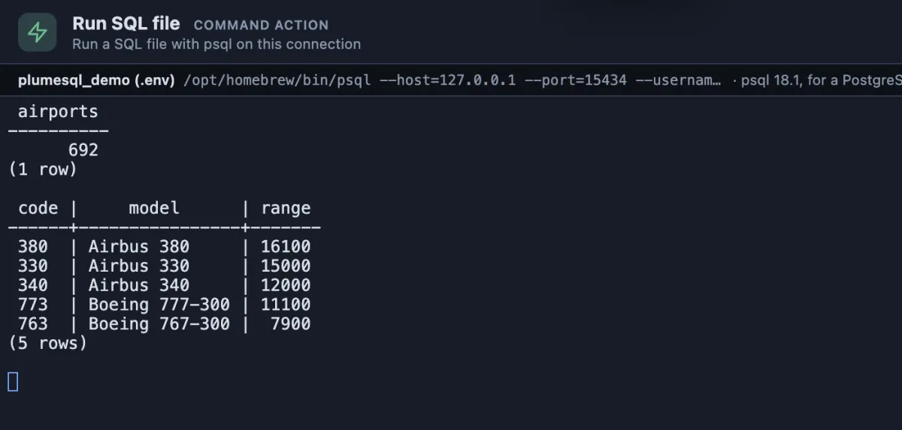

# Run SQL file

A SQL file from the workspace run with psql on the tab's database, statement by statement, stopping at the first error.



`demo.sql` holds two queries; psql runs them in order and prints each answer: 692 airports, then the five aircraft that fly farthest.

```sql
select count(*) as airports from postgres_air.airport;
select code, model, range from postgres_air.aircraft order by range desc limit 5;
```

## When to use it

- **Apply a migration or a seed script** exactly as the command line or a deploy script would.
- **Run a plain SQL dump** (the kind **Dump schema** or **Dump table** writes) on another database.
- **A script with psql's own commands** (`\set`, `\i`, `\copy`), which only psql understands.

## What it does

1. Asks which file to run: the workspace's files, newest first.
2. Asks first, naming the file, the database and the host.
3. Runs `psql --file` on the tab's connection, in a terminal of its own, with `ON_ERROR_STOP=1`, so it stops at the first error instead of carrying on, and `--echo-errors`, so the failing statement is printed beside its error.

## Settings

| Setting | Default | What it does |
|---|---|---|
| script | asked | The SQL file to run, picked from the workspace. |

## Good to know

- **Each statement commits on its own**, as psql runs them. When every statement must land or none, put `begin;` at the top of the file and `commit;` at the end.
- **The password stays secret.** It reaches psql through the environment (`PGPASSWORD`), never the command line.
- **No setup.** PlumeSQL finds the PostgreSQL client tools on this machine and runs a psql new enough for the server, or, for a server in Docker here, the server's own image (System, Client tools).

## Requirements

PostgreSQL 13 or newer and a PostgreSQL client installation (or Docker) on this machine.
