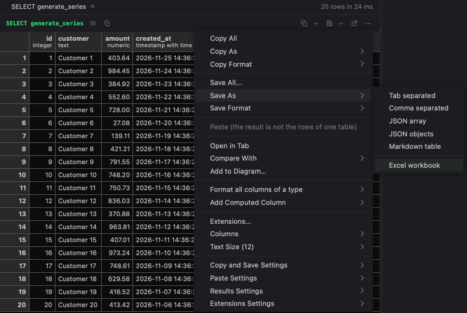

# Save as XLSX

Save a result as an Excel workbook from Save As: the rows under a bold
header on one sheet, the columns and their types on another. The rows
you see, saved where you choose, with nothing run again.

## What it writes

A result's dots menu (or a right-click in the grid): **Save As > Excel
workbook**, or **Save All** / **Save Selection** with **Save Format** set
to Excel workbook. PlumeSQL's own Save dialog asks for the folder and
the name, and one `.xlsx` is written:

- **data**: the column names in bold on the first row, then the rows
  being saved (the selection, or all of them). Integers, `numeric`,
  `real` and `double precision` are numbers, `boolean` is TRUE or FALSE,
  NULL is an empty cell, and everything else is text exactly as the grid
  holds it (dates and timestamps too).
- **fields**: each column with its type as the grid's header names it
  (`integer`, `double precision`, `citext`), then how many rows, the
  table the result was read from when PlumeSQL knows it (a query on one
  table), and when it was saved.

**Copy As > Excel workbook** copies the rows as tab separated text with
a header line instead, which pastes into Excel as cells.

## Inputs

None.

## Requirements

Nothing beyond PlumeSQL: no psql, no Node, no package. The workbook is
made in the grid's own sandbox.

## Notes

- **The query itself is not in the workbook.** PlumeSQL hands a Save As
  format the rows and the columns, never the statement they came from.
  The command extension Query to XLSX runs from a statement's menu and
  writes the query on its second sheet.
- **At most the copy row cap.** A format an extension adds reads at most
  `results.copyMaxRows` rows (10,000 by default; Settings, Results, Copy
  and Save), and the Log says when it cut the rows.
- A column a formatting extension reformats is saved as the grid shows
  it, so a number shown with separators is saved as text.
- A `numeric` or `bigint` value with more than 15 significant digits is
  written as text, because Excel keeps only 15 and would round it. A
  text value longer than 32,767 characters (Excel's cell limit) is cut.
- The workbook is not compressed: Save As formats return text, so the
  zip is stored, about as large as the data written out. Every byte of
  it is plain ASCII, which is what lets it pass through a text save.
- The formatting is the bold header row and nothing else.
