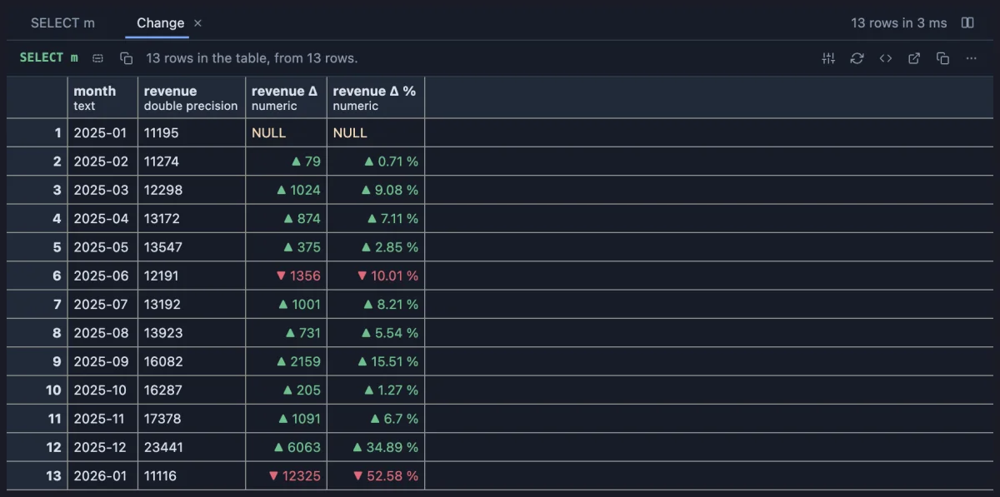
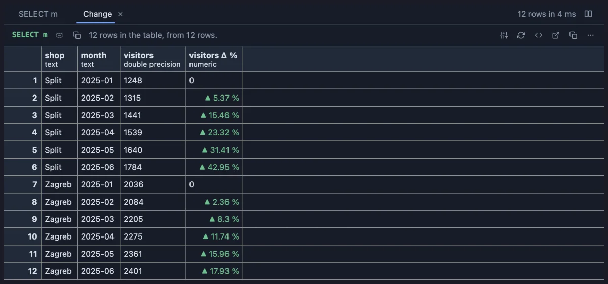

# Change

See how much a number went up or down from one row to the next, in amount and in percent, like the "vs last month" column of a sales report.



Thirteen months of a shop's revenue. Next to each month, how much it moved from the month before: June dips as the summer starts, the autumn climbs, December jumps by about a third, and January falls back to where the year began. Up is green with ▲, down is red with ▼.

## What it is for

- **Is this month better than last month?** Revenue, sign-ups, tickets closed, each row compared with the one before it.
- **How far have we come since the start?** Compare every row with the first one instead: growth since January, weight since the first weigh-in, the price since launch.
- **Several series at once**: with a Group column, each shop, team or product is compared only with its own previous row, never with another's.

## How to read it

A **Change** tab opens beside the grid with the same rows and columns, and two new columns right after the one you picked: `revenue Δ` (the difference, in the column's own units) and `revenue Δ %` (the difference as a percent of the earlier value). The first row of the result, or of each group, has nothing before it and stays empty. So does a row whose earlier value is empty.

The rows are compared in the order the query returns them, so order the query the way time runs: `order by month`.

## Try it

**A shop's year, month over month** (any connection, made up on the spot), the picture above:

```sql
-- @extension change open
-- @inputs column=revenue
select to_char(m, 'YYYY-MM') as month,
       round(10000 + 600 * extract(month from m) - 1500 * (extract(month from m) between 6 and 8)::int
             + 6000 * (extract(month from m) = 12)::int + random() * 800) as revenue
from generate_series(date '2025-01-01', date '2026-01-01', interval '1 month') m
order by m;
```

**Two shops side by side, each against its own first month**: how much each grew since January.

```sql
-- @extension change open
-- @inputs column=visitors, vs=first row, show=percent, group=shop
select shop, to_char(m, 'YYYY-MM') as month,
       round(base * (1 + growth * (extract(month from m) - 1)) + random() * 50) as visitors
from (values ('Zagreb', 2000, 0.04), ('Split', 1200, 0.09)) as s(shop, base, growth),
     generate_series(date '2025-01-01', date '2025-06-01', interval '1 month') m
order by shop, m;
```



## Settings

| Setting | `@inputs` key | Default | What it does |
|---|---|---|---|
| Column | `column` | asked | The number whose change you want to see |
| Compared with | `vs` | previous row | `previous row`: each row against the one just above it; `first row`: each row against the first one (of the result, or of its group) |
| Show | `show` | both | `difference`, `percent`, or `both` columns |
| Group | `group` | none | A column that splits the rows into groups (a shop, a product); each group is compared only within itself |

## Good to know

The percent is the difference divided by the earlier value's size, so a move from -10 to -5 reads +50 %, and an earlier value of zero gives no percent. The value behind each cell is the plain signed number, so copying and filtering read `-12.5`, not the arrow. The first 100,000 rows are listed.

From a script: `-- @extension change` above the query, and `-- @inputs column=revenue, vs=first row, group=region` to answer the settings in the file. A pipeline charts the change: `-- @extension change | echarts`. In SQL the same is `lag()`: **Window function refactors** (`window-refactors`) writes it into your query from the editor's lightbulb, computed by PostgreSQL over every row, a query you keep and share rather than a column of the grid.

## Requirements

PostgreSQL 13 or newer. Nothing runs on the server: the column is computed in the result's sandbox from the rows already fetched.
