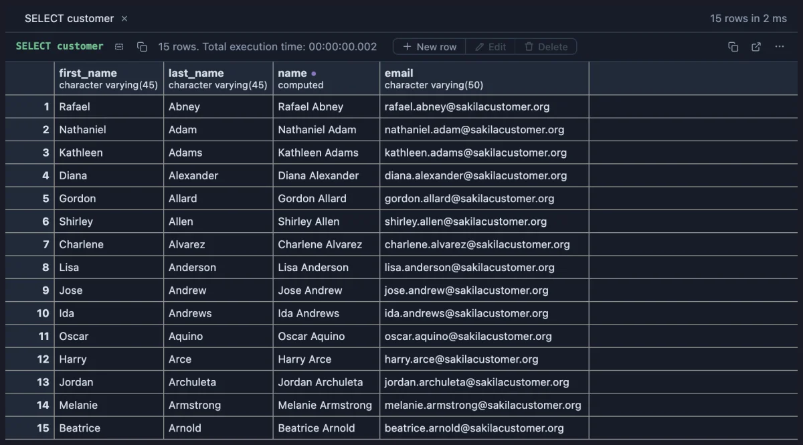

# Full name

Adds a `name` column that joins `first_name` and `last_name` into one, whenever a result has both: "Mary" and "Smith" read as "Mary Smith".



dvdrental customers: the `name` column right after `last_name` reads each person as one name, ready to read down, sort or copy into a letter.

## What it is for

- **Reading people at a glance**: customers, employees, authors, contacts, wherever a table splits a name in two.
- **Copying names out**: a list of full names for an email or a mail merge, without writing `first_name || ' ' || last_name`.
- **Leaving it on**: it does nothing to a result without both columns, so it can stay attached everywhere.

## How to read it

A computed column named `name` appears right after `last_name`, holding the first name, a space and the last name. When one of the two is empty, the other stands alone. The two original columns stay as they are.

## Try it

**Customers**, in the [dvdrental](https://neon.com/postgresql/postgresql-getting-started/postgresql-sample-database) sample database, the picture above:

```sql
-- @extension full-name
select first_name, last_name, email
from customer
order by last_name
limit 15;
```

**Actors, with the films they played in**, the column order does not matter:

```sql
-- @extension full-name
select last_name, first_name, count(*) as films
from actor join film_actor using (actor_id)
group by actor_id
order by films desc
limit 10;
```

## Where it applies

Every result that has a column named exactly `first_name` and one named exactly `last_name`, wherever the extension is attached; any other result is left untouched. There are no settings.

## Good to know

The new column is computed in the grid: it copies and saves with the rest, as shown, but it is not part of the query, so the database never sees it. To match other column names (`given_name`, `surname`) or join them another way ("Smith, Mary"), Fork it from the row menu and change the two names and the line that joins them; the file is a few lines long.

To attach it, put `-- @extension full-name` above a query (in the file header it covers every query in the file) or pick it from a result's own menu.

## Requirements

PostgreSQL 13 or newer. Nothing runs on the server: the column is computed in the grid from the rows already fetched.
