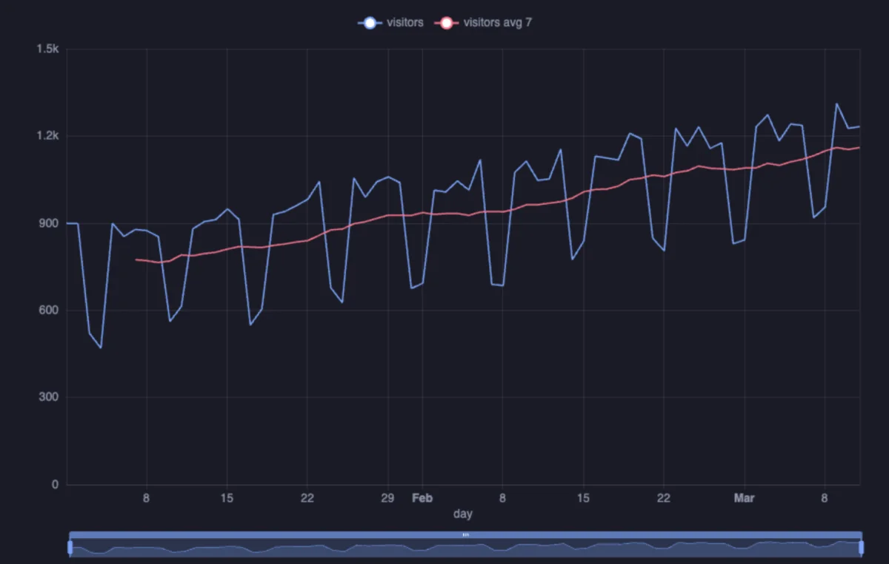
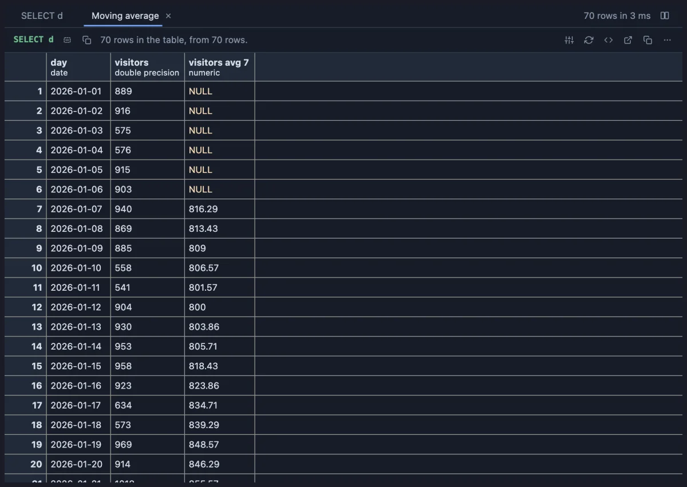

# Moving average

Smooth out a jumpy series so the trend shows: each row gets the average of itself and the rows just before it, like the "7-day average" line in the news.



Ten weeks of a website's daily visitors, drawn through a pipeline into a chart. The raw line zigzags every week (weekends are quiet); the 7-day average irons the weekly zigzag out, and what is left is the real story: visits are growing.

## What it is for

- **Seeing the trend through the noise**: daily sales, sign-ups, errors or response times jump around; a 7-day average shows whether they are really going up.
- **Taking out a weekly pattern**: an average over exactly 7 days always holds one Saturday and one Sunday, so the weekend dip disappears.
- **Spotting when something changed**: a step in the smoothed line is a real shift (a release, a campaign), not one bad day.

## How to read it

A **Moving average** tab opens beside the grid with the same rows, and one new column after the one you picked: `visitors avg 7`. Each cell is the average of that row and the 6 rows before it (with **Kind** `trailing`), or of the rows around it (`centered`). With **Min periods** at 7, the first six rows stay empty until a full week is there to average.

The window walks the rows in the order the query returns them, and it counts rows, not days, so order by the date and have one row per day.

## Try it

**Ten weeks of website visitors** (any connection, made up on the spot): weekdays busy, weekends quiet, slowly growing.

```sql
-- @extension moving-average open
-- @inputs column=visitors, window=7, min=7
select d::date as day,
       round(800 + 6 * (d::date - date '2026-01-01')
             - 350 * (extract(isodow from d) >= 6)::int + random() * 120) as visitors
from generate_series(date '2026-01-01', date '2026-03-11', interval '1 day') d
order by d;
```



**Drawn as a chart**, the picture at the top: the moving average step hands its table to ECharts, which draws both lines.

```sql
-- @extension moving-average | echarts open
-- @inputs moving-average: column=visitors, window=7, min=7
-- @inputs echarts: kind=line, x=day, series=visitors, visitors avg 7
select d::date as day,
       round(800 + 6 * (d::date - date '2026-01-01')
             - 350 * (extract(isodow from d) >= 6)::int + random() * 120) as visitors
from generate_series(date '2026-01-01', date '2026-03-11', interval '1 day') d
order by d;
```

## Settings

| Setting | `@inputs` key | Default | What it does |
|---|---|---|---|
| Column | `column` | asked | The number to smooth |
| Window | `window` | 7 | How many rows each average covers: 7 for a week of days, 30 for a month, 12 for a year of months |
| Kind | `kind` | trailing | `trailing`: this row and the ones before it (what you could know on that day); `centered`: rows on both sides (smoother, for looking back) |
| Min periods | `min` | 1 | How many values a window needs before it shows an average; set it to the window to leave the first rows empty rather than average one or two days |

## Good to know

An empty value is skipped, not counted as zero. A centered window of an even size leans one row back. A missing day is not a gap here, because the window counts rows: fill the days in first (the Resample extension does) when some are missing. The first 100,000 rows are listed.

From a script: `-- @extension moving-average` above the query, and `-- @inputs column=sales, window=28, min=28` to answer the settings in the file. In SQL the same is `avg(x) over (order by day rows between 6 preceding and current row)`: **Window function refactors** (`window-refactors`) writes it into your query from the editor's lightbulb, by days or by rows, computed by PostgreSQL over every row.

## Requirements

PostgreSQL 13 or newer. Nothing runs on the server: the column is computed in the result's sandbox from the rows already fetched. The chart example uses the ECharts extension.
