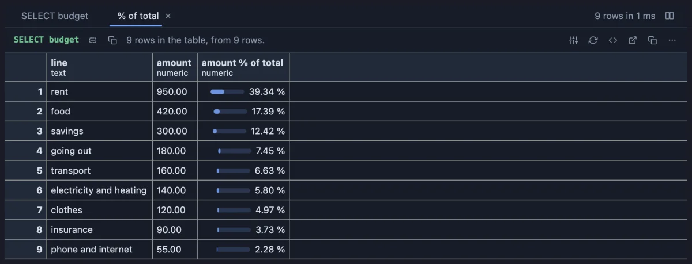
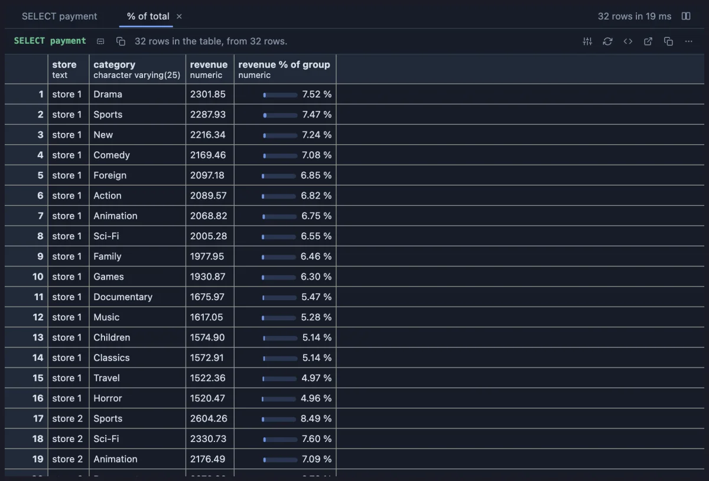

# Percent of total

Show each row as a share of the whole, with a small bar: which part brings in how much of the total, like a pie chart you can read as a table.



A household's month, line by line. Next to each amount, its share of everything spent, with a bar that fills in proportion: rent alone is about 40 % of the month, food comes second, and the rest are small slices of a few percent each.

## What it is for

- **What is the biggest part?** Revenue by product, time by task, disk space by table, votes by party.
- **Shares within each group**: with Share of `group`, every store, team or region adds up to 100 % on its own, so you can compare what sells in each.
- **How fast does it add up?** With Share of `running`, rows sorted from the largest show how few of them make most of the total (the top three products are 60 % of sales).

## How to read it

A **% of total** tab opens beside the grid with the same rows, and one new column after the one you picked, named for what it shows: `revenue % of total`, `revenue % of group` or `revenue running %`. Each cell is a percent from 0 to 100 with a short bar. Every row of the result counts toward the total, not only the ones on screen.

## Try it

**Where the money goes** (any connection, made up on the spot), the picture above:

```sql
-- @extension percent-of-total open
-- @inputs column=amount
select * from (values
  ('rent', 950.00), ('food', 420.00), ('transport', 160.00), ('electricity and heating', 140.00),
  ('phone and internet', 55.00), ('insurance', 90.00), ('going out', 180.00), ('clothes', 120.00),
  ('savings', 300.00)
) as budget(line, amount)
order by amount desc;
```

**Each store's own split**, in the [dvdrental](https://neon.com/postgresql/postgresql-getting-started/postgresql-sample-database) sample database: revenue per film category as a share of its store's total, so both stores add up to 100. The shares are close (no category dominates), so here the percent reads better than the bar.

```sql
-- @extension percent-of-total open
-- @inputs column=revenue, of=group, group=store
select 'store ' || i.store_id as store, c.name as category, sum(p.amount) as revenue
from payment p
     join rental r using (rental_id)
     join inventory i using (inventory_id)
     join film_category fc using (film_id)
     join category c using (category_id)
group by i.store_id, c.name
order by store, revenue desc;
```



## Settings

| Setting | `@inputs` key | Default | What it does |
|---|---|---|---|
| Column | `column` | asked | The number whose share you want to see |
| Share of | `of` | total | `total`: of the whole column; `group`: of the row's own group, each group adding up to 100; `running`: everything so far, down the rows, as a share of the total, reaching 100 on the last row |
| Group | `group` | none | A column whose values split the rows into groups (a store, a region); with `running`, the running share starts again in each group |

## Good to know

Percents have two decimals; the value behind each cell is the plain number, so copying and filtering read `12.5`. An empty value counts for nothing, and a total of zero leaves the column empty. The totals read every row the view reads; the grid lists the first 100,000, and the Log says how many were left out. For a running percent, sort the query first (`order by revenue desc`); the rows keep the result's order.

From a script: `-- @extension percent-of-total` above the query, and `-- @inputs column=amount, of=group, group=region` to answer the settings in the file. The table feeds another extension like a result does: `-- @extension percent-of-total | echarts` charts it. In SQL the same is `100.0 * x / sum(x) over ()`: **Window function refactors** (`window-refactors`) writes it into your query from the editor's lightbulb.

## Requirements

PostgreSQL 13 or newer. Nothing runs on the server: the column is computed in the result's sandbox from the rows already fetched.
