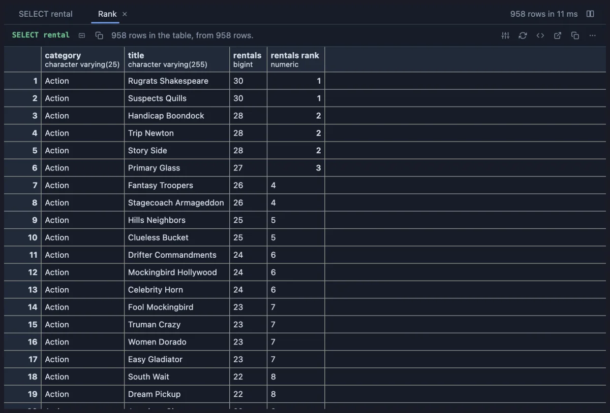
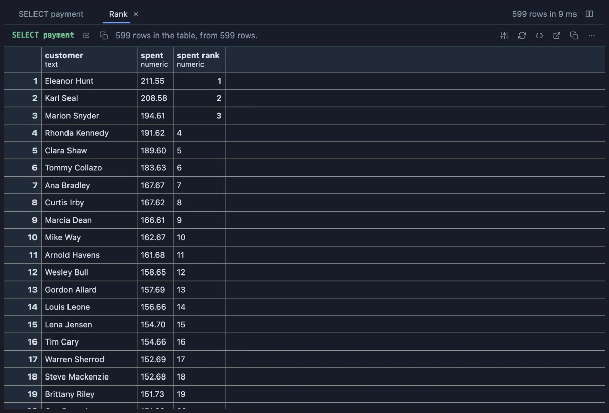

# Rank

Number the rows by how big they are, 1 for the largest: a leaderboard, overall or within each group, like a spreadsheet's RANK.



Films ranked by how many times they were rented, within their own category, in the dvdrental sample database. Each category has its own number 1, and the top three of each are in bold, so the leaders of every category read off at once.

## What it is for

- **Who is on top?** Salespeople by revenue, products by units sold, pages by visits, queries by time spent.
- **The best in each group**: with a Group column, every category, region or team gets its own ranking starting at 1.
- **Where does this one stand?** A row's rank says more than its value: 87 sales may be 3rd in one region and 40th in another.

## How to read it

A **Rank** tab opens beside the grid with the same rows, and a `<column> rank` column after the one you picked. Rank 1 is the largest value (or the smallest, with Order `ascending`). Ranks 1 to 3 are in bold. An empty value gets no rank.

When two rows are equal, **Ties** decides: `competition` gives them the same rank and skips the next one (1, 2, 2, 4, as in sport), `dense` does not skip (1, 2, 2, 3), and `average` gives each the middle of the places they share (1, 2.5, 2.5, 4, as statistics does).

## Try it

**The most rented films of each category**, in the [dvdrental](https://neon.com/postgresql/postgresql-getting-started/postgresql-sample-database) sample database, the picture above:

```sql
-- @extension rank open
-- @inputs column=rentals, group=category, ties=dense
select c.name as category, f.title, count(*) as rentals
from rental r
     join inventory i using (inventory_id)
     join film f using (film_id)
     join film_category fc using (film_id)
     join category c using (category_id)
group by c.name, f.title
order by category, rentals desc;
```

**The customers who spent the most**, over the whole result:

```sql
-- @extension rank open
-- @inputs column=spent
select c.first_name || ' ' || c.last_name as customer, sum(p.amount) as spent
from payment p join customer c using (customer_id)
group by c.customer_id
order by spent desc;
```



## Settings

| Setting | `@inputs` key | Default | What it does |
|---|---|---|---|
| Column | `column` | asked | The number the rows are ranked by |
| Order | `order` | descending | `descending`: the largest is 1; `ascending`: the smallest is 1 (fastest time, lowest price) |
| Ties | `ties` | competition | How equal values share a rank: `competition` 1, 2, 2, 4; `dense` 1, 2, 2, 3; `average` 1, 2.5, 2.5, 4 |
| Group | `group` | none | A column whose values split the rows into groups, each ranked on its own from 1 |

## Good to know

The ranks read every row the view reads; the grid lists the first 100,000. To see the leaders first, sort the rank column in the grid, or order the query. From a script: `-- @extension rank` above the query, and `-- @inputs column=sales, ties=dense, group=region` to answer the settings in the file. In a pipeline the rank column is a number like any other: `-- @extension rank | echarts`.

In SQL the same is `rank()` or `dense_rank()`: **Window function refactors** (`window-refactors`) writes it into your query from the editor's lightbulb, computed by PostgreSQL over every row.

## Requirements

PostgreSQL 13 or newer. Nothing runs on the server: the ranks are computed in the result's sandbox from the rows already fetched.
