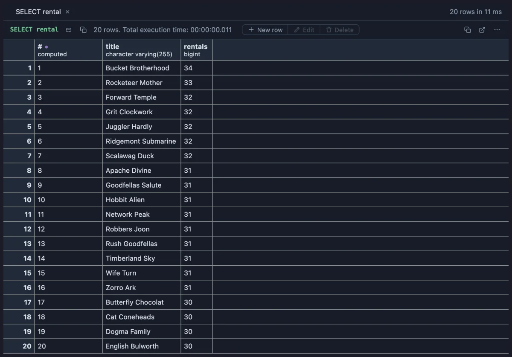

# Row numbers

Adds a `#` column at the start that numbers the rows 1, 2, 3, so a list reads as a numbered list: a top ten, a queue, a ranking.



The twenty most rented films in dvdrental: with the `#` column the list reads as a chart position, "Bucket Brotherhood is number 1".

## What it is for

- **Top lists**: the ten biggest customers, the slowest queries, the most visited pages, each with its place.
- **Talking about rows**: "look at row 37" works when everyone sees the same numbers, in a copy or a saved file too.
- **Counting as you read**: where the 100th row is in a long list.

## How to read it

A computed column named `#` stands first, holding each row's position in the whole result, from 1. The numbers follow the order of the query, so order it the way you want the list numbered. The count is right past the first screen: row 5,000 says 5000.

## Try it

**The most rented films**, in the [dvdrental](https://neon.com/postgresql/postgresql-getting-started/postgresql-sample-database) sample database, the picture above:

```sql
-- @extension row-numbers
select f.title, count(*) as rentals
from rental r join inventory i using (inventory_id) join film f using (film_id)
group by f.title
order by rentals desc, f.title
limit 20;
```

**The largest tables of a database** (any connection), numbered from the largest:

```sql
-- @extension row-numbers
select relname as "table", pg_catalog.pg_size_pretty(pg_catalog.pg_total_relation_size(oid)) as size
from pg_catalog.pg_class
where relkind = 'r'
order by pg_catalog.pg_total_relation_size(oid) desc
limit 15;
```

## Where it applies

Every result, wherever the extension is attached. There are no settings.

## Good to know

The number is the row's position, computed in the grid, not a value from the database: it copies and saves with the rest, as shown. Equal values get different numbers (one after the other); for a ranking where ties share a place, the Rank extension does that. To start from 0 or name the column differently, Fork it from the row menu and edit the one line.

To attach it, put `-- @extension row-numbers` above a query, or in the file header for all of them, or attach it from the result's menu. In SQL the same is `row_number() over (order by ...)`: **Window function refactors** (`window-refactors`) writes it into your query from the editor's lightbulb.

## Requirements

PostgreSQL 13 or newer. Nothing runs on the server: the numbers are added in the grid.
