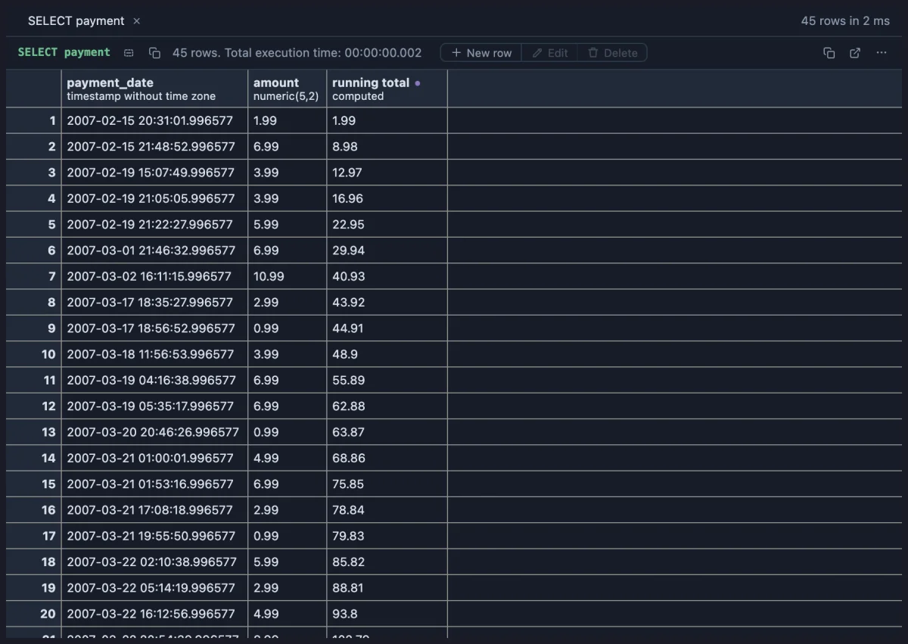
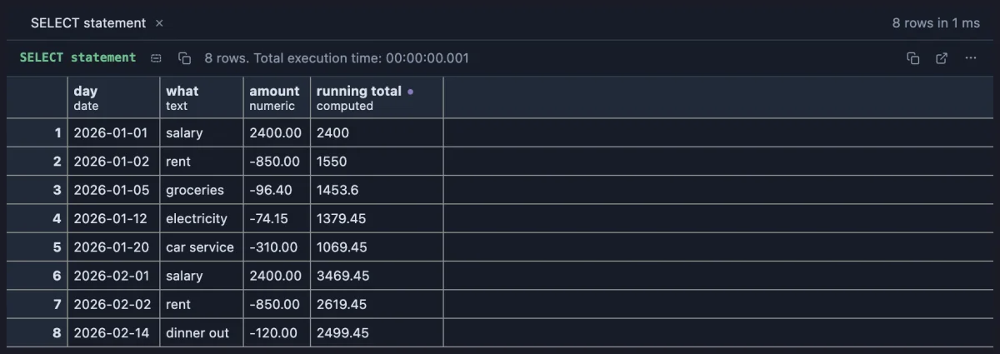

# Running total

Adds a `running total` column that adds up the `amount` column row by row, like the balance column on a bank statement.



One customer's payments in dvdrental, oldest first. The running total grows with every payment, so the last row is everything they have spent, and any row says how much they had spent by that day.

## What it is for

- **A balance**: deposits and withdrawals (negative amounts) into the balance after each one, like a bank statement.
- **Progress toward a goal**: sales adding up through the month, hours logged on a project, kilometres run this year.
- **When did we pass the mark?** The row where the running total crosses a budget or a target.

## How to read it

A computed column named `running total` appears at the end. Each cell is the sum of the `amount` column from the first row down to this one, so the rows must be in the order you want them added: order the query (by date, usually). An empty amount adds nothing.

## Try it

**One customer's spending**, in the [dvdrental](https://neon.com/postgresql/postgresql-getting-started/postgresql-sample-database) sample database, the picture above:

```sql
-- @extension running-total
select payment_date, amount
from payment
where customer_id = 148
order by payment_date;
```

**A savings account** (any connection, made up on the spot): a salary in, rent and bills out, the balance after each.

```sql
-- @extension running-total
select * from (values
  (date '2026-01-01', 'salary', 2400.00), (date '2026-01-02', 'rent', -850.00),
  (date '2026-01-05', 'groceries', -96.40), (date '2026-01-12', 'electricity', -74.15),
  (date '2026-01-20', 'car service', -310.00), (date '2026-02-01', 'salary', 2400.00),
  (date '2026-02-02', 'rent', -850.00), (date '2026-02-14', 'dinner out', -120.00)
) as statement(day, what, amount)
order by day;
```



## Where it applies

Every result with a column named exactly `amount`, wherever the extension is attached; any other result is left untouched. There are no settings: to add up another column, Fork it from the row menu and change `amount` in the file (one word, twice).

## Good to know

The total is kept as the grid draws its rows: it is right from the first row to the last on a small result, but on a large one, which the grid reads in blocks as you scroll, it can start again at a block. For a total that is right over any number of rows, let PostgreSQL compute it: `sum(amount) over (order by payment_date)`, which **Window function refactors** (`window-refactors`) writes into your query from the editor's lightbulb, per customer too.

The column copies and saves with the rest, as shown. The sum keeps as many decimals as the amounts it adds (no `0.30000000000000004`). To attach it, put `-- @extension running-total` above a query (or in the file header for every query), or pick it from a result's own menu.

## Requirements

PostgreSQL 13 or newer. Nothing runs on the server: the column is computed in the grid from the rows already fetched.
