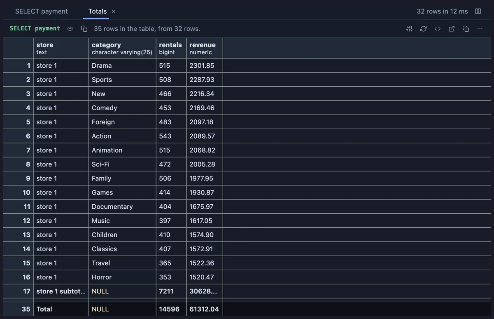
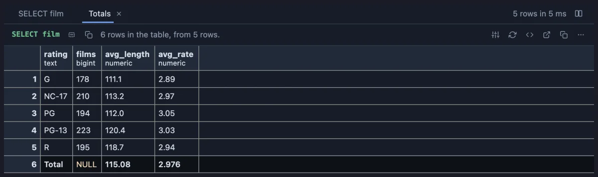

# Totals and subtotals

Add a Total row under the result, and a subtotal after each group if you like, the way a spreadsheet's Subtotal command does.



Rentals and revenue per film category for each dvdrental store. A bold subtotal row closes each store's list, and the Total row at the bottom adds up everything: the two stores are almost exactly even.

## What it is for

- **What does it add up to?** The sum of an invoice's lines, a month's expenses, a report's columns, without writing a second query.
- **Totals per group**: subtotals per store, per department or per month, each one right under its group.
- **Not only sums**: the mean, the smallest, the largest, the median or a count, in the same rows.

## How to read it

A **Totals** tab opens beside the grid: every row of the result, and a **Total** row frozen at the bottom with the chosen columns added up (or averaged, counted, ...). The word Total stands in the first column that is not totalled. With **Subtotal by**, the rows are gathered by that column's value and a bold `<value> subtotal` row closes each group. The grand Total adds up every row, not the subtotals.

## Try it

**Revenue per store and category, with a subtotal per store**, in the [dvdrental](https://neon.com/postgresql/postgresql-getting-started/postgresql-sample-database) sample database, the picture above:

```sql
-- @extension totals open
-- @inputs columns=rentals, revenue, by=store
select 'store ' || i.store_id as store, c.name as category, count(*) as rentals, sum(p.amount) as revenue
from payment p
     join rental r using (rental_id)
     join inventory i using (inventory_id)
     join film_category fc using (film_id)
     join category c using (category_id)
group by i.store_id, c.name
order by store, revenue desc;
```

**The average instead of the sum**: the typical film by rating, its length and its price, with an overall average at the bottom.

```sql
-- @extension totals open
-- @inputs columns=avg_length, avg_rate, agg=mean
select rating::text as rating, count(*) as films, round(avg(length), 1) as avg_length, round(avg(rental_rate), 2) as avg_rate
from film
group by rating
order by rating;
```



## Settings

| Setting | `@inputs` key | Default | What it does |
|---|---|---|---|
| Columns | `columns` | every number column | Which number columns get a total, as a comma list |
| Fold | `agg` | sum | How a total combines its values: `sum`, `mean`, `min`, `max`, `count` or `median` |
| Subtotal by | `by` | none | A column whose values group the rows, with a subtotal row after each group |

## Good to know

The groups come in the order their first row appears, and the rows keep their order within each, so order the query by the subtotal column. Count counts the numbers in a column, as a spreadsheet's COUNT does, so an empty value is not counted. The totals add up every row the view reads; the grid lists the first 100,000.

In a pipeline the frozen Total row stays behind but the subtotal rows travel with the data, so chart the plain result, or run without Subtotal by: `-- @extension totals | echarts`. From a script: `-- @extension totals` above the query, and `-- @inputs columns=amount, qty, by=region` to answer the settings in the file. For totals the server computes, `group by rollup (region)` is the SQL answer.

## Requirements

PostgreSQL 13 or newer. Nothing runs on the server: the totals are computed in the result's sandbox from the rows already fetched.
