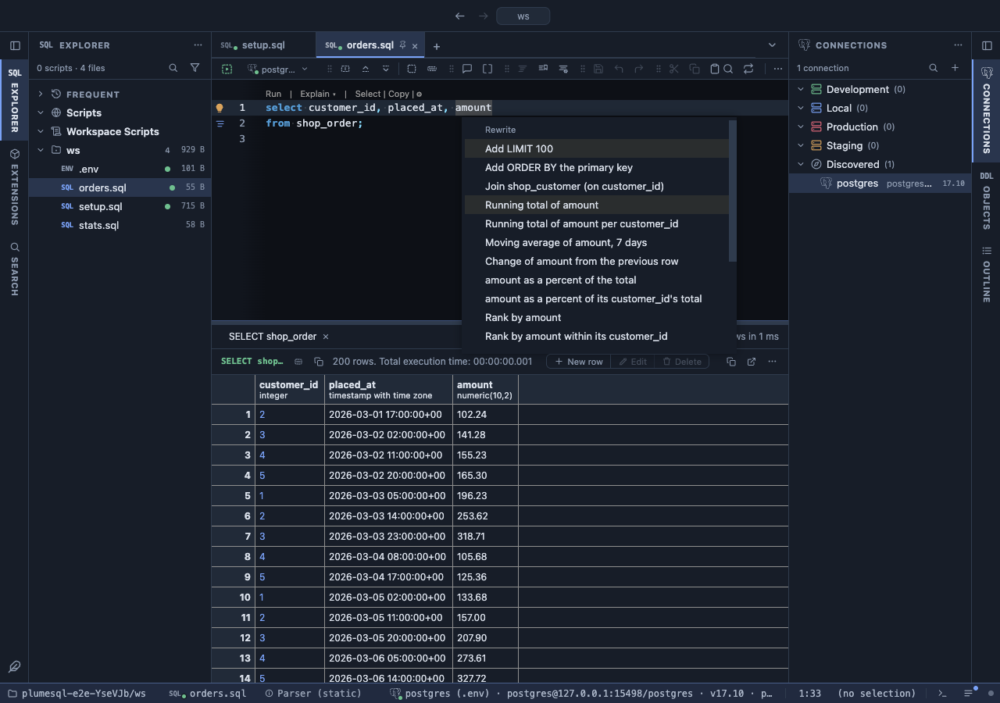
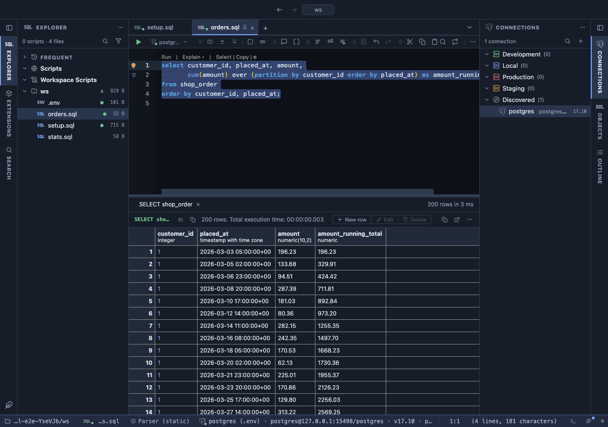

# Window function refactors

The calculations everyone looks up every time (a running total, a moving average, the change from the previous row, a share of the total, a rank), written into your SQL for you: put the caret on a number in a query, open the editor's lightbulb (Ctrl+. or ⌘.) and pick one.



The lightbulb on a query of orders, the caret on `amount`: every offer is a column PostgreSQL will compute for you, the calculation already written.

## What it is for

- **A running total, a 7-day average, month over month** in a query you keep, not only on screen: the SQL is written for you, right the first time.
- **The top rows of each group**: the three biggest orders of every customer, each customer's latest order, as a query above yours.
- **Learning the syntax** of window functions by watching what each offer writes.

These are the SQL side of the Calculations grid extensions of the same names (Running total, Moving average, Change, Percent of total, Rank, Row numbers): those compute in the grid, over the rows a query returned; these let PostgreSQL compute over every row, in a query you keep, filter, share or serve.

## How to read it

An offer that adds a column writes it into your select list (`sum(amount) over (order by placed_at) as amount_running_total`) and, when the query has no `ORDER BY`, adds one, because a running total read down unordered rows means nothing. An offer that needs a query of its own (top rows per group, latest row per key) writes it above yours, which stays as it was. Run the query to see the new column.

**Running total of amount per customer_id**, run:



## Try it

In the [dvdrental](https://neon.com/postgresql/postgresql-getting-started/postgresql-sample-database) sample database, put this in a script, the caret on `amount`, and open the lightbulb:

```sql
select customer_id, payment_date, amount
from payment
where customer_id <= 3;
```

Pick **Running total of amount per customer_id**: each customer's payments add up on their own. Pick **Moving average of amount** for a smoothed amount, **Change** for the difference from the payment before, **Percent of the total** for each payment's share.

On a grouped query the calculation reads the group's total. Put the caret on `sum(amount)` here:

```sql
select date_trunc('day', payment_date) as day, sum(amount) as total
from payment
group by 1;
```

**Running total of total** writes `sum(sum(amount)) over (order by date_trunc('day', payment_date))`, and **total as a percent of the total** each day's share, `100.0 * sum(amount) / sum(sum(amount)) over ()`, the one people most often get wrong by hand.

## What it offers

| Offer | Writes |
|---|---|
| Running total | `sum(amount) over (order by placed_at)`, overall or per group |
| Moving average | `avg(amount) over (order by placed_at rows between 6 preceding and current row)`; over daily data `range between interval '6 days' preceding and current row`, right even when days are missing |
| Change | `amount - lag(amount) over (order by placed_at)` and the percent it is (a zero before reads NULL, never a division error) |
| Percent of total | `round(100.0 * amount / sum(amount) over (), 2)`, of the whole or of the row's group |
| Rank | `rank() over (order by amount desc)`, overall or within each group |
| Quartile | `ntile(4) over (order by amount)` |
| Row numbers | `row_number() over (order by placed_at)` |
| Top N per group | the 3 rows with the highest amount per customer, as a query above |
| Latest row per key | each customer's newest row with PostgreSQL's `distinct on`, as a query above |

## Settings

On the extension's page and in the Refactors settings:

| Setting | Default | What it does |
|---|---|---|
| Moving average window | 7 | How many rows, or days, each average reads |
| Moving average frame | by date | `by date` counts the days before each row when the query is ordered by a date; `by rows` counts rows |
| Change as | difference and percent | `difference and percent`, `difference` or `percent` |
| Ties | rank | `rank` leaves gaps after ties (1, 1, 3), `dense_rank` does not (1, 1, 2), `row_number` numbers ties apart |
| Groups | 4 | How many groups the quartile offer makes: 4 for quartiles, 10 for deciles |
| Rows per group | 3 | How many rows the top-per-group offer keeps |

## Good to know

How it chooses:

- **The number column**: the one under the caret (its item in the select list, or its name anywhere in the query); else the query's first number column that is no id.
- **The order**: the query's own `ORDER BY`, else a date or time column, else a hypertable's time column, else the primary key.
- **The group** ("per customer_id"): a foreign key column; or, once the query has run, a column whose values repeat in its first rows.
- **Days or rows** for a moving average: days when the order is a date, or a timestamp whose rows lie hours apart in the last run; rows otherwise (readings every few minutes would make seven days the whole result).

Window columns go into a query only where they can: a `SELECT` with its own list, not `DISTINCT`. A query above works over anything that returns rows, unions included once they have run. A one-line select list that would grow past 80 characters gets the new column on a line of its own.

What it reads: the statement's shape (its select list and clauses) and its tables' columns from PlumeSQL's dictionary of the connection; for the group and the moving average's days, also the first rows of the query's last run in this tab, which PlumeSQL already has. Nothing is asked of the server until you run the query. It applies in the SQL editor wherever the extension is attached (everywhere from the install on; change it on its page).

## Requirements

PostgreSQL 13 or newer, and PlumeSQL 0.24.0 or newer.
