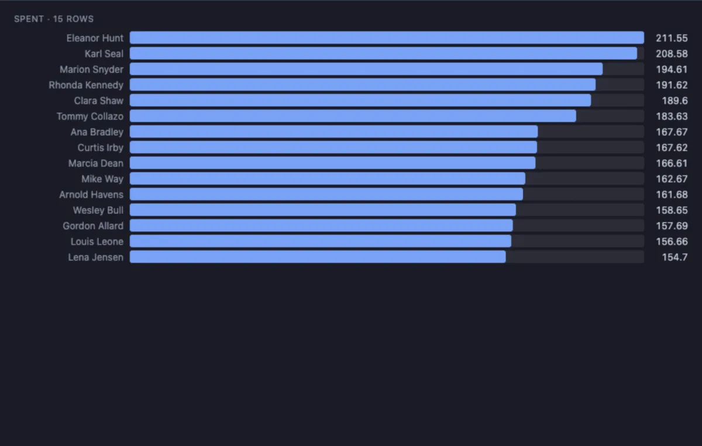
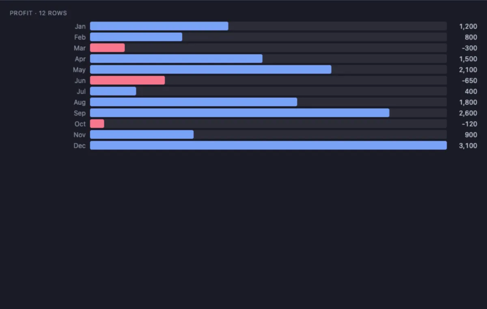

# Bar chart

A plain ranking you read at a glance: one horizontal bar per row, longest for the largest, with its name and its number beside it.



The fifteen customers who spent the most in the dvdrental shop. The bars make the shape visible at once: Eleanor Hunt and Karl Seal lead, both above 200, and below them the list slopes gently from about 195 down to 155.

## What it is for

- **Who or what is on top?** The best customers, the best-selling products, the busiest support agents, as a list you can read from across the room.
- **Which tables take the space?** The largest tables or indexes of a database, in kilobytes, the biggest first.
- **Where did we gain and where did we lose?** Negative numbers draw in red, so a month in the loss stands out among the profitable ones.

Of the chart extensions it is the simplest: no library to load, it opens instantly and draws a short list (up to 50 rows by default) better than a full chart would. For a long series over time, pick ECharts or μPlot; for several numbers per row, Chart.js or Plot chart.

## How to read it

Each row of the result is one bar, in the order the query returns them, so put an `ORDER BY` in the query to rank them. The bar's length is its value against the largest value; the number is printed at its end; a negative value draws red. Hover a bar for its name and value; click it to select its row in the grid.

## Try it

**The best customers**, in the [dvdrental](https://neon.com/postgresql/postgresql-getting-started/postgresql-sample-database) sample database, the picture above:

```sql
-- @extension bar-chart open
-- @inputs value=spent, label=customer
select c.first_name || ' ' || c.last_name as customer, sum(p.amount) as spent
from payment p join customer c using (customer_id)
group by c.customer_id
order by spent desc
limit 15;
```

**A year of profit and loss** (any connection, made up on the spot): the months in the loss in red.

```sql
-- @extension bar-chart open
-- @inputs value=profit, label=month
select to_char(date '2026-01-01' + (m || ' month')::interval, 'Mon') as month,
       (array[1200, 800, -300, 1500, 2100, -650, 400, 1800, 2600, -120, 900, 3100])[m + 1] as profit
from generate_series(0, 11) m;
```



**The largest tables of a database** (any database), in kilobytes:

```sql
-- @extension bar-chart open
-- @inputs value=kb, label=table
select relname as "table", pg_catalog.pg_total_relation_size(oid) / 1024 as kb
from pg_catalog.pg_class
where relkind = 'r' and relnamespace not in ('pg_catalog'::regnamespace, 'information_schema'::regnamespace)
order by kb desc
limit 15;
```

## Settings

| Setting | `@inputs` key | Default | What it does |
|---|---|---|---|
| Value | `value` | asked | The number each bar shows |
| Label | `label` | the first text column | What each bar is called; with no text column, the row's number |
| Top rows | `top` | 50 | How many rows to draw, from the first one; the rest are left out |

## Good to know

The chart is hand drawn in plain HTML with no library: the smallest chart extension there is, and the one to read to learn how a view is written. It draws the rows the result shows, up to **Top rows**. **Copy values** in the header copies the numbers, one per line. Both themes. Put `-- @extension bar-chart open` above the query to land on the chart after Run (`only` hides the grid, `beside` splits the two), or attach it from the result's menu; `-- @inputs` answers the settings in the file so nothing asks.

## Requirements

PostgreSQL 13 or newer. The view draws in the result's sandbox; the server is not involved.
