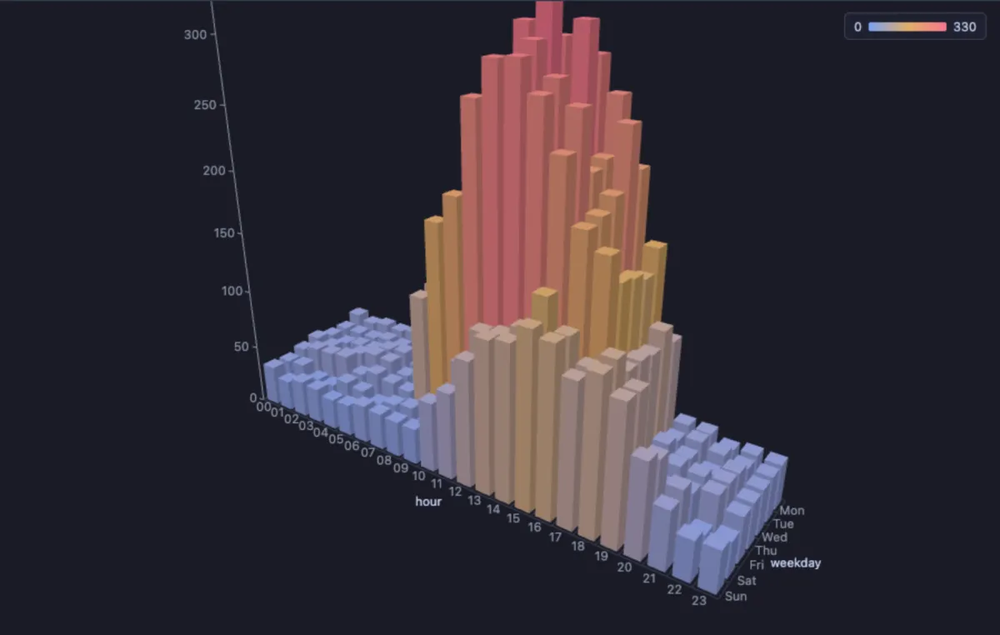
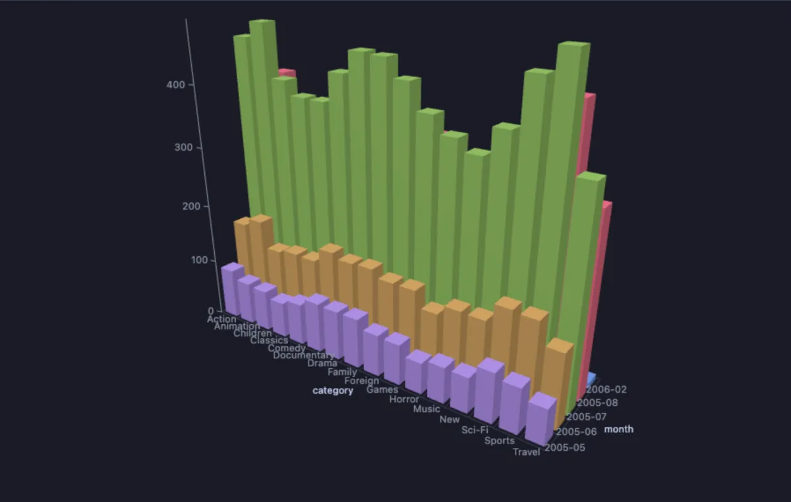

# 3D Bars

Compare a number across two things at once: one set of categories along the width, another along the depth, and a bar standing where they meet, as tall as its number.



A week of website visits, hour by hour. On the five working days the bars rise into a tall ridge from late morning into the afternoon; on Saturday and Sunday they stay low and peak later in the day. One picture shows both when people come and how much the weekend differs, which two separate charts would leave you to put together.

## What it is for

- **A shop**: sales by product and month, orders by region and weekday, returns by category and reason.
- **An app or a database**: requests by endpoint and hour, errors by server and day, rows by table and partition.
- **A team**: tickets by person and week, hours by project and month.

Whenever a number depends on two categories, this shows the whole grid of them at once, and the high and low corners stand out.

## How to read it

The width is one category (the **X** column), the depth is the other (the **Depth** column), and each bar is as tall as the number for that pair: the rows that share it summed, averaged, their minimum, their maximum or counted. The colour follows the height by default (blue low, red high), or marks each depth row or each X value with a colour of its own. Hover a bar for its two categories and its number.

Steering: drag with the left button to turn the scene, drag with the right button (or Shift and drag) to slide it, wheel to zoom; the arrow keys slide it too once the chart has focus. Double-click, Home or 0 brings the camera back. Click a bar to select its first row in the grid.

## Try it

**Website visits by hour and weekday** (any connection, made up on the spot), the picture above:

```sql
-- @extension bars-3d open
-- @inputs x=hour, z=weekday, value=visits, agg=sum, color=height
select lpad(h::text, 2, '0') as hour,
       (array['Mon', 'Tue', 'Wed', 'Thu', 'Fri', 'Sat', 'Sun'])[d] as weekday,
       round((case when d <= 5 then 40 + 260 * greatest(0, sin(pi() * (h - 7) / 12))
                   else 30 + 110 * greatest(0, sin(pi() * (h - 9) / 13)) end)
             * (0.85 + random() * 0.3)) as visits
from generate_series(1, 7) d, generate_series(0, 23) h
order by d, h;
```

**Rentals by film category and month**, in the [dvdrental](https://neon.com/postgresql/postgresql-getting-started/postgresql-sample-database) sample database, each month a row of its own colour. With no value, the rows are counted. July and August 2005 tower over May and June, and the handful of February 2006 rentals hide at the back: every category follows the same season.

```sql
-- @extension bars-3d open
-- @inputs x=category, z=month, agg=count, color=depth
select c.name as category, to_char(r.rental_date, 'YYYY-MM') as month
from rental r
     join inventory i using (inventory_id)
     join film_category fc using (film_id)
     join category c using (category_id)
order by month desc, category;
```



The months are ordered newest first in the query so the short rows stand in front of the tall ones: the axes keep the order the values first come in, so `ORDER BY` arranges the scene.

## Settings

| Setting | `@inputs` key | Default | What it does |
|---|---|---|---|
| X (categories) | `x` | asked | The categories along the width, one place for each distinct value |
| Depth (categories) | `z` | none | The categories along the depth; none draws a single row of bars |
| Height | `value` | asked | The number each bar stands for; not needed when counting |
| Combine | `agg` | sum | How the rows of one bar combine: `sum`, `avg`, `min`, `max` or `count` |
| Colour by | `color` | height | `height` (a colour ramp, blue to red), `depth` (a colour per depth row) or `x` (a colour per X value) |
| Top rows | `top` | 100000 | How many rows the view reads from the result, from the first one |

## Good to know

Each axis takes at most 80 categories; rows past them are left out and the Log says how many. Negative numbers grow down from the floor. All bars are one instanced mesh, a single draw call, so thousands of them turn smoothly, and the scene only draws while something moves. **Reset camera** in the header does the same as a double-click, **Copy data** copies the bars as CSV. The labels are drawn over the canvas, so Copy as Image gives the bars without their labels. Attach it from a script with `-- @extension bars-3d` above a query (add `open`, `only` or `beside` to open on the view), or from a result's own menu; `-- @inputs` answers the settings in the file so the chart draws with no dialog.

## Requirements

PostgreSQL 13 or newer. Nothing runs on the server: the view is drawn in the result's sandbox. A GPU-capable browser: the desktop app, or a normal browser tab. three.js comes from `cdn.jsdelivr.net`, which has to be an allowed remote script host (the Log offers Allow host when it is not); after the first load it is kept on this machine and works offline. Three core installs with it.
