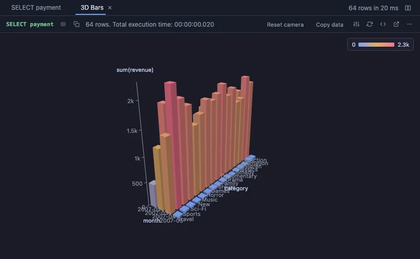

# 3D Bars



Bars in 3D: a category along the width, another along the depth, a number as the height. Orbit, zoom and pan with the mouse (three.js, through the Three core extension, which installs with it).

## What it shows

A **3D Bars** tab beside the grid. Every distinct value of the X column gets a place along the width, every distinct value of the Depth column a place along the depth, and the bar standing there is as tall as its number. The rows that share one place make one bar: summed, averaged, their minimum, their maximum, or simply counted. The axes keep the order the values first appear in, so an `ORDER BY` in the query orders them.

Drag with the left button to orbit, with the right button (or Shift and drag) to pan, and wheel to zoom; the arrow keys pan once the chart has focus. Double-click, Home or 0 brings the camera back. Hover a bar to read its values, click it to select its first row in the grid. The header's **Reset camera** does the same as a double-click, **Copy data** copies the bars as CSV.

All bars are one instanced mesh, a single draw call, so thousands of them turn smoothly, and the scene only draws while something moves.

## Inputs

| Input | `@inputs` key | Default | Meaning |
|---|---|---|---|
| X (categories) | `x` | asked | One bar per distinct value, along the width |
| Depth (categories) | `z` | none | A second category along the depth; none draws a single row of bars |
| Height | `value` | asked | The number each bar stands for; count needs none |
| Combine | `agg` | sum | How the rows that share one X and depth make one bar: sum, avg, min, max or count |
| Colour by | `color` | height | A colour ramp over the height, or a palette colour per depth or per X value |
| Top rows | `top` | 100000 | How many rows the view reads from the result, from the first one |

## Example

```sql
-- @extension bars-3d open
-- @inputs x=month, z=region, value=amount
select to_char(ordered_at, 'YYYY-MM') as month, region, sum(amount) as amount
from orders
group by 1, 2
order by 1, 2;
```

## Requirements

PostgreSQL 13 or newer. Nothing on the server: the view runs in the result's sandbox. A GPU-capable browser: the desktop app, or a normal browser tab. The library comes from `cdn.jsdelivr.net`, which has to be an allowed remote script host (the Log offers Allow host when it is not); after the first load it is cached and works offline.

## Notes

Each axis takes at most 80 categories; rows past them are left out and the Log says how many. Negative numbers grow down from the floor. The labels are drawn over the canvas, so Copy as Image gives the bars without their labels. Attach it from a script with `-- @extension bars-3d` above a query (add `open`, `only` or `beside` to open on the view), or from a result's own menu; `-- @inputs` answers the inputs in the file so the chart draws with no dialog.
