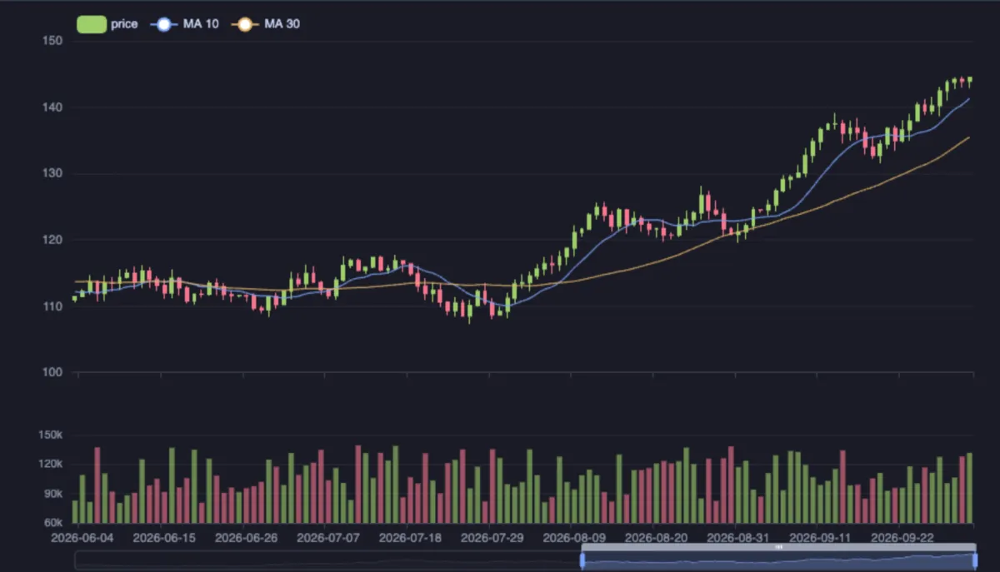
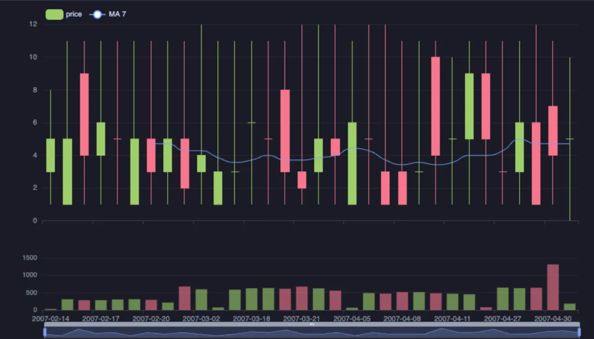

# Candlestick



Open, high, low and close as candles over time: a candle per period, green where it closed higher than it opened and red where lower, its wick from the low to the high. Moving averages of the close run over the candles, volume bars stand under them, and the slider and the wheel zoom into a range (ECharts, through ECharts core, which installs with it).

## What it shows

A **Candlestick** tab beside the grid.

- **Time** is the period a candle is: a date or a timestamp (put in order for you), or any label in the order the rows come.
- **Open**, **High**, **Low** and **Close** draw the candle; a row missing any of them is left out, never drawn as a zero.
- **Volume** adds bars under the candles, each coloured like its candle.
- **Moving averages** are the close averaged over the last N periods, as a comma list (`5, 20` by default; blank for none).
- The view opens on the last 120 candles; the slider brings the rest in. Hover a period for its four prices, its change and its averages. The copy button in the header copies the candles as CSV.

Candles are not only for prices: any measurement folded per period has an open, a high, a low and a close (the first, the largest, the smallest and the last response time of each hour), and reads well this way.

## Inputs

| Input | `@inputs` key | Default | Meaning |
|---|---|---|---|
| Time | `x` | asked | The period a candle is |
| Open, High, Low, Close | `open`, `high`, `low`, `close` | asked | The four prices |
| Volume | `volume` | none | Bars under the candles |
| Moving averages | `averages` | 5, 20 | Periods of the averages of the close |
| Title | `title` | none | A title over the chart |
| Top rows | `top` | 100000 | How many rows the view reads |

## Examples

**A price over nine months**, made up on the spot (any connection): a random walk of daily returns, its open the day before's close.

```sql
-- @extension candlestick open
-- @inputs x=day, open=open, high=high, low=low, close=close, volume=volume, averages=10, 30
with days as (
  select d::date as day, (random() - 0.48) * 0.04 as ret
  from generate_series(date '2026-01-01', date '2026-10-01', interval '1 day') d
), closes as (
  select day, 100 * exp(sum(ret) over (order by day)) as close from days
), candles as (
  select day, close, coalesce(lag(close) over (order by day), close) as open from closes
)
select day,
       round(open::numeric, 2) as open,
       round((greatest(open, close) * (1 + random() * 0.012))::numeric, 2) as high,
       round((least(open, close) * (1 - random() * 0.012))::numeric, 2) as low,
       round(close::numeric, 2) as close,
       (80000 + random() * 60000)::int as volume
from candles
order by day;
```

**The spread of payments, day by day**, in the [dvdrental](https://neon.com/postgresql/postgresql-getting-started/postgresql-sample-database) sample database: each day's first, largest, smallest and last payment, and how many there were as the volume.

```sql
-- @extension candlestick open
-- @inputs x=day, open=first, high=largest, low=smallest, close=last, volume=payments, averages=7
select payment_date::date as day,
       (array_agg(amount order by payment_date))[1] as first,
       max(amount) as largest,
       min(amount) as smallest,
       (array_agg(amount order by payment_date desc))[1] as last,
       count(*) as payments
from payment
group by 1
order by 1;
```



## Requirements

PostgreSQL 13 or newer. Nothing on the server: the view runs in the result's sandbox. ECharts comes from `cdn.jsdelivr.net`, which has to be an allowed remote script host (the Log offers Allow host when it is not); after the first load it is kept on this machine and works offline.

## Notes

Attach it from a script with `-- @extension candlestick` above a query (add `open`, `only` or `beside` to open on the view), or from a result's own menu; `-- @inputs` answers the inputs in the file so the chart draws with no dialog.
