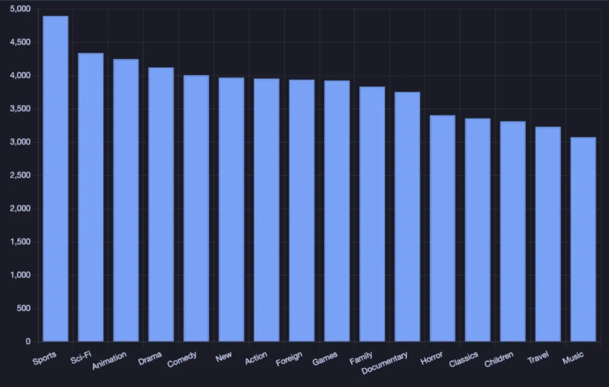
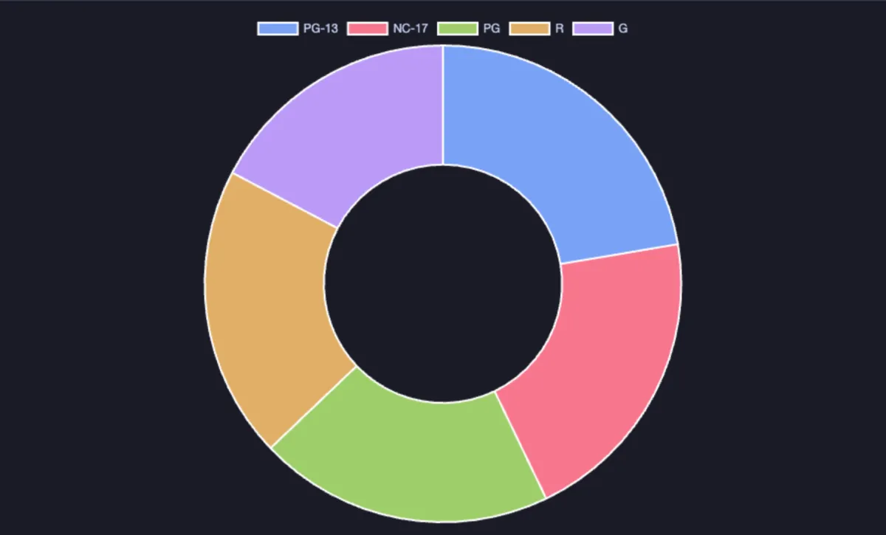
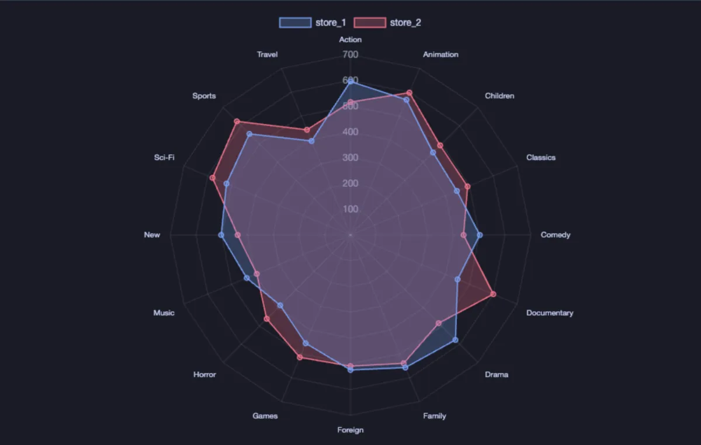

# Chart.js

The classic office charts, bars, lines, pies, doughnuts, radar and polar area, for a small result: a few dozen categories and one or more numbers each.



What each film category earned in the dvdrental shop, sorted. Sports leads clearly, Music and Travel trail, and Sports earned about half as much again as Music.

## What it is for

- **How do the parts compare?** Sales per region, tickets per team, revenue per category, as bars or as a pie.
- **What share does each part have?** A doughnut of orders by status, of users by plan, of films by rating.
- **How do two things compare on many sides?** A radar puts two stores, two products or two releases side by side on five to ten measures at once; of the chart extensions, only this one draws radar and polar area.

Pick Chart.js for a small, clean chart of up to about 60 categories. For a long series over time with zoom, pick ECharts or μPlot; for raw rows that still need summing up, Vega-Lite does the summing for you.

## How to read it

**Category** is what goes along the axis (or around the pie), one per row; **Series** are the numbers, one colour each. With more than one series, a legend names them, and a click on a legend entry hides that series. Hover a bar, a point or a slice for its value. A pie, doughnut or polar area draws the first series only. A radar and a polar area measure from zero at the centre, so the distance from the middle is the value itself.

## Try it

**Revenue per film category**, in the [dvdrental](https://neon.com/postgresql/postgresql-getting-started/postgresql-sample-database) sample database, the picture above:

```sql
-- @extension chartjs open
-- @inputs kind=bar, category=category, series=revenue
select c.name as category, sum(p.amount) as revenue
from payment p
     join rental r using (rental_id)
     join inventory i using (inventory_id)
     join film_category fc using (film_id)
     join category c using (category_id)
group by c.name
order by revenue desc;
```

**Which ratings people rent**, as a doughnut:

```sql
-- @extension chartjs open
-- @inputs kind=doughnut, category=rating, series=rentals
select f.rating::text as rating, count(*) as rentals
from rental r join inventory i using (inventory_id) join film f using (film_id)
group by f.rating
order by rentals desc;
```



**Two stores on every category**, as a radar: where one store is stronger, its outline reaches further. Store 2 rents out clearly more documentaries (600 against 450), store 1 more action and drama films.

```sql
-- @extension chartjs open
-- @inputs kind=radar, category=category, series=store_1, store_2
select c.name as category,
       count(*) filter (where i.store_id = 1) as store_1,
       count(*) filter (where i.store_id = 2) as store_2
from rental r
     join inventory i using (inventory_id)
     join film_category fc using (film_id)
     join category c using (category_id)
group by c.name
order by c.name;
```



## Settings

| Setting | `@inputs` key | Default | What it does |
|---|---|---|---|
| Chart type | `kind` | bar | `bar`, `line`, `pie`, `doughnut`, `radar` or `polarArea` |
| Category (X / label) | `category` | asked | What goes along the axis or around the pie, one per row; none numbers the rows |
| Series (Y) | `series` | asked | The numbers to draw, one colour each, as a comma list |
| Palette | `palette` | Vivid | `Vivid`, `Cool`, `Warm` or `Mono` |
| Title | `title` | none | A title over the chart |
| Top rows | `top` | 60 | How many rows to draw, from the first one; the rest are left out |

## Good to know

Chart.js 4 draws on a canvas, loaded once on the first draw and cached after. **Copy data** in the header copies the rows drawn as CSV. `-- @extension chartjs` above a query attaches it; `open`, `only` or `beside` after the id says how the tab opens, and `-- @inputs` in the file draws it without the dialog. As the last step of a pipeline it charts what another extension computed, for example RFM segments: `-- @extension rfm | chartjs`.

## Requirements

PostgreSQL 13 or newer. Runs entirely in the result's sandbox, with no server side. Loads `cdn.jsdelivr.net` at run time; the host must be on the allowed remote script hosts (the extension's page offers Allow).
