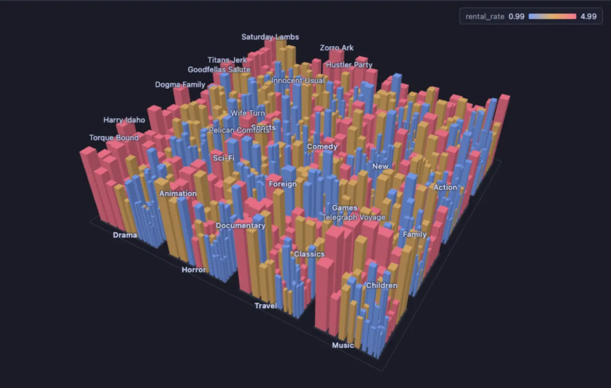
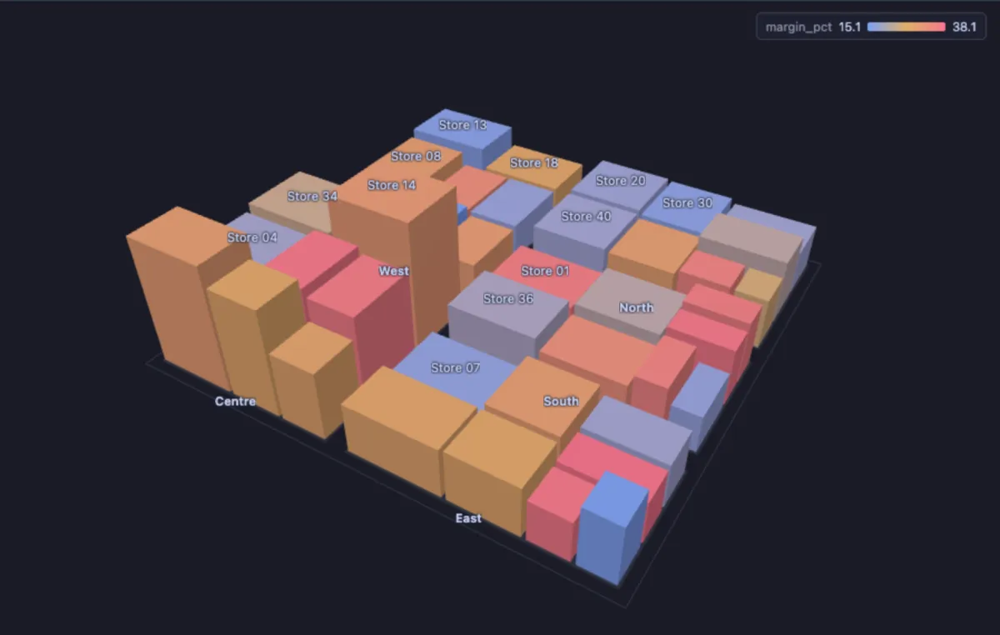

# City 3D

Turn rows into a city you can walk around: every row a building, grouped into districts, its footprint one number, its height another and its colour a third, so the rows that are big on two counts at once stand out from across town.



The films of a video rental shop, one building each, in a district per category. A wide building earned a lot, a tall one was rented often, and the colour is its price per rental, from blue for cheap to red for dear. The films worth a closer look are the wide and tall ones, and whether they are cheap or dear says where the money comes from.

## What it is for

- **A shop**: products as buildings in a district per category, the footprint their revenue, the height their returns: the problem product is wide and tall.
- **A database**: tables as buildings in a district per schema, the footprint their size, the height their dead rows (the Storage city extension does exactly this).
- **A team**: projects as buildings in a district per department, the footprint their budget, the height their overrun.

A flat treemap answers "where is the most"; the city adds "and which of those is also the worst", in one picture.

## How to read it

The districts share the ground out in proportion to their totals, and the buildings share out their district in proportion to their own number (a squarified treemap, so every plot stays close to a square). The taller a building, the higher its **Height** number; the colour runs along a ramp for a number, or gives each category a colour of its own. The districts are named on their ground, the largest buildings on their roofs, every building in its tooltip.

Steering: drag with the left button to turn the city, drag with the right button (or Shift and drag) to slide it, wheel to zoom. **Spin** turns it slowly; **Reset camera** (or a double-click, Home, 0) brings the camera back. Hover a building for its numbers, click it to select its row in the grid.

## Try it

**Film revenue by category**, in the [dvdrental](https://neon.com/postgresql/postgresql-getting-started/postgresql-sample-database) sample database, the picture above: a district per category, a building per film, its footprint what it earned, its height how often it was rented, its colour its rental rate.

```sql
-- @extension city-3d open
-- @inputs district=category, name=title, area=revenue, height=rentals, color=rental_rate
select c.name as category, f.title, sum(p.amount) as revenue, count(*) as rentals, f.rental_rate
from payment p
join rental r using (rental_id)
join inventory i using (inventory_id)
join film f using (film_id)
join film_category fc using (film_id)
join category c using (category_id)
group by c.name, f.film_id;
```

**A chain of forty stores** (any connection, made up on the spot): a district per region, the footprint each store's floor space, the height its sales per square metre, the colour its margin. The big stores are not the busiest: the Centre district's buildings are the tallest, small floors selling the most per square metre.

```sql
-- @extension city-3d open
-- @inputs district=region, name=store, area=floor_m2, height=sales_per_m2, color=margin_pct
select region,
       'Store ' || lpad(g::text, 2, '0') as store,
       floor_m2,
       round((case when region = 'Centre' then 9000 else 4000 end) * (0.6 + random() * 0.8)) as sales_per_m2,
       round((15 + random() * 25)::numeric, 1) as margin_pct
from (select g,
             (array['North', 'South', 'East', 'West', 'Centre'])[1 + g % 5] as region,
             (400 + random() * 2600)::int as floor_m2
      from generate_series(1, 40) g) s;
```



## Settings

| Setting | `@inputs` key | Default | What it does |
|---|---|---|---|
| Footprint | `area` | asked | The number a building covers ground in proportion to (a size, an amount) |
| Footprint scale | `areaScale` | linear | `linear` keeps the ground in proportion; `sqrt` keeps the order but lets the small buildings be seen beside a giant |
| District | `district` | none | The category buildings group into, a district each; none makes one district |
| Name | `name` | none | What a building is called, on its roof (the largest) and in the tooltip |
| Height | `height` | none | The number a building rises with; none keeps every building low |
| Colour by | `color` | none | A number (along the ramp below) or a category; none colours by district |
| Colour ramp | `ramp` | ramp | For a number: `ramp` runs blue, amber, red from low to high; `alarm` runs green, amber, red, for a number where high is bad |
| Top rows | `top` | 20000 | How many rows the view reads from the result, from the first one |

## Good to know

Rows with no positive footprint are left out, and the Log says how many. A category colour gives each of the twelve most frequent values a colour; a building with no value for a number colour is muted. **Copy data** copies the buildings as CSV. Labels are drawn over the canvas, so Copy as Image gives the city without its labels. The Storage city extension (Storage and Maintenance) opens a database's tables in this view: schemas as districts, size as the footprint, dead rows as the height. Attach it from a script with `-- @extension city-3d` above a query (add `open`, `only` or `beside` to open on the view), or from a result's own menu; `-- @inputs` answers the settings in the file so the city draws with no dialog.

## Requirements

PostgreSQL 13 or newer. Nothing runs on the server: the view is drawn in the result's sandbox. A GPU-capable browser: the desktop app, or a normal browser tab. three.js comes from `cdn.jsdelivr.net`, which has to be an allowed remote script host (the Log offers Allow host when it is not); after the first load it is kept on this machine and works offline. Three core installs with it.
