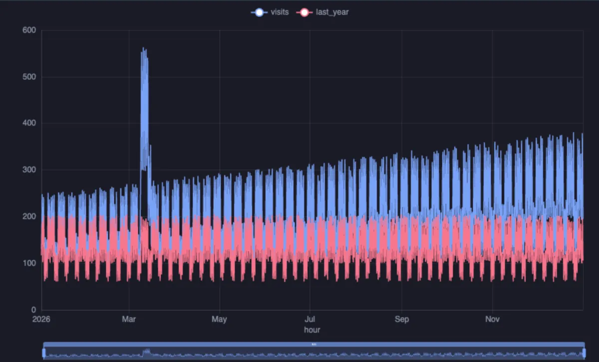
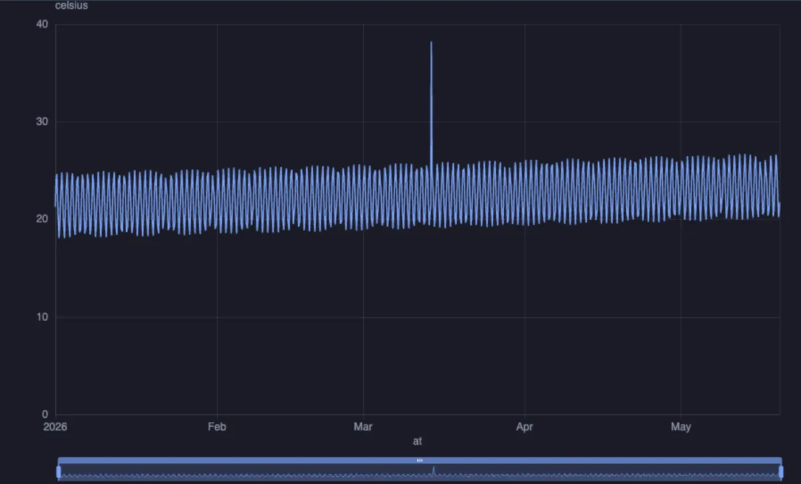
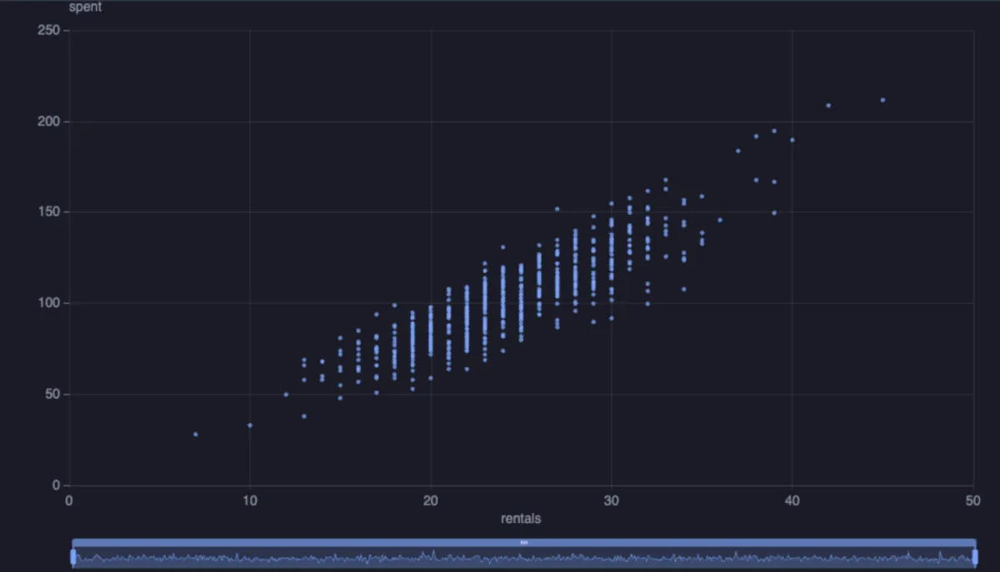

# ECharts

Lines, areas, bars, points and pies for results of any length, with a zoom slider under the chart: a year of hourly numbers, or a million readings, and you slide in to the week or the hour you care about.



A year of website visits, hour by hour (8,760 points), against the year before. Even at this size the story is there: visits grow through the year, the weekends are quieter, and the second week of March jumps far above both lines. Slide the window under the chart onto March to see that campaign week hour by hour.

## What it is for

- **What happened over time?** Visits, orders, sign-ups, sales per hour or per day, this year against the last, a long history you can zoom into.
- **What did the machines do?** Readings from a sensor, a server's CPU or a queue's length every minute for months: a million points still draw in about a second, and the peaks are kept when the line is thinned to the pixels.
- **Do two numbers go together?** As points, one per row: do customers who rent more also spend more?

Pick ECharts when the result is long and you will want to zoom. For the fastest plain line chart pick μPlot, for millions of points as a cloud Scatter GL, for a small classic chart (with radar and pies) Chart.js.

## How to read it

The horizontal axis is **X**: a date or a timestamp draws a time axis, a number a number axis, text one category per row, and no X the row order. Each column in **Series** is a line (or bars, points, an area) of its own colour, named in the legend. Under the chart a slider shows the whole result: drag its ends, or wheel and drag on the chart, to zoom; the tooltip follows the cursor and reads every series at that point.

## Try it

**A year of visits, hour by hour** (any connection, made up on the spot), the picture above:

```sql
-- @extension echarts open
-- @inputs kind=line, x=hour, series=visits, last_year
select h as hour,
       round((120 + 100 * greatest(0, sin(pi() * (extract(hour from h) - 6) / 16)))
             * case when extract(isodow from h) >= 6 then 0.6 else 1 end
             * (1 + extract(doy from h) / 600)
             * case when h >= '2026-03-09' and h < '2026-03-16' then 2.2 else 1 end
             + random() * 30) as visits,
       round((100 + 80 * greatest(0, sin(pi() * (extract(hour from h) - 6) / 16)))
             * case when extract(isodow from h) >= 6 then 0.6 else 1 end
             + random() * 25) as last_year
from generate_series(timestamp '2026-01-01', timestamp '2026-12-31 23:00', interval '1 hour') h;
```

**Two hundred thousand sensor readings**, one a minute for twenty weeks (any connection): a daily swing, a slow drift and one fault you find by zooming in on the spike.

```sql
-- @extension echarts open
-- @inputs kind=line, x=at, series=celsius
select t as at,
       round((21 + 3 * sin(2 * pi() * extract(epoch from t) / 86400) + extract(epoch from t - timestamp '2026-01-01') / 6e6
              + case when t between '2026-03-14 02:00' and '2026-03-14 05:00' then 14 else 0 end
              + random() * 0.8)::numeric, 2) as celsius
from generate_series(timestamp '2026-01-01', timestamp '2026-01-01' + interval '199999 minutes', interval '1 minute') t;
```



**Do the customers who rent more also spend more?** In the [dvdrental](https://neon.com/postgresql/postgresql-getting-started/postgresql-sample-database) sample database, one point per customer:

```sql
-- @extension echarts open
-- @inputs kind=scatter, x=rentals, series=spent
select count(*) as rentals, sum(p.amount) as spent
from payment p
group by p.customer_id;
```



## Settings

| Setting | `@inputs` key | Default | What it does |
|---|---|---|---|
| Chart | `kind` | line | `line`, `area`, `bar`, `scatter` (points) or `pie` |
| X (a column, or the row order) | `x` | asked | The horizontal axis: a date or timestamp makes a time axis, a number a number axis, text categories; none uses the row order |
| Series (Y) | `series` | asked | The numbers to draw, one colour each, as a comma list |
| Palette | `palette` | Vivid | `Vivid`, `Cool`, `Warm` or `Mono` |
| Title | `title` | none | A title over the chart |

## Good to know

The whole result is paged in, up to a million rows. A line of that size is thinned to the pixels on the fly with its peaks kept (ECharts' LTTB sampling), and points and bars switch to ECharts' large mode, so a million rows draw in about a second. A pie draws the first series over its first 40 rows. **Copy data** in the header copies what was drawn as CSV. From a script: `-- @extension echarts` (plus `open`, `only` or `beside`) above the query, and `-- @inputs` to answer the settings in the file so the dialog never shows. As the last step of a pipeline it charts what another extension computed: `-- @extension group-by | echarts`, `-- @extension forecast | echarts`.

## Requirements

PostgreSQL 13 or newer. No server side: the result's sandbox draws it from the rows already fetched. Apache ECharts comes from `cdn.jsdelivr.net` when the view draws, so that host has to be allowed first; the extension's page has the Allow button.
