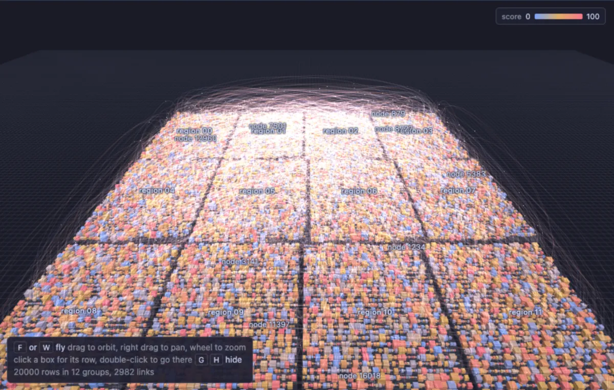
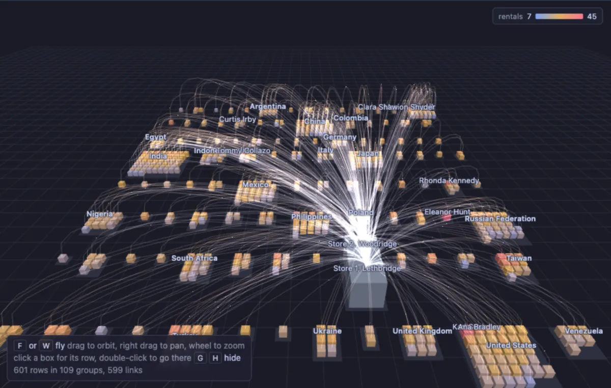
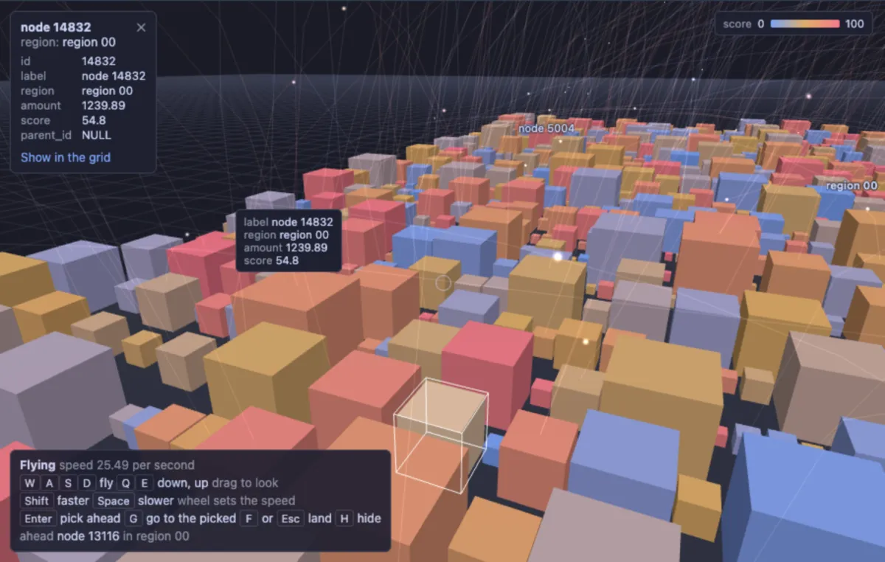
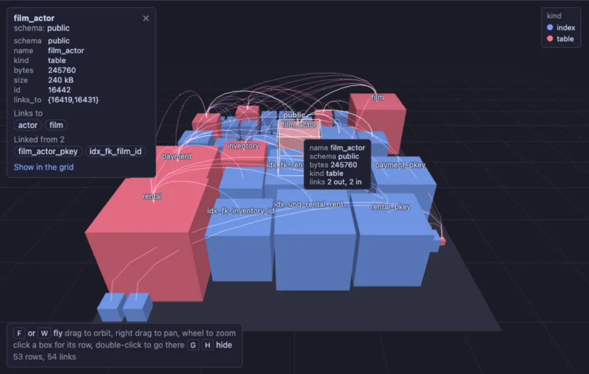
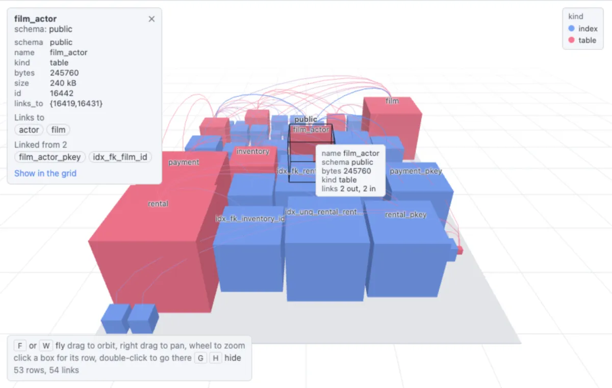

# Flythrough 3D


Fly through a query result: every row a box, packed on shelves in the order the rows come, the shelves gathered into a block per group, and rows that link to other rows joined by paths with signals running along them. Orbit around the whole city, then take off with **F** (or **W**) and fly through it with the keys, the way a game does (three.js, through the Three core extension, which installs with it).

## What it shows

A **Flythrough 3D** tab beside the grid.



- **Boxes on shelves.** Rows are laid down in their own order: along a shelf, then the next shelf behind it. The query's `ORDER BY` is the order you fly past them. A box grows with its **Size**: with the `volume` scale it holds its number (twice the number, twice the volume), with `log` it grows with the number of digits, so one giant does not hide the rest.
- **Blocks by group.** A **Group** column gathers the rows into blocks, one per value, with aisles between them to fly along. The `stacks` layout piles shelves into floors, so a block is a cube of boxes, for a great many rows.
- **Paths and signals.** Pick an **Id** and a **Links to** column (a parent id, a foreign key, or an array of ids) and every link becomes a path from the row to the row it names, rising with the distance and coloured from one end's colour to the other's. Packets of light run along the paths, from the row that links to the row it reaches. The **Signals** button stops them and starts them again. The more paths there are, the fainter each is drawn, so thousands read as a haze over the city rather than a wall.



- **Colour by** a number runs along a ramp (`ramp`: blue, amber, red; `alarm`: green, amber, red where high is bad); a category gives each of the twelve most frequent values a colour; with nothing picked, each group has its own.
- **Click a box** and its row shows on a card: every value, the rows it links to and the rows that link to it, each a button that flies there, and its paths drawn bright. **Show in the grid** on the card takes you to the row in the result grid; a click alone never leaves the view.

## Flying



| In orbit | |
|---|---|
| Drag, right drag, wheel | Orbit, pan, zoom |
| **F** or **W** | Take off |
| Click a box | Its row on a card (Show in the grid takes you to it there) |
| Double-click a box, or **G** | Glide to it |
| Double-click the ground, **Home** or **0** | The whole city again |

| In flight | |
|---|---|
| **W A S D** or the arrows | Forward, left, back, right |
| **Q** and **E** | Down and up |
| Drag (any button) | Look around |
| **Shift** / **Space** (held) | Four times faster / five times slower |
| Wheel | Set the cruising speed |
| **Enter** | Pick the box straight ahead (the ring in the middle aims) |
| **G** | Glide to the picked box |
| **F** or **Esc** | Land: orbit again around what is ahead |

**H** hides the key list in either mode. The cruising speed is set at take-off from where the camera is: what it looks at is six seconds away, so a take-off from high above crosses the city and one beside a box creeps along the shelf. The keys go to the view once it has been clicked; the **Fly** button takes off too, and the key list asks for a click when the view does not have the keys yet. **Tour** flies over the blocks by itself, in the order they stand; any key or a click takes over. **Reset camera** brings the camera home, the copy button copies the rows' picked columns as CSV.

## Inputs

| Input | `@inputs` key | Default | Meaning |
|---|---|---|---|
| Group | `group` | none | The category rows gather into, a block each |
| Size | `size` | none | The number a box grows with |
| Size scale | `sizeScale` | volume | `volume`: a box's volume in proportion; `log`: the number of digits |
| Name | `name` | none | What a box is called |
| Colour by | `color` | none | A number (along the ramp) or a category |
| Colour ramp | `ramp` | ramp | `ramp` (blue, amber, red) or `alarm` (green, amber, red) |
| Id | `id` | none | What other rows call a row by when they link to it |
| Links to | `link` | none | The id a row points at, or an array of ids |
| Layout | `layout` | shelves | `shelves`: one floor per block; `stacks`: floors on floors |
| Top rows | `top` | 50000 | How many rows the view reads from the result, from the first one |

## Examples

Your database, the way a memory explorer shows a heap: every table, materialized view and index a box, a block per schema, a table's indexes on the shelf beside it, the size on disk as the box, and paths from every index to its table, from every foreign key to the table it references and from every partition to its parent.

```sql
-- @extension flythrough-3d open
-- @inputs group=schema, name=name, size=bytes, sizeScale=log, color=kind, id=id, link=links_to
select n.nspname as schema,
       c.relname as name,
       case c.relkind when 'r' then 'table' when 'p' then 'partitioned table' when 'm' then 'materialized view'
                      when 'i' then 'index' when 'I' then 'partitioned index' end as kind,
       pg_catalog.pg_relation_size(c.oid) as bytes,
       pg_catalog.pg_size_pretty(pg_catalog.pg_relation_size(c.oid)) as size,
       c.oid::text as id,
       array(select x.indrelid::text from pg_catalog.pg_index x where x.indexrelid = c.oid
             union select f.confrelid::text from pg_catalog.pg_constraint f where f.conrelid = c.oid and f.contype = 'f'
             union select h.inhparent::text from pg_catalog.pg_inherits h where h.inhrelid = c.oid) as links_to
from pg_catalog.pg_class c
     join pg_catalog.pg_namespace n on n.oid = c.relnamespace
     left join pg_catalog.pg_index ix on ix.indexrelid = c.oid
     left join pg_catalog.pg_class t on t.oid = ix.indrelid
where c.relkind in ('r', 'p', 'm', 'i', 'I')
  and n.nspname <> 'information_schema'
  and n.nspname !~ '^pg_'
order by n.nspname, coalesce(t.relname, c.relname), c.relkind in ('i', 'I'), c.relname;
```



The same in the light theme, the colours following the app's theme:



Twenty thousand made-up rows, to try it on any connection: twelve regions, a lognormal amount as the size, a score as the colour, and one row in seven linked to an earlier one.

```sql
-- @extension flythrough-3d open
-- @inputs group=region, name=label, size=amount, color=score, id=id, link=parent_id
select g as id,
       'node ' || g as label,
       'region ' || lpad((g % 12)::text, 2, '0') as region,
       round(exp(random() * 9)::numeric, 2) as amount,
       round((random() * 100)::numeric, 1) as score,
       case when g > 12 and random() < 0.15 then g - 1 - floor(random() * least(g - 1, 600))::int end as parent_id
from generate_series(1, 20000) g
order by region, g;
```

## Requirements

PostgreSQL 13 or newer. Nothing on the server: the view runs in the result's sandbox. A GPU-capable browser: the desktop app, or a normal browser tab. three.js comes from `cdn.jsdelivr.net`, which has to be an allowed remote script host (the Log offers Allow host when it is not); after the first load it is kept on this machine and works offline.

## Notes

The view keeps the mouse pointer: the result's sandbox does not lock it, so in flight you look around by dragging rather than by moving the mouse alone. Links that name an id the view did not read are not drawn, and the Log says how many; the first 20,000 links are drawn, and signals run along up to 2,500 of them. Labels are drawn over the canvas, so Copy as Image gives the city without its labels. Attach it from a script with `-- @extension flythrough-3d` above a query (add `open`, `only` or `beside` to open on the view), or from a result's own menu; `-- @inputs` answers the inputs in the file so the view draws with no dialog.
