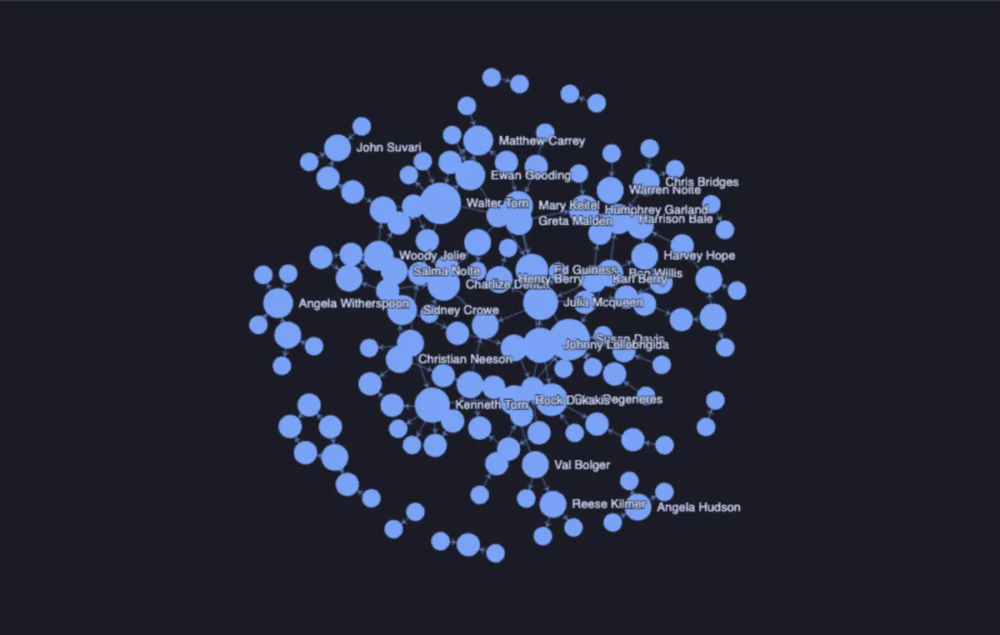
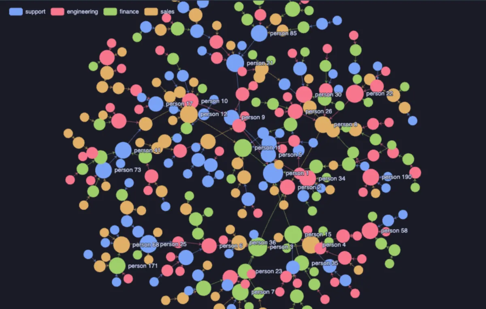

# Network graph



Rows as a network: every distinct value of one column a node, and the rows that point at another node (a parent, a manager, the other end of an edge) the links between them. Laid out by force, so linked nodes pull together and clusters show by themselves, or on a circle. Hover a node and its neighbours stand out; drag nodes, wheel to zoom, drag the background to pan (ECharts, through ECharts core, which installs with it).

## What it shows

A **Network** tab beside the grid.

- **Nodes** are the distinct values of **Node**. A row names a node and, in **Links to**, the node it points at: one value, or an array of them (`{3,7,9}` or `[3,7,9]`), so one row can link to many. A value that is only ever linked to is a node too.
- Two shapes of data work the same way: rows that are things with a parent (`id`, `parent_id`), and rows that are edges (`from`, `to`).
- **Size by** a number grows a node with it; without one, a node grows with how many links it has, so the hubs stand out. **Colour by** gives each of the twelve most frequent categories a colour, toggled from the legend.
- **Labels** name the thirty largest nodes by default; hovering names any of them.
- **Copy data** copies the links as a `source,target` CSV.

Up to 3,000 nodes and 12,000 links are drawn; past that the Log says how many were left out, and a narrower query reads better anyway.

## Inputs

| Input | `@inputs` key | Default | Meaning |
|---|---|---|---|
| Node | `source` | asked | What a row is: one node per distinct value |
| Links to | `target` | none | The node a row points at, or an array of them |
| Label | `label` | none | What a node is called |
| Colour by | `group` | none | A category |
| Size by | `size` | none | A number a node grows with; none sizes by links |
| Layout | `layout` | force | `force` or `circular` |
| Labels | `labels` | largest | `largest`, `all` or `none` |
| Title | `title` | none | A title over the chart |
| Top rows | `top` | 20000 | How many rows the view reads |

## Examples

**Who blocks whom, right now.** Every client backend a node, coloured by its state, with a link to each backend it waits on. A chain of waits reads as a path, and the backend at its end is the one to look at; on a quiet server the backends stand alone, unlinked.

```sql
-- @extension network-graph open
-- @inputs source=pid, target=blocked_by, label=label, group=state
select a.pid,
       a.usename || ' ' || a.pid || ': ' || left(a.query, 40) as label,
       coalesce(a.state, 'unknown') as state,
       pg_catalog.pg_blocking_pids(a.pid) as blocked_by
from pg_catalog.pg_stat_activity a
where a.backend_type = 'client backend';
```

**Which roles inherit from which.** Every role a node, coloured by whether it can log in, linked to the roles it is a member of.

```sql
-- @extension network-graph open
-- @inputs source=role, target=member_of, group=can_login
select r.rolname as role,
       r.rolcanlogin as can_login,
       array(select g.rolname
             from pg_catalog.pg_auth_members m
                  join pg_catalog.pg_roles g on g.oid = m.roleid
             where m.member = r.oid) as member_of
from pg_catalog.pg_roles r
where r.rolname !~ '^pg_';
```

**Actors who keep working together**, in the [dvdrental](https://neon.com/postgresql/postgresql-getting-started/postgresql-sample-database) sample database: a link between two actors who share four films or more. The busiest actors grow into hubs.

```sql
-- @extension network-graph open
-- @inputs source=actor, target=costar
select a1.first_name || ' ' || a1.last_name as actor,
       a2.first_name || ' ' || a2.last_name as costar,
       count(*) as films
from film_actor f1
     join film_actor f2 on f2.film_id = f1.film_id and f2.actor_id > f1.actor_id
     join actor a1 on a1.actor_id = f1.actor_id
     join actor a2 on a2.actor_id = f2.actor_id
group by 1, 2
having count(*) >= 4;
```

**A company as a reporting tree**, made up on the spot (any connection): every person linked to their manager, coloured by team.

```sql
-- @extension network-graph open
-- @inputs source=id, target=manager_id, label=name, group=team
select g as id,
       'person ' || g as name,
       (array['sales', 'support', 'engineering', 'finance'])[1 + g % 4] as team,
       case when g > 1 then 1 + floor(random() * (g - 1))::int end as manager_id
from generate_series(1, 150) g;
```



## Requirements

PostgreSQL 13 or newer. Nothing on the server: the view runs in the result's sandbox. ECharts comes from `cdn.jsdelivr.net`, which has to be an allowed remote script host (the Log offers Allow host when it is not); after the first load it is kept on this machine and works offline.

## Notes

A link that points back at its own row is left out, and a link named twice is drawn once. Attach it from a script with `-- @extension network-graph` above a query (add `open`, `only` or `beside` to open on the view), or from a result's own menu; `-- @inputs` answers the inputs in the file so the graph draws with no dialog. For a hierarchy read top-down rather than as a web, the Tree extension draws the same `id` and parent rows as a tree.
