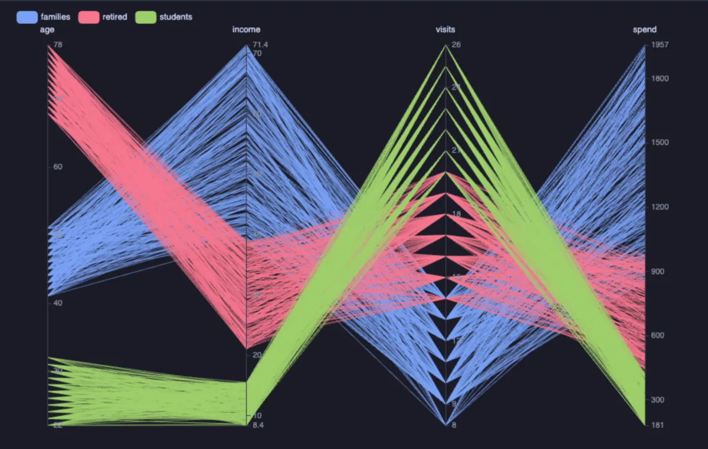
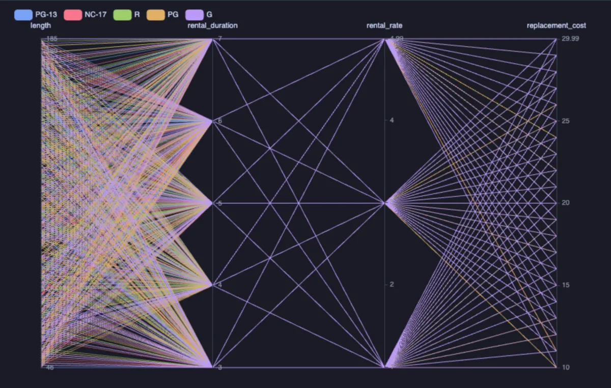

# Parallel coordinates



Many columns side by side as vertical axes, and every row a line across them: rows that are alike run together, the odd ones cross the bundle, and a column that moves with another shows as lines that stay level between them. Drag along an axis to keep only the rows in that range, on as many axes as you like (ECharts, through ECharts core, which installs with it).

## What it shows

A **Parallel** tab beside the grid.

- **Axes** are the columns, in the order given: a number gets a scale, a text column its values in the order they first come.
- **Colour by** a number runs the lines along a ramp (`ramp` blue to red, or `alarm` green to red), with a handle to narrow the range; a category gives each of its ten most frequent values a colour, toggled from the legend.
- **Filter by dragging**: a drag along an axis keeps the lines that pass through that stretch and fades the rest. Drag on more axes to combine; click an axis outside its selection to clear it.
- The lines fade as there are more of them, so a few thousand still read. **Copy data** copies the rows' axes as CSV.

## Inputs

| Input | `@inputs` key | Default | Meaning |
|---|---|---|---|
| Axes | `series` | asked | Two or more columns, in order |
| Colour by | `color` | none | A number or a category |
| Colour ramp | `ramp` | ramp | `ramp` or `alarm`, for a number |
| Title | `title` | none | A title over the chart |
| Top rows | `top` | 5000 | How many rows the view reads |

## Examples

**Films compared on four numbers**, in the [dvdrental](https://neon.com/postgresql/postgresql-getting-started/postgresql-sample-database) sample database, coloured by rating. Drag on the length axis to see what the long films cost to rent and to replace.

```sql
-- @extension parallel-coordinates open
-- @inputs series=length, rental_duration, rental_rate, replacement_cost, color=rating
select title, length, rental_duration, rental_rate, replacement_cost, rating::text as rating
from film;
```



**How the tables of a database are used**, on any database with tables: reads by scan and by index, live and dead rows, coloured by the share of dead rows, so the tables that need a vacuum stand out in red.

```sql
-- @extension parallel-coordinates open
-- @inputs series=seq_scan, idx_scan, live_rows, dead_rows, color=dead_pct, ramp=alarm
select relname as "table",
       seq_scan,
       coalesce(idx_scan, 0) as idx_scan,
       n_live_tup as live_rows,
       n_dead_tup as dead_rows,
       round(100.0 * n_dead_tup / nullif(n_live_tup + n_dead_tup, 0), 1) as dead_pct
from pg_catalog.pg_stat_user_tables;
```

**Three kinds of customer**, made up on the spot (any connection): age, income, visits and spend, coloured by segment.

```sql
-- @extension parallel-coordinates open
-- @inputs series=age, income, visits, spend, color=segment
select (array['students', 'families', 'retired'])[1 + g % 3] as segment,
       (array[22, 41, 68])[1 + g % 3] + (random() * 10)::int as age,
       round(((array[12, 55, 30])[1 + g % 3] * (0.7 + random() * 0.6))::numeric, 1) as income,
       (array[20, 8, 14])[1 + g % 3] + (random() * 6)::int as visits,
       round(((array[300, 1400, 700])[1 + g % 3] * (0.6 + random() * 0.8))::numeric) as spend
from generate_series(1, 900) g;
```

## Requirements

PostgreSQL 13 or newer. Nothing on the server: the view runs in the result's sandbox. ECharts comes from `cdn.jsdelivr.net`, which has to be an allowed remote script host (the Log offers Allow host when it is not); after the first load it is kept on this machine and works offline.

## Notes

Attach it from a script with `-- @extension parallel-coordinates` above a query (add `open`, `only` or `beside` to open on the view), or from a result's own menu; `-- @inputs` answers the inputs in the file so the chart draws with no dialog.
