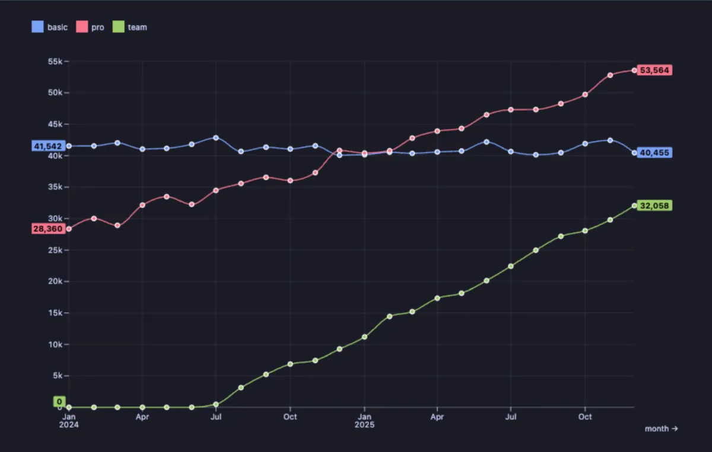
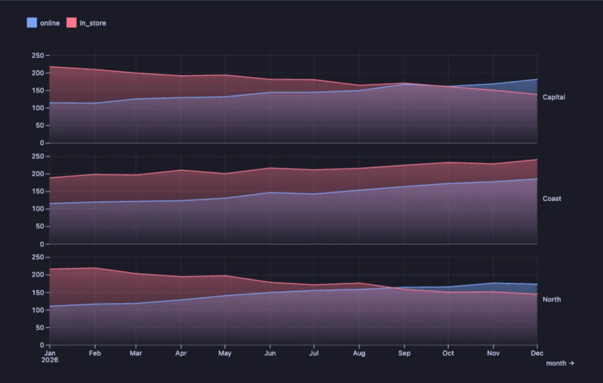

# Plot chart

A clean line, area, dot or bar chart of one or more numbers over time, with each line's last value printed at its end, a read-out wherever you point, and, when you have groups, one small panel per group.



Monthly revenue of three plans over two years. The labels at the ends tell the result without hovering: Pro overtook Basic in the spring of 2025 and is now the largest, Basic is flat, and Team, launched in mid 2024, is climbing fastest.

## What it is for

- **How did it move?** Revenue, users, orders or response times month by month, several lines on one chart, readable as it is, ready for a slide or a report.
- **How do the groups compare, each on its own?** With **Facet by**, one panel per region, team or server, the same scale in every panel, so a group that behaves differently stands out.
- **What exactly was it on that day?** Point anywhere: a read-out gives every line's value there.

Pick Plot chart for a chart you show to someone: tidy, labelled, with panels. For a long series you zoom into, pick ECharts or μPlot; for an overview with a detail window, Focus.

## How to read it

The horizontal axis is **X**: a date or a timestamp, a number, a category, or (with none) the row order. Each column in **Series** is one line (or area, dots, bars), its colour in the legend, its last value printed at the right end of the line. **Facet by** cuts the chart into stacked panels, one per value of that column. **Curve** shapes the line: `linear` joins the points straight, `monotone-x` smooths without overshooting, `step` draws stairs (right for prices or plans that change on a day), `basis` a soft spline.

## Try it

**Revenue of three plans** (any connection, made up on the spot), the picture above:

```sql
-- @extension plot-chart open
-- @inputs mark=line, x=month, series=basic, pro, team, curve=monotone-x
select m::date as month,
       round(40000 + random() * 3000) as basic,
       round(25000 + 1100 * row_number() over (order by m) + random() * 3000) as pro,
       case when m >= '2024-07-01' then round(1800 * (extract(epoch from m - timestamp '2024-07-01') / 2629800) + random() * 2000) else 0 end as team
from generate_series(timestamp '2024-01-01', timestamp '2025-12-01', interval '1 month') m;
```

**Online and in-store sales, a panel per region** (any connection): online grows everywhere, the stores shrink everywhere except the coast.

```sql
-- @extension plot-chart open
-- @inputs mark=area, x=month, series=online, in_store, facet=region
select r as region, m::date as month,
       round(100 + 6 * extract(month from m) + random() * 15) as online,
       round(case when r = 'Coast' then 180 + 4 * extract(month from m) else 220 - 7 * extract(month from m) end + random() * 15) as in_store
from unnest(array['North', 'Capital', 'Coast']) r,
     generate_series(timestamp '2026-01-01', timestamp '2026-12-01', interval '1 month') m;
```



**Rentals per day and store**, in the [dvdrental](https://neon.com/postgresql/postgresql-getting-started/postgresql-sample-database) sample database, as bars: each day's bar is the two stores stacked, so its height is the day's total.

```sql
-- @extension plot-chart open
-- @inputs mark=bar, x=day, series=store_1, store_2
select r.rental_date::date as day,
       count(*) filter (where i.store_id = 1) as store_1,
       count(*) filter (where i.store_id = 2) as store_2
from rental r join inventory i using (inventory_id)
group by 1
order by 1;
```

## Settings

| Setting | `@inputs` key | Default | What it does |
|---|---|---|---|
| Mark | `mark` | line | `line`, `area`, `dot` or `bar` |
| X (a column, or the row order) | `x` | asked | The horizontal axis: a date or timestamp makes a time axis, a number a number axis, text categories; none uses the row order |
| Series (Y) | `series` | asked | The numbers to draw, one colour each, as a comma list |
| Facet by | `facet` | none | A column whose values each get a panel of their own |
| Curve | `curve` | linear | The line's shape: `linear`, `monotone-x` (smooth), `step` (stairs) or `basis` (a soft spline) |
| Palette | `palette` | Vivid | `Vivid`, `Cool`, `Warm` or `Mono` |
| Title | `title` | none | A title over the chart |

## Good to know

Sized for a lot of rows: the rows are paged in and bucketed down to what fits the pixels before Observable Plot, an SVG renderer, gets them, so a long series stays light. An area chart is shaded with a soft gradient. From a script: `-- @extension plot-chart` (plus `open`, `only` or `beside` for how the view opens) above the query, and `-- @inputs` to answer the settings in the file so the dialog never shows. From a result: its own menu.

## Requirements

PostgreSQL 13 or newer. No server side: the result's sandbox draws it from the rows already fetched. Observable Plot comes from `cdn.jsdelivr.net` when the view draws, so that host has to be allowed first; the extension's page has the Allow button. Plot core, the helpers common to the Observable Plot charts, installs with it.
