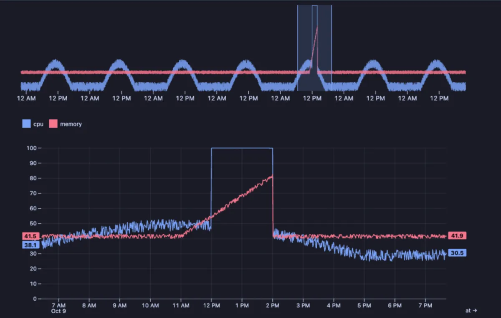
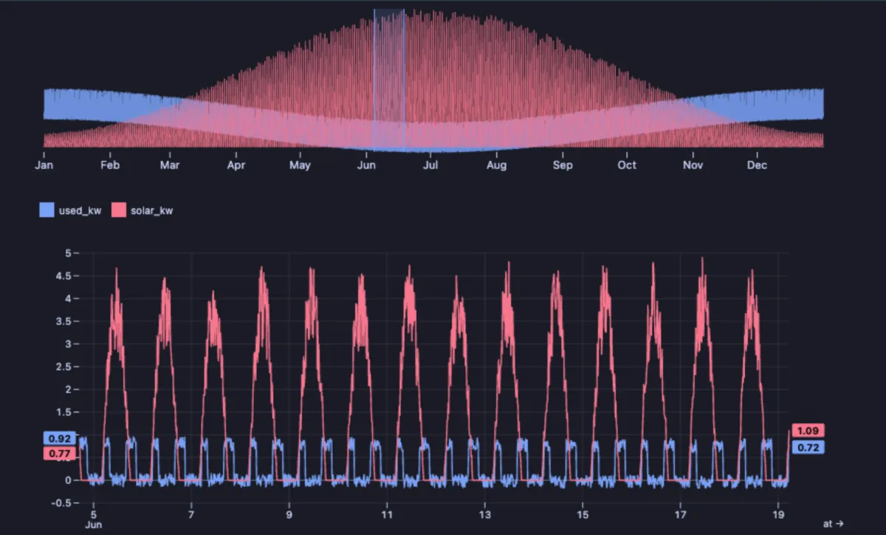

# Focus

A long history on top, a magnifying glass below: drag a window over the overview and the detail chart zooms to exactly that stretch, so you inspect one day without losing sight of the whole month.



A week of a server's CPU and memory, minute by minute (10,080 points). The overview shows a daily rhythm and one bad afternoon on Friday; with the window dragged over it, the detail shows the incident minute by minute: CPU at the ceiling for two hours while memory climbs, then both drop at once, the moment of the restart.

## What it is for

- **What happened in that hour?** A week of server metrics, a month of queue lengths, a year of sales: spot the odd stretch in the overview, then read it in the detail.
- **Is this normal?** The overview keeps the usual pattern in view while you look at one unusual day.
- **Comparing two stretches**: slide the same window across the overview, from Monday to Friday, and the detail redraws as you go.

Pick Focus when the history is long and the interesting part is short. For a single zoomable chart, pick ECharts or μPlot; for a chart to show someone, Plot chart.

## How to read it

The upper chart always shows everything. Drag across it to draw a window; the lower chart shows only what is inside the window, with its own axes. Drag the window to move it, drag outside it to draw a new one. Point at either chart for a read-out of every series at that moment.

## Try it

**A week of CPU and memory** (any connection, made up on the spot), the picture above:

```sql
-- @extension plot-focus open
-- @inputs x=at, series=cpu, memory
select t as at,
       round(least(100, 25 + 20 * greatest(0, sin(pi() * (extract(epoch from t::time) / 3600 - 7) / 12)) + random() * 8
             + case when t between '2026-10-09 14:00' and '2026-10-09 16:00' then 60 else 0 end)::numeric, 1) as cpu,
       round(least(100, 40 + case when t between '2026-10-09 13:00' and '2026-10-09 16:00'
                                  then extract(epoch from t - timestamp '2026-10-09 13:00') / 270 else 0 end
             + random() * 3)::numeric, 1) as memory
from generate_series(timestamp '2026-10-05', timestamp '2026-10-11 23:59', interval '1 minute') t;
```

**A year of electricity, every fifteen minutes** (any connection): the house's use and the solar panels' yield. The overview shows the seasons; a window on two weeks of June shows each sunny day, and that the panels yield most just when the house uses least.

```sql
-- @extension plot-focus open
-- @inputs x=at, series=used_kw, solar_kw
select t as at,
       round((0.4 + 0.8 * (case when extract(hour from t) between 7 and 9 or extract(hour from t) between 18 and 22 then 1 else 0 end)
              + 0.6 * cos(2 * pi() * extract(doy from t) / 365) + random() * 0.3)::numeric, 2) as used_kw,
       round(greatest(0, 5 * sin(pi() * (extract(hour from t) + extract(minute from t) / 60 - 6) / 14)
              * (0.55 - 0.45 * cos(2 * pi() * extract(doy from t) / 365)) * (0.6 + random() * 0.4))::numeric, 2) as solar_kw
from generate_series(timestamp '2026-01-01', timestamp '2026-12-31 23:45', interval '15 minutes') t;
```



## Settings

| Setting | `@inputs` key | Default | What it does |
|---|---|---|---|
| X (a number, a timestamp, or the row order) | `x` | asked | The horizontal axis: a timestamp or a number; none (or text) uses the row order |
| Series (Y) | `series` | asked | The numbers to draw, one colour each, as a comma list |
| Palette | `palette` | Vivid | `Vivid`, `Cool`, `Warm` or `Mono` |
| Title | `title` | none | A title over the charts |

## Good to know

Made for big results: up to a million rows are paged in and thinned to what the pixels can carry before they reach Observable Plot, which draws SVG and would choke on the raw count. The detail chart re-reads the full detail inside the window, so a narrow window shows every point. Put `-- @extension plot-focus open` above the query to land on the chart after Run (`only` hides the grid, `beside` splits the two), or attach it from the result's menu; `-- @inputs` answers the settings in the file so nothing asks.

## Requirements

PostgreSQL 13 or newer. The view draws in the result's sandbox; the server is not involved. Needs `cdn.jsdelivr.net` among the allowed remote script hosts, since Observable Plot loads from there when the view opens; Allow is on the extension's page. Plot core, the helpers every Observable Plot chart here shares, installs alongside.
