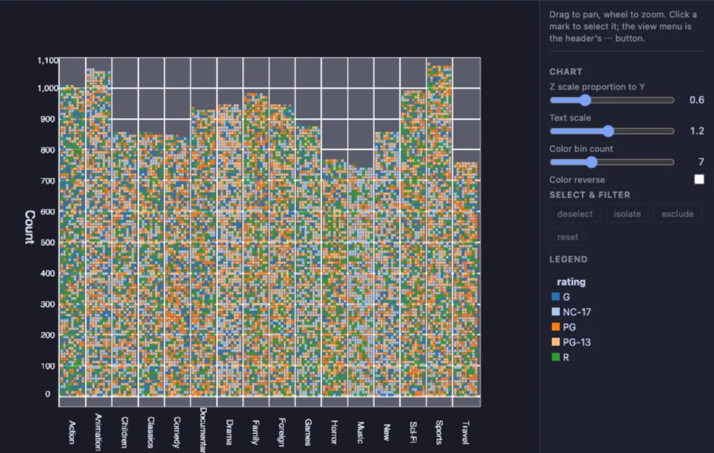
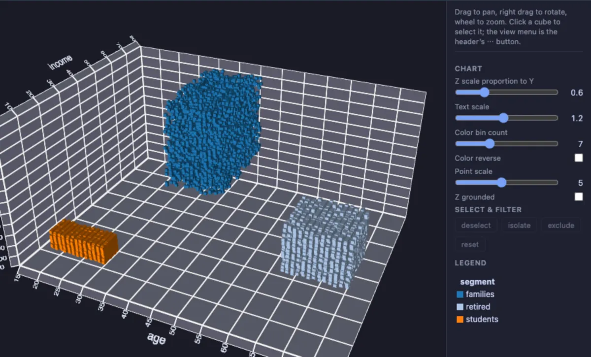

# SandDance

Every row of a big result as a small cube you can see: stacked into bars by a category, spread out as a 3D scatter, packed into a treemap, and animated from one arrangement to the next, so you watch the same rows regroup.



All 14,596 payments of the dvdrental shop, one square each, stacked into a bar per film category and coloured by the film's rating. The bars give the totals (Sports the tallest), the colours show the mix inside each one; switch **View** to `3d` and the squares become cubes you can turn, or **Chart** to `scatterplot` and they fly apart into a cloud.

## What it is for

- **Exploring a table you do not know yet.** Throw tens of thousands of rows at it, then try bars, stacks, a scatter or small multiples until a pattern shows.
- **Showing that a total is made of individual things.** A bar of cubes says "these are 3,000 separate orders", which a plain bar does not.
- **Three numbers at once.** In 3D, a scatter takes a third number as height: age, income and spending of every customer together.

Pick SandDance for exploration and for showing many individual rows. For a precise chart to read values from, pick Chart.js, Vega-Lite or Plot chart; for a million plain points, Scatter GL.

## How to read it

Each row is one cube. **Chart** decides how they are arranged: `barchart` stacks them by **X**, `scatterplot` places them by **X** and **Y** (and **Z** as height in 3D), `density` packs them by position, `stacks`, `strips`, `grid` and `treemap` group them in other ways. **Colour** paints each cube by a column, **Size** scales it, **Sort by** orders it, and **Facet** repeats the chart once per value of a column. In `3d`, drag with the right button to turn the scene; the panel on the right holds SandDance's own controls. Change a setting and the cubes move to their new places.

## Try it

**Every payment as a cube**, in the [dvdrental](https://neon.com/postgresql/postgresql-getting-started/postgresql-sample-database) sample database, the picture above:

```sql
-- @extension sanddance open
-- @inputs chart=barchartV, view=2d, x=category, color=rating, top=20000
select c.name as category, f.rating::text as rating, p.amount
from payment p
     join rental r using (rental_id)
     join inventory i using (inventory_id)
     join film f using (film_id)
     join film_category fc using (film_id)
     join category c using (category_id);
```

**Twenty thousand customers in 3D** (any connection, made up on the spot): age across, income up, spending as height, coloured by segment; the three segments separate into their own clouds.

```sql
-- @extension sanddance open
-- @inputs chart=scatterplot, view=3d, x=age, y=income, z=spend, color=segment, top=20000
select segment,
       round(age + random() * 12) as age,
       round((income * (0.7 + random() * 0.6))::numeric, 1) as income,
       round((spend * (0.5 + random()))::numeric) as spend
from (select (array['students', 'families', 'retired'])[1 + g % 3] as segment,
             (array[19, 34, 64])[1 + g % 3] as age,
             (array[12, 58, 31])[1 + g % 3] as income,
             (array[300, 1500, 800])[1 + g % 3] as spend
      from generate_series(1, 20000) g) c;
```



## Settings

| Setting | `@inputs` key | Default | What it does |
|---|---|---|---|
| Chart | `chart` | scatterplot | How the cubes are arranged: `scatterplot`, `barchart` (picks horizontal or vertical), `barchartV`, `barchartH`, `density`, `stacks`, `strips`, `grid` or `treemap` |
| View | `view` | 3d | `3d` turns with a right drag; `2d` is flat |
| X, Y | `x`, `y` | asked | The columns on the two axes (a bar chart needs only X) |
| Z (height, 3D) | `z` | none | A column drawn as height in the 3D view |
| Colour | `color` | none | The column the cubes are coloured by |
| Size | `size` | none | A number that scales each cube |
| Sort by | `sort` | none | The column the cubes are ordered by |
| Facet (small multiples) | `facet` | none | Repeats the chart once per value of a column |
| Colours | `scheme` | category20 | The colour set: `category20`, `category10`, `tableau20`, `tableau10`, `dark2` and `paired` for categories; `viridis`, `magma`, `inferno`, `plasma`, `turbo`, `blues`, `greens`, `reds`, `spectral`, `blueorange`, `redblue` and `rainbow` for numbers |
| Top rows | `top` | 20000 | How many rows the view reads, from the first one; raise it for a really large result |

## Good to know

SandDance is Microsoft's, drawn with WebGL, and built for a lot of points; numeric cells are read as numbers for the axes, text stays a category. The view redraws in place when the pane is resized. Because a right drag turns the 3D scene, a right-click opens no PlumeSQL menu inside the view; the view's menu is the dots button in its header. The chart and column vocabulary is documented at https://microsoft.github.io/SandDance and the colour scheme names at https://vega.github.io/vega/docs/schemes. In a file's header, `-- @extension sanddance` applies to every query in the file; `-- @noask` keeps the settings dialog closed.

## Requirements

A GPU-capable browser: the desktop app, or a normal browser tab. The view loads Vega and the SandDance bundle (about 1.9 MB, once, cached after) from `cdn.jsdelivr.net`, so that host must be allowed (`extensions.remoteScriptHosts`; a blocked host offers "Allow host" in the Log). No database requirement: it reads the result rows only.
