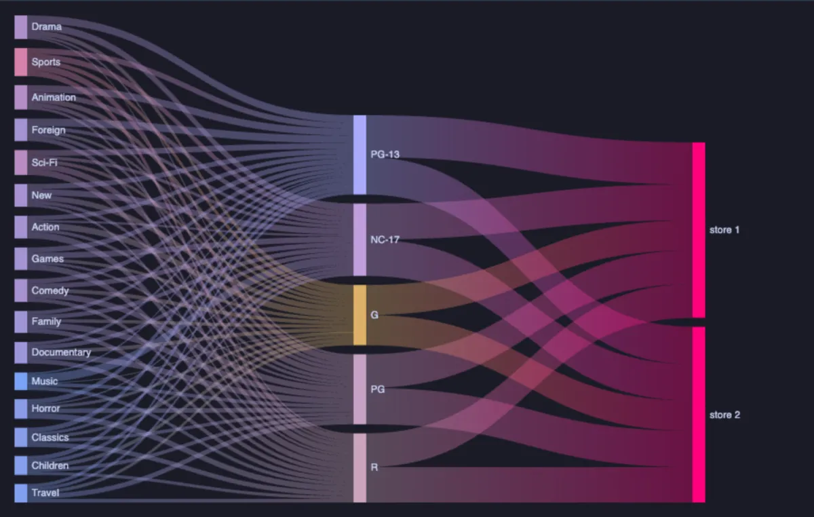
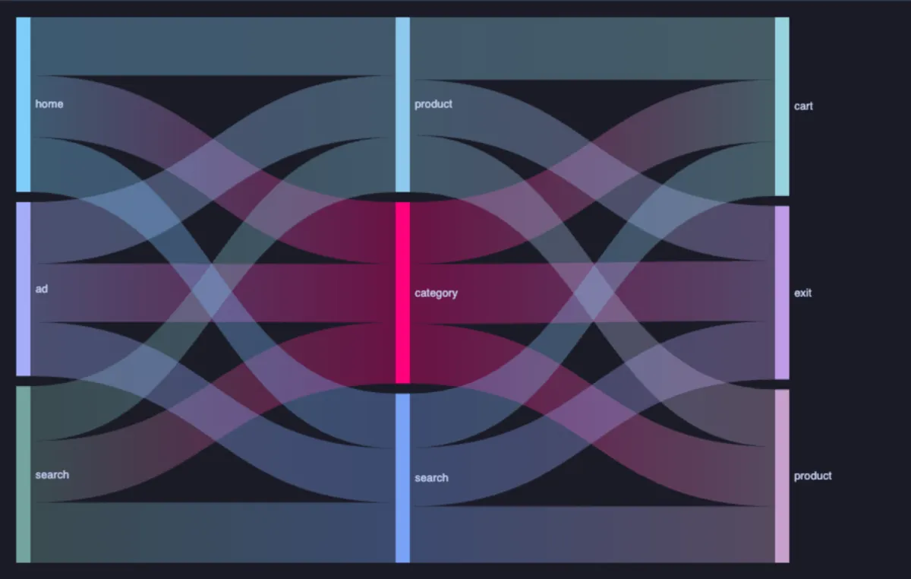

# Sankey



Flows between stages, each drawn as a band as wide as its value: where the money goes from category to rating to store, how visitors move from page to page, which users hold which connections in which state. Hover a band or a node and its flows stand out; drag a node to untangle (ECharts, through ECharts core, which installs with it).

## What it shows

A **Sankey** tab beside the grid.

- **Stages** are two or more columns in order. Every pair of neighbours is a flow: with two columns, `from` and `to`; with more, a path through each stage in turn.
- **Value** makes a band as wide as its total; without one, every row counts once.
- A name is a node **at its stage**: `search` in the first column and `search` in the second are two nodes, so a flow never loops back and a page visited twice in a journey reads as two steps.
- **Direction** turns the flow top down. The copy button in the header copies the flows as CSV.

The 3,000 widest flows are drawn; rows with no positive value are left out, and the Log says how many.

## Inputs

| Input | `@inputs` key | Default | Meaning |
|---|---|---|---|
| Stages (from, to, ...) | `path` | asked | Two or more columns, in order |
| Value | `value` | none | How wide a flow is, summed; none counts rows |
| Direction | `orient` | left to right | `left to right` or `top down` |
| Title | `title` | none | A title over the chart |
| Top rows | `top` | 100000 | How many rows the view reads |

## Examples

**Where the revenue comes from**, in the [dvdrental](https://neon.com/postgresql/postgresql-getting-started/postgresql-sample-database) sample database: from film category to rating to the store that rented it out.

```sql
-- @extension sankey open
-- @inputs path=category, rating, store, value=revenue
select c.name as category,
       f.rating::text as rating,
       'store ' || i.store_id as store,
       sum(p.amount) as revenue
from payment p
     join rental r using (rental_id)
     join inventory i using (inventory_id)
     join film f using (film_id)
     join film_category fc using (film_id)
     join category c using (category_id)
group by 1, 2, 3;
```

**Who is connected, and doing what**, on any server: database to user to state, a band per group of backends.

```sql
-- @extension sankey open
-- @inputs path=database, usename, state
select coalesce(datname, 'none') as database,
       coalesce(usename, backend_type) as usename,
       coalesce(state, 'background') as state
from pg_catalog.pg_stat_activity;
```

**Visitor journeys**, made up on the spot (any connection): five thousand visits through three steps.

```sql
-- @extension sankey open
-- @inputs path=landing, second, third, value=visitors
select landing, second, third, count(*) as visitors
from (select (array['home', 'search', 'ad'])[1 + floor(random() * 3)::int] as landing,
             (array['product', 'category', 'search'])[1 + floor(random() * 3)::int] as second,
             (array['cart', 'product', 'exit'])[1 + floor(random() * 3)::int] as third
      from generate_series(1, 5000)) v
group by 1, 2, 3;
```



## Requirements

PostgreSQL 13 or newer. Nothing on the server: the view runs in the result's sandbox. ECharts comes from `cdn.jsdelivr.net`, which has to be an allowed remote script host (the Log offers Allow host when it is not); after the first load it is kept on this machine and works offline.

## Notes

A Sankey reads a few dozen nodes well; for hundreds, group the small ones in the query (`case when ... else 'other' end`). Attach it from a script with `-- @extension sankey` above a query (add `open`, `only` or `beside` to open on the view), or from a result's own menu; `-- @inputs` answers the inputs in the file so the chart draws with no dialog. A pipeline feeds it from another step: `-- @extension group-by | sankey`.
