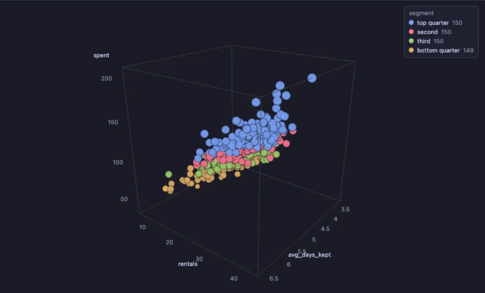
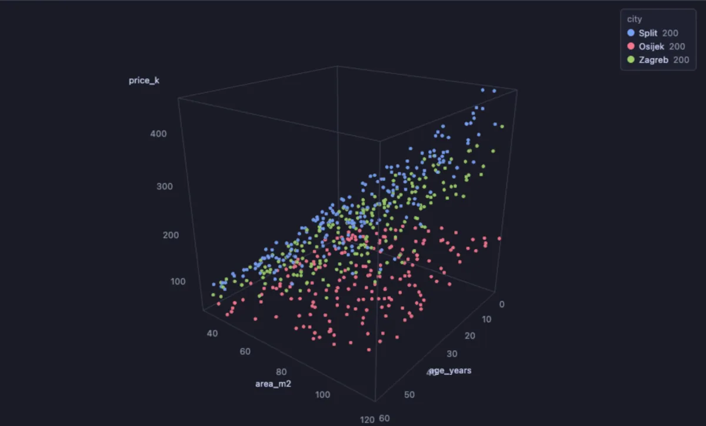

# Scatter 3D

See how three numbers go together: every row a point in a box you can turn, placed by one number along the width, one along the height and one along the depth, coloured and sized by two more.



Six hundred customers of a video rental shop: how often they rent, how much they spend and how long they keep a film, coloured by their spending quarter and sized by what they spent. Spending rises with renting (a tight band from the front left to the back right), but how long people keep a film does not move with either: the band is as wide at the front of the box as at the back.

## What it is for

- **A shop**: customers by visits, basket size and days since the last order (recency, frequency and money, the three numbers of RFM), to see the groups.
- **A database**: statements by how often they run, how long they take and how much they read from the cache (the Query landscape extension does exactly this), tables by size, reads and dead rows.
- **A team or a market**: flats by area, price and age; servers by CPU, memory and disk; students by three test scores.

A two-dimensional scatter shows how two numbers go together; this one shows the third as well, so a group that only stands apart on the third number stops hiding behind the others.

## How to read it

Each row is a point at its X, Y and Z, inside a box whose axes keep their numbers on the side that faces you as the camera turns. A category in **Colour by** gives each of its twelve most frequent values a colour of its own (the rest share a muted one), and a click on a legend entry hides or shows its points; a number colours along the theme's ramp instead. **Size by** grows each point with a number (by the square root, so the area reads in proportion). Turning the box is what shows the depth: a cloud that looks like one blob from the front can be two layers from the side.

Steering: drag with the left button to turn, with the right button (or Shift and drag) to slide, wheel to zoom; the arrow keys slide too once the chart has focus. **Spin** turns the cloud slowly, which is what makes its depth readable; a press on the chart stops it. Double-click, Home or 0, or **Reset camera**, brings the camera back. Hover a point to name it, click it to select its row in the grid.

## Try it

**Customers in three numbers**, in the [dvdrental](https://neon.com/postgresql/postgresql-getting-started/postgresql-sample-database) sample database, the picture above:

```sql
-- @extension scatter-3d open
-- @inputs x=rentals, y=spent, z=avg_days_kept, color=segment, size=spent, label=customer
select c.first_name || ' ' || c.last_name as customer,
       count(*) as rentals,
       sum(p.amount) as spent,
       round(avg(r.return_date::date - r.rental_date::date), 1) as avg_days_kept,
       case ntile(4) over (order by sum(p.amount) desc)
         when 1 then 'top quarter' when 2 then 'second' when 3 then 'third' else 'bottom quarter' end as segment
from customer c
join payment p using (customer_id)
join rental r using (rental_id)
group by c.customer_id;
```

**Flats for sale in three cities** (any connection, made up on the spot): area along the width, price up, age in depth, a colour per city. The three cities make three planes rising with the area: Split's steepest, Zagreb's just under it, Osijek's flattest; and each slopes down a little towards the older flats at the back.

```sql
-- @extension scatter-3d open
-- @inputs x=area_m2, y=price_k, z=age_years, color=city, label=listing
select 'Flat ' || g as listing,
       city,
       area_m2,
       age_years,
       round(area_m2 * per_m2 * (1 - age_years * 0.006) / 1000) as price_k
from (select g,
             (array['Zagreb', 'Split', 'Osijek'])[1 + g % 3] as city,
             (30 + random() * 90)::int as area_m2,
             (random() * 60)::int as age_years,
             (array[3200, 3800, 1500])[1 + g % 3] * (0.85 + random() * 0.3) as per_m2
      from generate_series(1, 600) g) f;
```



The same idea on your own orders is RFM segmentation: the days since the last order (recency), the number of orders (frequency) and what they came to (monetary), one point per customer; the RFM segments extension scores and names them.

## Settings

| Setting | `@inputs` key | Default | What it does |
|---|---|---|---|
| X, Y, Z | `x`, `y`, `z` | asked | The three numbers, along the width, the height and the depth |
| Colour by | `color` | none | A category (a colour each, the most frequent first) or a number (a ramp); none paints every point alike |
| Size by | `size` | none | A number a point grows with; none draws every point alike |
| Label | `label` | none | What the tooltip names a point by: a name, a query, an id |
| X, Y, Z scale | `xScale`, `yScale`, `zScale` | linear | `linear`, or `log` for a number that spans orders of magnitude (calls, bytes, durations); a log axis leaves out what is not positive |
| Top rows | `top` | 200000 | How many rows the view reads from the result, from the first one |

## Good to know

Rows missing a number on an axis are left out, and the Log says how many (on a log axis, the rows that are not positive too). All points are one draw call, so a few hundred thousand of them still turn smoothly. Labels are drawn over the canvas, so Copy as Image gives the points without their labels. The Query landscape extension (Performance) opens the server's statements in this view: calls, mean time and cache share, on log axes. Attach it from a script with `-- @extension scatter-3d` above a query (add `open`, `only` or `beside` to open on the view), or from a result's own menu; `-- @inputs` answers the settings in the file so the chart draws with no dialog.

## Requirements

PostgreSQL 13 or newer. Nothing runs on the server: the view is drawn in the result's sandbox. A GPU-capable browser: the desktop app, or a normal browser tab. three.js comes from `cdn.jsdelivr.net`, which has to be an allowed remote script host (the Log offers Allow host when it is not); after the first load it is kept on this machine and works offline. Three core installs with it.
