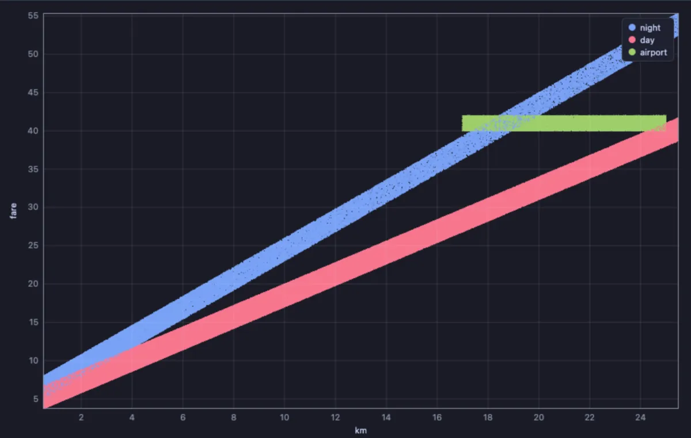
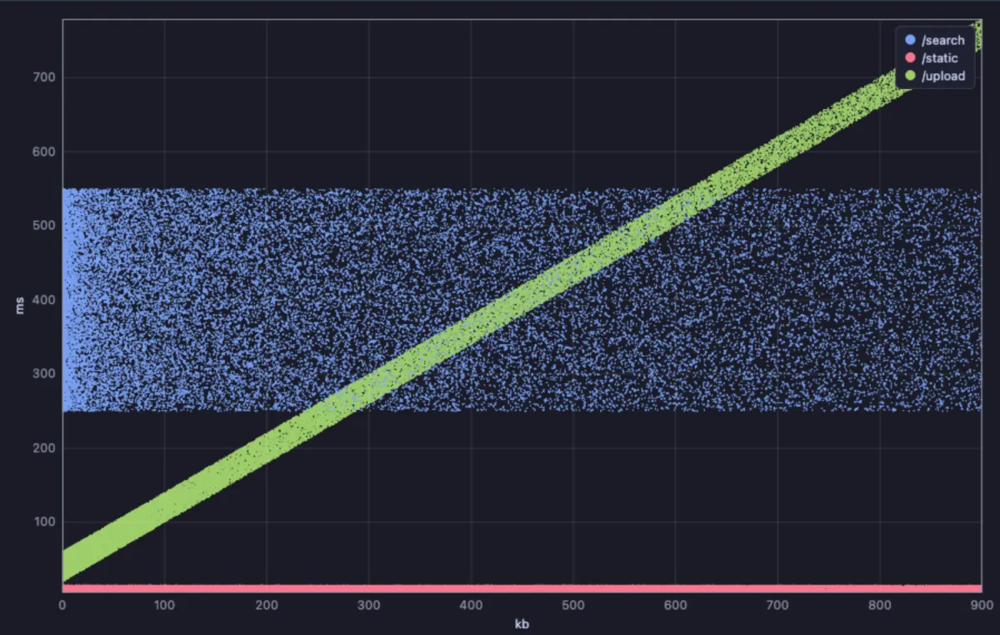

# Scatter GL

Hundreds of thousands of rows as points, one per row, drawn by the graphics card: two numbers against each other, the shape of the whole cloud at once, and every single row still one hover away.



Three hundred thousand taxi trips, distance against fare. At this size a table says nothing, but the cloud says it all: two fans rising with the distance (the day tariff and the steeper night tariff), and a flat band of trips at 40 whatever the distance, the airport's fixed price. Zoom into any corner and hover a point for its trip.

## What it is for

- **The shape of a big table.** Price against size, duration against distance, age against income: hundreds of thousands of rows where a sample would hide the rare cases.
- **Finding the odd ones.** Points far from the cloud are the rows to look at: a fare of zero on a long trip, a response of ten seconds for a tiny request.
- **Seeing groups.** Colour the points by a category (a tariff, an endpoint, a country) and the groups separate; colour by a number and it runs along a ramp.

Pick Scatter GL when there are too many points for any other chart: it is written for the graphics card and pans and zooms a million points smoothly. For a few hundred points with other chart types around them, ECharts' scatter is enough; for points in 3D, Scatter 3D.

## How to read it

Each row is one point at its **X** and **Y**. Wheel to zoom around the cursor, drag to pan, double-click to see everything again. Hover a point for its row; click it to select that row in the grid. With **Colour** a category, each of the twelve most frequent values gets a colour and the legend names them; with a number, the points run from blue through amber to red.

## Try it

**Three hundred thousand taxi trips** (any connection, made up on the spot), the picture above:

```sql
-- @extension scatter-gl open
-- @inputs x=km, y=fare, color=tariff, size=2
select round(d::numeric, 2) as km,
       round((case tariff when 'airport' then 40 + random() * 2
                          when 'night' then 4 + d * 1.9 + random() * 3
                          else 3 + d * 1.4 + random() * 3 end)::numeric, 2) as fare,
       tariff
from (select tariff,
             case when tariff = 'airport' then 17 + random() * 8 else 0.5 + random() ^ 2 * 25 end as d
      from (select case when r < 0.08 then 'airport' when r < 0.3 then 'night' else 'day' end as tariff
            from (select random() as r from generate_series(1, 300000)) s) k) t;
```

**A hundred thousand API requests** (any connection): response size against time taken, coloured by endpoint. Static files are fast whatever their size, uploads grow with their size, and search is slow from the first byte.

```sql
-- @extension scatter-gl open
-- @inputs x=kb, y=ms, color=endpoint, size=2
select endpoint,
       round(kb::numeric, 1) as kb,
       round((case endpoint when '/static' then 5 + random() * 10
                            when '/upload' then 20 + kb * 0.8 + random() * 40
                            else 250 + random() * 300 end)::numeric, 1) as ms
from (select (array['/static', '/upload', '/search'])[1 + floor(random() * 3)::int] as endpoint,
             random() ^ 2 * 900 as kb
      from generate_series(1, 100000)) r;
```



## Settings

| Setting | `@inputs` key | Default | What it does |
|---|---|---|---|
| X | `x` | asked | The number across |
| Y | `y` | asked | The number up |
| Colour | `color` | none | A category (a colour each, up to twelve) or a number (a ramp) |
| Point size (px) | `size` | 3 | How big each point is, in pixels; smaller reads better for very many points |

## Good to know

Hand written WebGL, no library and nothing to fetch: one vertex per row goes to the graphics card once, so a million points pan and zoom at full frame rate. The whole result is paged in, up to a million rows. Clicking a point selects its row in the result grid. Attach it from a script with `-- @extension scatter-gl` above a query (add `open`, `only` or `beside` to open on the view), or from a result's own menu; `-- @inputs` answers the settings in the file so the chart draws with no dialog.

## Requirements

PostgreSQL 13 or newer. Nothing on the server: the view runs in the result's sandbox. A GPU-capable browser: the desktop app, or a normal browser tab.
