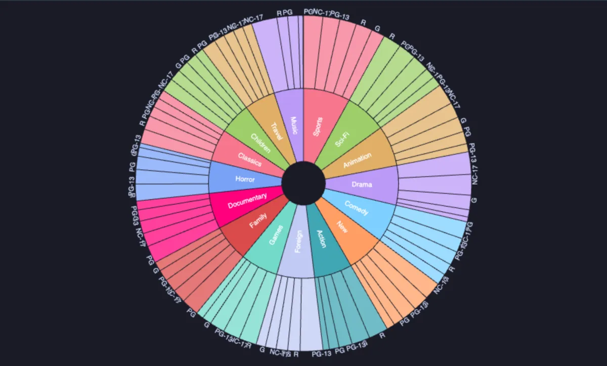
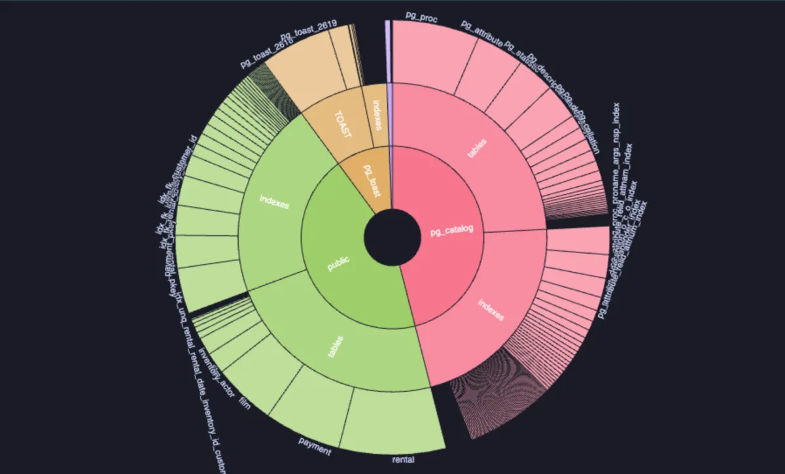

# Sunburst



Rings of a hierarchy: the innermost level in the middle, each level a ring around it, and every slice as wide as its share of the value. Hover a slice for its path and its share of the whole; click one to zoom into it, and the centre to come back out (ECharts, through ECharts core, which installs with it).

## What it shows

A **Sunburst** tab beside the grid.

- **Levels** are one column per level of the hierarchy, the innermost ring first: region, country, city.
- **Value** makes a slice as wide as its total (or its mean, or its row count, by **Fold**); without one, every row counts once.
- Slices are sorted largest first within their parent. The outermost ring carries its labels outside, where there is room.
- **Copy data** copies the slices as CSV, one row per full path.

A treemap shows the same data as nested rectangles, better for comparing sizes; a sunburst shows the levels better, and where a share comes from.

## Inputs

| Input | `@inputs` key | Default | Meaning |
|---|---|---|---|
| Levels (inner first) | `path` | asked | One column per level, the innermost first |
| Value | `value` | none | The number a slice is as wide as |
| Fold | `agg` | sum | `sum`, `count` or `mean` |
| Title | `title` | none | A title over the chart |
| Top rows | `top` | 1000000 | How many rows the view reads |

## Examples

**Where the space goes**, on any database (its system catalogs included): schema, then the kind of relation, then each one by its size on disk.

```sql
-- @extension sunburst open
-- @inputs path=schema, kind, name, value=bytes
select n.nspname as schema,
       case c.relkind when 'r' then 'tables' when 'i' then 'indexes' when 'm' then 'materialized views'
                      when 't' then 'TOAST' else 'other' end as kind,
       c.relname as name,
       pg_catalog.pg_relation_size(c.oid) as bytes
from pg_catalog.pg_class c
     join pg_catalog.pg_namespace n on n.oid = c.relnamespace
where c.relkind in ('r', 'i', 'm', 't');
```



**Revenue by category and rating**, in the [dvdrental](https://neon.com/postgresql/postgresql-getting-started/postgresql-sample-database) sample database.

```sql
-- @extension sunburst open
-- @inputs path=category, rating, value=amount
select c.name as category, f.rating::text as rating, p.amount
from payment p
     join rental r using (rental_id)
     join inventory i using (inventory_id)
     join film f using (film_id)
     join film_category fc using (film_id)
     join category c using (category_id);
```

**Sales by region, country and product**, made up on the spot (any connection).

```sql
-- @extension sunburst open
-- @inputs path=region, country, product, value=sales
select case when g % 6 < 2 then 'Europe' when g % 6 < 4 then 'Americas' else 'Asia' end as region,
       (array['Croatia', 'Germany', 'Brazil', 'Canada', 'Japan', 'India'])[1 + g % 6] as country,
       (array['basic', 'pro', 'team'])[1 + g % 5 / 2] as product,
       round((random() * 1000)::numeric, 2) as sales
from generate_series(1, 3000) g;
```

## Requirements

PostgreSQL 13 or newer. Nothing on the server: the view runs in the result's sandbox. ECharts comes from `cdn.jsdelivr.net`, which has to be an allowed remote script host (the Log offers Allow host when it is not); after the first load it is kept on this machine and works offline.

## Notes

Slices with a zero or negative value are left out (a slice cannot be negative), and the Log says how many. Attach it from a script with `-- @extension sunburst` above a query (add `open`, `only` or `beside` to open on the view), or from a result's own menu; `-- @inputs` answers the inputs in the file so the chart draws with no dialog.
