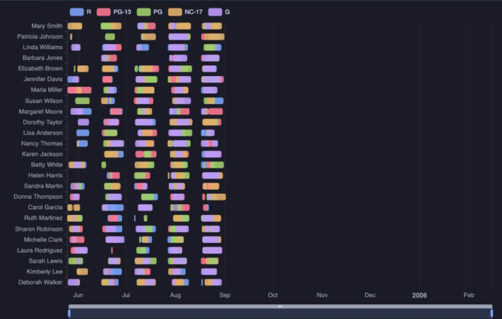
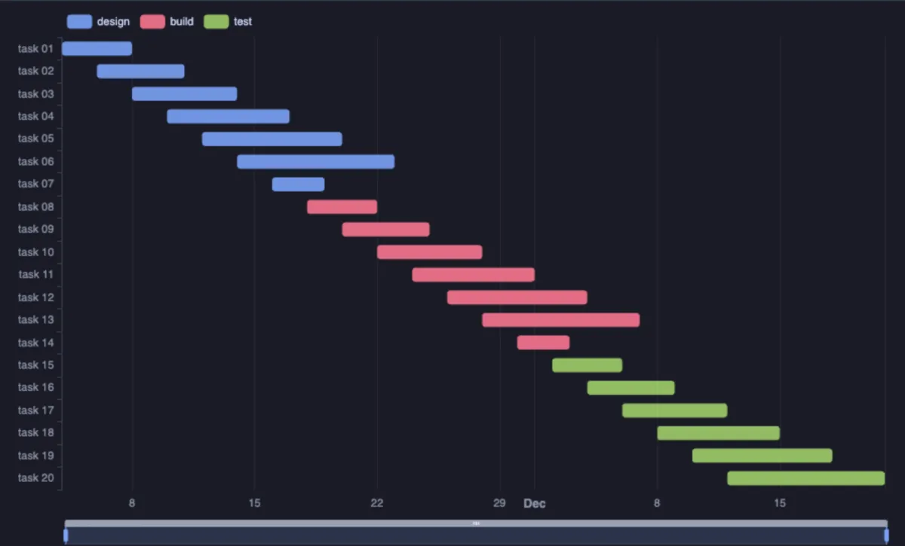

# Timeline



A Gantt timeline: every row a bar from its start to its end, on a lane per task, job, customer or backend, coloured by a category. Zoom into time with the slider or the wheel, scroll through many lanes, hover a bar for its times and how long it took (ECharts, through ECharts core, which installs with it).

## What it shows

A **Timeline** tab beside the grid.

- **Lane** puts every bar of the same value on one line, in the order the rows come, so the query's `ORDER BY` orders the lanes.
- A bar runs from **Start** to **End**. A row with no end (still running, or an event at one moment) is a short mark at its start.
- **Colour by** gives each of the twelve most frequent categories a colour, toggled from the legend.
- With more than thirty lanes, a scroll bar on the right moves through them: the wheel scrolls the lanes, and a pinch (or Ctrl and the wheel) zooms time. With fewer, the wheel zooms time.
- Times read in the clock the server wrote them in, never shifted to this machine's zone. The copy button in the header copies the bars as CSV.

## Inputs

| Input | `@inputs` key | Default | Meaning |
|---|---|---|---|
| Lane | `label` | asked | One lane per distinct value |
| Start | `start` | asked | When a bar begins |
| End | `end` | none | When it ends; none draws marks |
| Colour by | `group` | none | A category |
| Title | `title` | none | A title over the chart |
| Top rows | `top` | 20000 | How many rows the view reads |

## Examples

**What every backend is doing, and since when**, on any server: a lane per backend, a bar from the start of its statement to now (or to when it went idle), coloured by state.

```sql
-- @extension timeline open
-- @inputs label=backend, start=started, end=until, group=state
select coalesce(usename, backend_type) || ' ' || pid as backend,
       coalesce(query_start, backend_start) as started,
       case when state = 'active' then now() else coalesce(state_change, now()) end as until,
       coalesce(state, 'background') as state
from pg_catalog.pg_stat_activity
order by backend_start;
```

**Who had which film, when**, in the [dvdrental](https://neon.com/postgresql/postgresql-getting-started/postgresql-sample-database) sample database: the rentals of twenty-five customers, each bar a rental from the day it went out to the day it came back, coloured by the film's rating.

```sql
-- @extension timeline open
-- @inputs label=customer, start=rental_date, end=return_date, group=rating
select c.first_name || ' ' || c.last_name as customer,
       r.rental_date,
       r.return_date,
       f.rating::text as rating
from rental r
     join customer c using (customer_id)
     join inventory i using (inventory_id)
     join film f using (film_id)
where c.customer_id <= 25
order by c.customer_id, r.rental_date;
```

**A project plan**, made up on the spot (any connection): twenty tasks in three phases.

```sql
-- @extension timeline open
-- @inputs label=task, start=starts, end=ends, group=phase
select 'task ' || lpad(g::text, 2, '0') as task,
       date '2026-11-02' + g * 2 as starts,
       date '2026-11-02' + g * 2 + 3 + g % 7 as ends,
       (array['design', 'build', 'test'])[1 + (g - 1) / 7] as phase
from generate_series(1, 20) g
order by g;
```



## Requirements

PostgreSQL 13 or newer. Nothing on the server: the view runs in the result's sandbox. ECharts comes from `cdn.jsdelivr.net`, which has to be an allowed remote script host (the Log offers Allow host when it is not); after the first load it is kept on this machine and works offline.

## Notes

A row with no readable start is left out, and the Log says how many. Attach it from a script with `-- @extension timeline` above a query (add `open`, `only` or `beside` to open on the view), or from a result's own menu; `-- @inputs` answers the inputs in the file so the timeline draws with no dialog.
