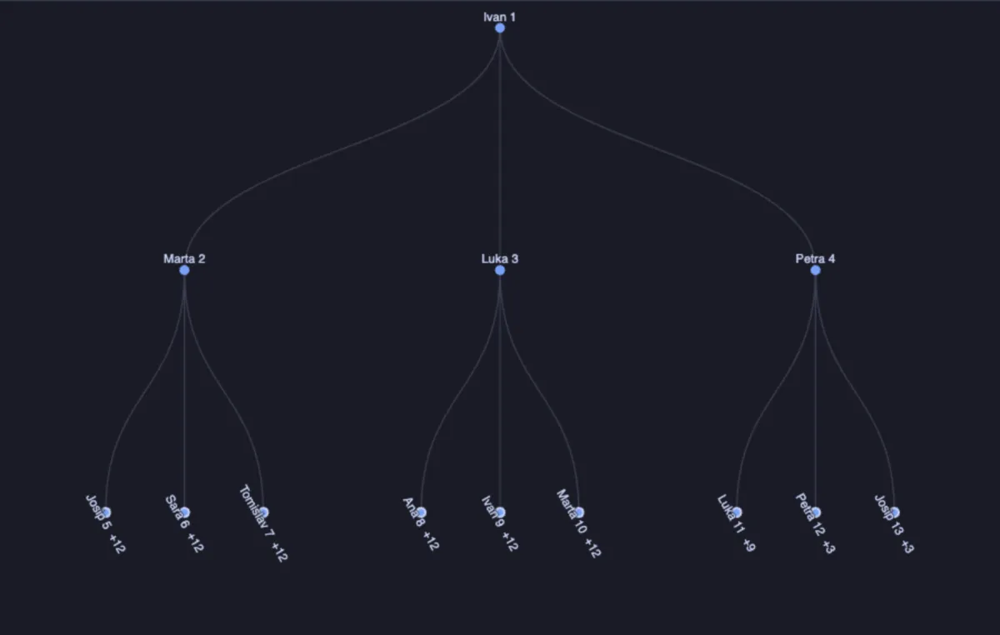
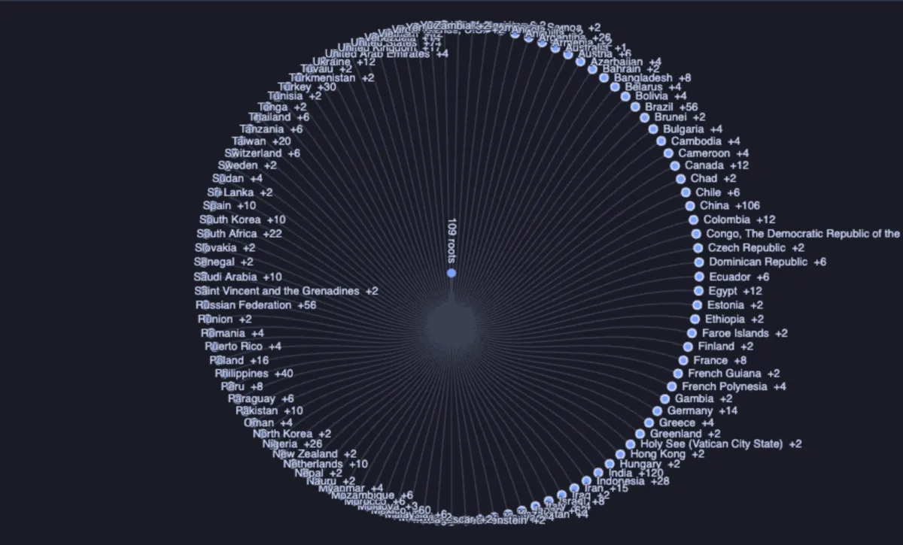

# Tree



A hierarchy as a tree: rows with an id and the id of their parent, drawn left to right like a file tree, top down like an org chart, or radial with the root in the middle. A click folds or unfolds a node, hovering one lights up everything below it, and the wheel and a drag zoom and pan (ECharts, through ECharts core, which installs with it).

## What it shows

A **Tree** tab beside the grid.

- Every row is a node: its **Id**, and in **Parent** the id of the node above it. A row with no parent is a root; several roots hang under one shared root.
- The first **Open levels** show unfolded, the rest fold, and a folded node says how many it holds (`+42`). Hover any node for its children and its whole count.
- **Size by** grows a node with a number; **Label** names it.
- A parent the result does not hold, or a loop of parents, makes the row a root, and the Log says how many. **Copy data** copies the tree as `id, parent, label, depth` in tree order.

This is what a recursive query (`with recursive`) produces, and what a table with a `parent_id` column holds.

## Inputs

| Input | `@inputs` key | Default | Meaning |
|---|---|---|---|
| Id | `id` | asked | What a row is called by its children |
| Parent | `link` | asked | The id of the row above; empty for a root |
| Label | `label` | none | What a node is called |
| Size by | `size` | none | A number a node grows with |
| Layout | `layout` | left to right | `left to right`, `top down` or `radial` |
| Open levels | `depth` | 3 | How many levels show unfolded at first |
| Title | `title` | none | A title over the chart |
| Top rows | `top` | 20000 | How many rows the view reads |

## Examples

**An org chart**, made up on the spot (any connection): a hundred people, every one reporting to someone a level up, top down.

```sql
-- @extension tree open
-- @inputs id=id, link=manager, label=name, layout=top down, depth=3
select g as id,
       case when g > 1 then (g + 1) / 3 end as manager,
       (array['Ana', 'Ivan', 'Marta', 'Luka', 'Petra', 'Josip', 'Sara', 'Tomislav'])[1 + g % 8] || ' ' || g as name
from generate_series(1, 100) g;
```

**Countries, cities and customers**, in the [dvdrental](https://neon.com/postgresql/postgresql-getting-started/postgresql-sample-database) sample database, radial: three kinds of rows joined into one hierarchy with `union all`. Click a country to open its cities.

```sql
-- @extension tree open
-- @inputs id=id, link=parent, label=label, layout=radial, depth=1
select 'country ' || country_id as id, null as parent, country as label from country
union all
select 'city ' || city_id, 'country ' || country_id, city from city
union all
select 'customer ' || c.customer_id, 'city ' || a.city_id, c.first_name || ' ' || c.last_name
from customer c join address a using (address_id);
```



**Partitions and inherited tables**, on any database: every table that has children, with the children under it.

```sql
-- @extension tree open
-- @inputs id=child, link=parent, size=bytes
select c.oid::regclass::text as child,
       h.inhparent::regclass::text as parent,
       pg_catalog.pg_total_relation_size(c.oid) as bytes
from pg_catalog.pg_class c
     left join pg_catalog.pg_inherits h on h.inhrelid = c.oid
where c.relkind in ('r', 'p')
  and (h.inhparent is not null or exists (select 1 from pg_catalog.pg_inherits x where x.inhparent = c.oid));
```

## Requirements

PostgreSQL 13 or newer. Nothing on the server: the view runs in the result's sandbox. ECharts comes from `cdn.jsdelivr.net`, which has to be an allowed remote script host (the Log offers Allow host when it is not); after the first load it is kept on this machine and works offline.

## Notes

Up to 20,000 nodes are read; a tree that large reads best folded, with **Open levels** at 1 or 2. Attach it from a script with `-- @extension tree` above a query (add `open`, `only` or `beside` to open on the view), or from a result's own menu; `-- @inputs` answers the inputs in the file so the tree draws with no dialog. The same rows read as a web in the Network graph extension.
