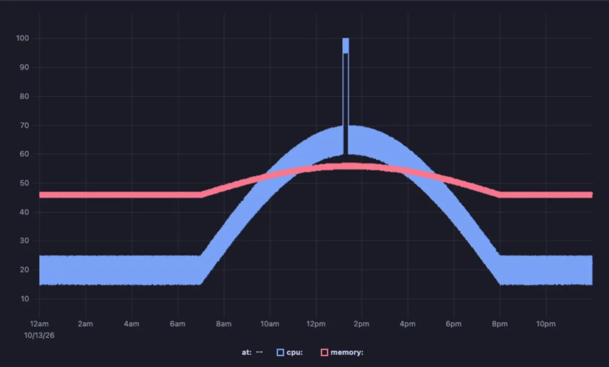
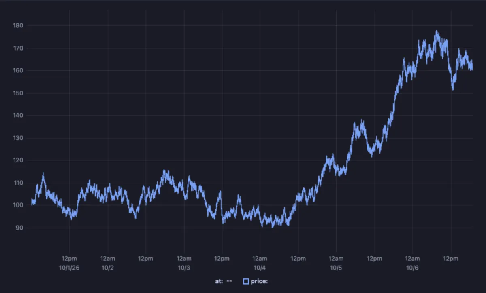

# μPlot

The fastest line chart there is: hundreds of thousands of points draw in a blink, drag across the chart to zoom into a stretch, and a live legend reads every line wherever the cursor is.



A day of a web server, second by second: 86,400 points per line, drawn at once. The busy daytime hump is plain, and so is the short spike just after lunch; drag across it to see it second by second, double-click to come back.

## What it is for

- **A very long series, now.** Metrics every second, sensor readings, prices by the tick: μPlot draws them faster than any other chart here, and zooms just as fast.
- **Reading exact values across lines.** The legend under the chart shows every line's value at the cursor, live, as you move.
- **Hiding a line to see the others.** Click a line's name in the legend to hide it, click again to bring it back.

Pick μPlot for lines and nothing else, when the result is long. For bars, areas, points or pies pick ECharts; for a chart to show someone, Plot chart; for a cloud of points, Scatter GL.

## How to read it

The horizontal axis is **X**: a timestamp makes a time axis, a number a number axis, and without one (or with a text column) the lines run along the row order. Each column in **Series** is a line. Drag across the chart to zoom to that stretch; double-click to reset. The legend under the chart shows the values at the cursor.

## Try it

**A day of a server, second by second** (any connection, made up on the spot), the picture above:

```sql
-- @extension uplot open
-- @inputs x=at, series=cpu, memory
select t as at,
       round(least(100, 15 + 45 * greatest(0, sin(pi() * (extract(epoch from t::time) / 3600 - 7) / 13)) + random() * 10
             + case when t between '2026-10-13 13:10' and '2026-10-13 13:25' then 35 else 0 end)::numeric, 1) as cpu,
       round((45 + 10 * greatest(0, sin(pi() * (extract(epoch from t::time) / 3600 - 7) / 13)) + random() * 2)::numeric, 1) as memory
from generate_series(timestamp '2026-10-13', timestamp '2026-10-13 23:59:59', interval '1 second') t;
```

**Half a million prices** (any connection): a random walk, a price every second for almost six days, drawn in a moment.

```sql
-- @extension uplot open
-- @inputs x=at, series=price
select timestamp '2026-10-01' + g * interval '1 second' as at,
       round((100 * exp(sum((random() - 0.5) * 0.002) over (order by g)))::numeric, 4) as price
from generate_series(1, 500000) g;
```



## Settings

| Setting | `@inputs` key | Default | What it does |
|---|---|---|---|
| X (a timestamp, a number, or the row order) | `x` | asked | The horizontal axis: a timestamp makes a time axis, a number a number axis; none (or text) uses the row order |
| Series (Y) | `series` | asked | The lines to draw, one colour each, as a comma list |
| Palette | `palette` | Vivid | `Vivid`, `Cool`, `Warm` or `Mono` |
| Title | `title` | none | A title over the chart |

## Good to know

μPlot is a 45 KB canvas library built for exactly one thing: a lot of points, fast. The whole result is paged in, up to a million rows; rows out of order are sorted by X. Its stylesheet is inlined in the extension, since the sandbox cannot fetch it. Put `-- @extension uplot open` above the query to land on the chart after Run (`only` hides the grid, `beside` splits the two), or attach it from the result's menu; `-- @inputs` answers the settings in the file so nothing asks.

## Requirements

PostgreSQL 13 or newer. The view draws in the result's sandbox; the server is not involved. Fetches μPlot from `cdn.jsdelivr.net` at run time: allow the host once (the page offers it) or the view stays blank.
