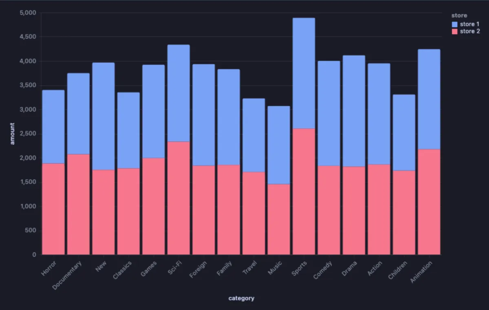
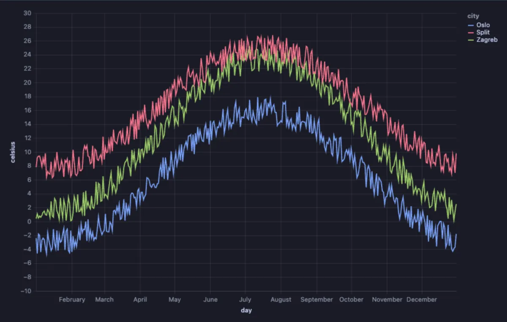
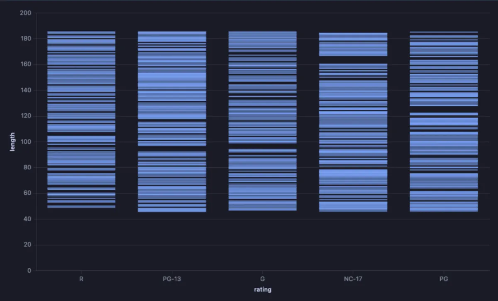

# Vega-Lite

Point it at raw rows and it adds them up for you: one bar per category with the rows summed (or averaged, or counted), a line per group over time, or every single value as a tick, without writing a GROUP BY.



Revenue per film category, each bar split between the two stores, drawn straight from the 14,596 payment rows: the chart did the summing. Sports leads, and in most categories the two stores earn about the same.

## What it is for

- **A quick look at raw data.** Orders, payments, events as they are in the table: pick the column to group by and the number to add up, and the chart folds them.
- **Groups side by side.** **Colour** splits every bar (or draws a line per value): sales per region per month, tickets per team per week.
- **Every value at once.** The `tick` mark draws one thin line per row, so you see where the values cluster per category without averaging them away.

Pick Vega-Lite when the result is not summed up yet. For a result already shaped as a few columns of numbers, Chart.js or Plot chart; for a long series with zoom, ECharts.

## How to read it

**X** is what goes across: a category (bars by default), a date (a line) or a number (points). **Y** is the number. When several rows share an X, **Aggregate Y** folds them: `auto` takes the mean when a category repeats, or pick `sum`, `count`, `median`, `min` or `max`. **Colour** splits by another column, with a legend. Hover any mark for its values.

## Try it

**Revenue per category and store, from the raw payments**, in the [dvdrental](https://neon.com/postgresql/postgresql-getting-started/postgresql-sample-database) sample database, the picture above:

```sql
-- @extension vega-lite open
-- @inputs mark=bar, x=category, y=amount, agg=sum, color=store
select c.name as category, 'store ' || i.store_id as store, p.amount
from payment p
     join rental r using (rental_id)
     join inventory i using (inventory_id)
     join film_category fc using (film_id)
     join category c using (category_id);
```

**A year of temperatures in three cities** (any connection, made up on the spot): a line per city, the seasons and the coast's milder swing plain to see.

```sql
-- @extension vega-lite open
-- @inputs mark=line, x=day, y=celsius, color=city
select d::date as day, city,
       round((avg_c + swing * -cos(2 * pi() * (extract(doy from d) - 15) / 365) + random() * 4 - 2)::numeric, 1) as celsius
from generate_series(date '2026-01-01', date '2026-12-31', interval '1 day') d,
     (values ('Zagreb', 12.5, 11.0), ('Split', 16.5, 8.5), ('Oslo', 6.5, 9.5)) as c(city, avg_c, swing);
```



**Every film's length, by rating**, in dvdrental: one tick per film, so you see the spread, not just an average.

```sql
-- @extension vega-lite open
-- @inputs mark=tick, x=rating, y=length, agg=none
select rating::text as rating, length from film;
```



## Settings

| Setting | `@inputs` key | Default | What it does |
|---|---|---|---|
| Mark | `mark` | auto | `auto` (bars for a category, a line over time, points otherwise), `bar`, `line`, `area`, `point` or `tick` |
| X | `x` | asked | What goes across: a category, a date or a number |
| Y | `y` | asked | The number up |
| Colour | `color` | none | A column whose values split the marks, one colour each |
| Aggregate Y | `agg` | auto | How rows sharing an X fold into one: `auto` (the mean when a category repeats), `none`, `sum`, `mean`, `median`, `count`, `min` or `max` |
| Title | `title` | none | A title over the chart |
| Top rows | `top` | 20000 | How many rows the view reads, from the first one; the rest are left out |

## Good to know

The chart fits the pane, follows the theme, and draws on a canvas past a few thousand rows. Category labels turn when there are more than twelve. The Vega runtime loads the classic-script way, three scripts once, cached after. `-- @extension vega-lite` above a query attaches it; `open`, `only` or `beside` after the id says how the tab opens, and `-- @inputs` in the file draws it without the dialog.

## Requirements

PostgreSQL 13 or newer. Runs entirely in the result's sandbox, with no server side. Loads the Vega runtime from `cdn.jsdelivr.net` at run time; the host must be on the allowed remote script hosts (the extension's page offers Allow).
