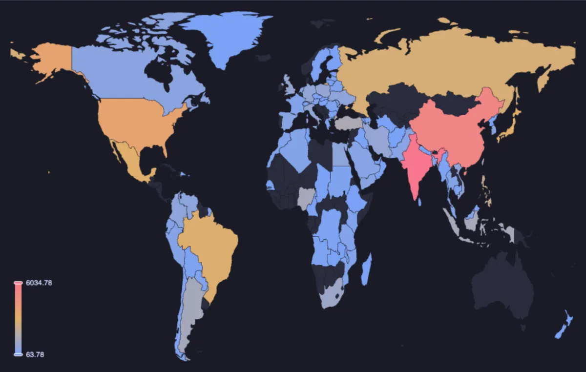
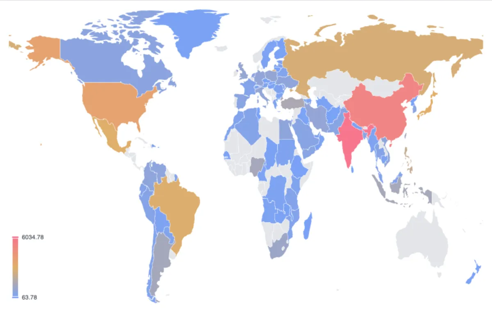
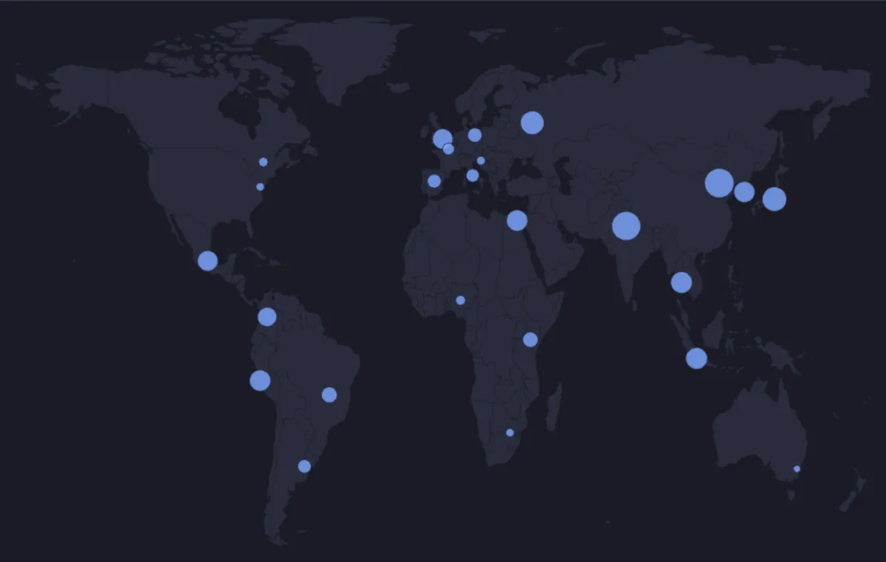

# World map



Countries coloured by a value, and points placed by latitude and longitude, on a world map drawn entirely on this machine: no PostGIS, no tile server, no network once ECharts is loaded. Wheel to zoom, drag to pan, hover a country or a point to read it (ECharts, through ECharts core, which installs with it).

## What it shows

A **World map** tab beside the grid.

- **Countries** come from a **Country** column holding a name or an ISO code: `Croatia`, `HR`, `HRV` and `191` are the same country. Names are matched with their usual spellings (`Russian Federation` and `Russia`, `Viet Nam` and `Vietnam`, `Congo, The Democratic Republic of the`), accents, case and punctuation ignored. A country takes its colour from **Value**, folded over its rows (sum, mean, count, max, min or median); without a value, from how many rows name it. The handle on the colour scale narrows the range shown.
- **Points** come from a **Latitude** and a **Longitude** column, one per row, sized by **Point size** and named by **Point label** in their tooltip. Countries and points can be drawn together.
- Names the map does not recognise, and countries too small to draw at this scale (Andorra, Singapore, the smaller islands), are listed in the Log, so nothing goes missing silently. An ISO code always works.
- **Copy data** copies the countries with their folded values (or the points) as CSV.

The shapes are Natural Earth's countries at 1:110m, which is the right detail for a world view; for streets and buildings, the PostGIS map extension draws geometry over a real basemap.

## Inputs

| Input | `@inputs` key | Default | Meaning |
|---|---|---|---|
| Country | `region` | none | A country's name or ISO code |
| Value | `value` | none | The number a country is coloured by; none counts rows |
| Fold | `agg` | sum | `sum`, `mean`, `count`, `max`, `min` or `median` |
| Latitude, Longitude | `lat`, `lon` | none | A point per row |
| Point size | `size` | none | A number a point grows with |
| Point label | `label` | none | What a point is called |
| Colour ramp | `ramp` | ramp | `ramp` (blue, amber, red) or `alarm` (green, amber, red) |
| Title | `title` | none | A title over the map |
| Top rows | `top` | 200000 | How many rows the view reads |

## Examples

**Revenue by country**, in the [dvdrental](https://neon.com/postgresql/postgresql-getting-started/postgresql-sample-database) sample database: what the customers of each country paid.

```sql
-- @extension world-map open
-- @inputs region=country, value=revenue
select co.country, count(distinct c.customer_id) as customers, sum(p.amount) as revenue
from payment p
     join customer c using (customer_id)
     join address a using (address_id)
     join city ci using (city_id)
     join country co using (country_id)
group by co.country;
```

The same map in the light theme, its colours following the app's:



**Capital cities as points** (any connection): placed by their coordinates and sized by their population, in millions, approximately.

```sql
-- @extension world-map open
-- @inputs lat=lat, lon=lon, size=population, label=city
select * from (values
  ('Zagreb', 45.815, 15.982, 0.8), ('London', 51.507, -0.128, 9.0), ('Paris', 48.857, 2.352, 2.1),
  ('Berlin', 52.520, 13.405, 3.7), ('Madrid', 40.417, -3.704, 3.3), ('Rome', 41.903, 12.496, 2.8),
  ('Moscow', 55.756, 37.617, 13.0), ('Cairo', 30.044, 31.236, 10.0), ('Nairobi', -1.292, 36.822, 4.4),
  ('Abuja', 9.076, 7.398, 1.2), ('Pretoria', -25.747, 28.229, 0.7), ('New Delhi', 28.614, 77.209, 21.0),
  ('Beijing', 39.904, 116.407, 21.5), ('Tokyo', 35.676, 139.650, 14.0), ('Seoul', 37.567, 126.978, 9.7),
  ('Jakarta', -6.208, 106.846, 10.6), ('Bangkok', 13.756, 100.502, 10.5), ('Canberra', -35.281, 149.130, 0.4),
  ('Washington', 38.907, -77.037, 0.7), ('Ottawa', 45.424, -75.699, 1.0), ('Mexico City', 19.433, -99.133, 9.2),
  ('Bogota', 4.711, -74.072, 7.9), ('Lima', -12.046, -77.043, 10.0), ('Brasilia', -15.794, -47.882, 4.8),
  ('Buenos Aires', -34.604, -58.382, 3.1)
) as capitals(city, lat, lon, population);
```



**Countries by ISO code** (any connection): the European Union's members by population, in millions, approximately. Zoom into Europe with the wheel.

```sql
-- @extension world-map open
-- @inputs region=code, value=population
select * from (values
  ('AT', 9.1), ('BE', 11.8), ('BG', 6.4), ('HR', 3.9), ('CY', 0.9), ('CZ', 10.9), ('DK', 6.0),
  ('EE', 1.4), ('FI', 5.6), ('FR', 68.4), ('DE', 84.4), ('GR', 10.4), ('HU', 9.6), ('IE', 5.3),
  ('IT', 59.0), ('LV', 1.9), ('LT', 2.9), ('LU', 0.7), ('MT', 0.6), ('NL', 17.9), ('PL', 36.6),
  ('PT', 10.6), ('RO', 19.1), ('SK', 5.4), ('SI', 2.1), ('ES', 48.6), ('SE', 10.6)
) as members(code, population);
```

## Requirements

PostgreSQL 13 or newer. Nothing on the server: the view runs in the result's sandbox, and the countries' shapes ship with the extension. ECharts comes from `cdn.jsdelivr.net`, which has to be an allowed remote script host (the Log offers Allow host when it is not); after the first load it is kept on this machine and works offline.

## Notes

The country shapes are [Natural Earth](https://www.naturalearthdata.com/)'s (public domain) through [world-atlas](https://github.com/topojson/world-atlas) 2.0.2 (ISC licence, Copyright 2013-2019 Michael Bostock); the ISO codes and English names are from [i18n-iso-countries](https://github.com/michaelwittig/node-i18n-iso-countries) 7.14.0 (MIT licence, Copyright 2016 widdix GmbH), in `lib/world.js`. Borders are drawn as Natural Earth draws them and say nothing about any dispute. Antarctica is left out. Attach it from a script with `-- @extension world-map` above a query (add `open`, `only` or `beside` to open on the view), or from a result's own menu; `-- @inputs` answers the inputs in the file so the map draws with no dialog.
