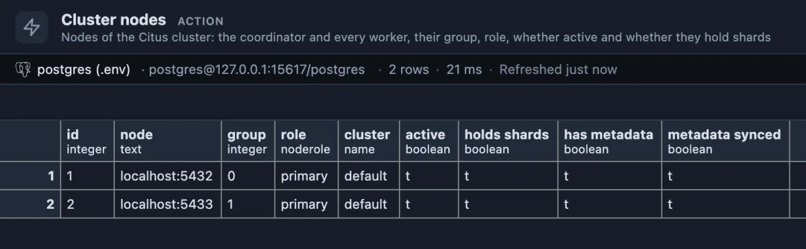

# Cluster nodes

The servers that make up a Citus cluster, as the coordinator sees them: which is which, whether each is up and whether it holds data.



A small test cluster: the coordinator on port 5432 (group 0), which here holds shards too, and one worker on port 5433 (group 1). Both are active, may hold shards and carry the cluster's metadata, in sync.

**Citus** is a PostgreSQL extension that spreads tables across several PostgreSQL servers, called **nodes**. You connect to one of them, the **coordinator**; it knows where every piece of every table lives and sends each query to the nodes that hold the rows. The other nodes are **workers**. This extension lists them.

## When to use it

- **You are handed a Citus cluster** and want to know its shape: how many workers, which one you are connected to.
- **Queries fail with connection errors to a worker**: check that the node is listed, `active` and with its metadata synced.
- **You added a worker** and want to see it before moving shards to it (Rebalance plan shows what would move).

## How to read it

One row per node, by group then id:

| Column | Meaning |
|---|---|
| id, node | The node's number and its address, `host:port`. |
| group | Its group. Group 0 is the coordinator; a worker and its standby copies share a group. |
| role | `primary` (takes reads and writes) or `secondary` (a standby copy). |
| cluster | The cluster's name, `default` unless several are defined. |
| active | Whether Citus sends queries to it. `f` means it has been disabled. |
| holds shards | Whether Citus may place shards on it. On a production cluster the coordinator usually holds none. |
| has metadata, metadata synced | Whether the node keeps a copy of the cluster's bookkeeping (so queries can start there too), and whether that copy is current. |

What to look for: a node with `active` `f`, or `metadata synced` `f` for more than a moment (a node Citus could not reach while it changed something). A worker you expected that is missing has not been added (`citus_add_node`).

## Try it

Run it from the Extensions side tab: its row's **Run**, on a connection to the coordinator.

On a test machine, the official Docker image runs a one-node Citus, coordinator and data in one server:

```sh
docker run -d --name citus -p 5500:5432 -e POSTGRES_PASSWORD=pass citusdata/citus:14-pg17
```

Cluster nodes then shows one row: the coordinator, group 0, holding shards.

## Good to know

Reads only. It reads `pg_dist_node`, Citus's own catalog table, which lives in `pg_catalog` wherever Citus is installed, so it is qualified. Cluster nodes describes the cluster's plan, not a live check: a node that went down still reads `active` until someone disables it.

## Requirements

PostgreSQL 13 or newer with the `citus` extension; without it the run answers with the server's own error. Run it on the coordinator.
