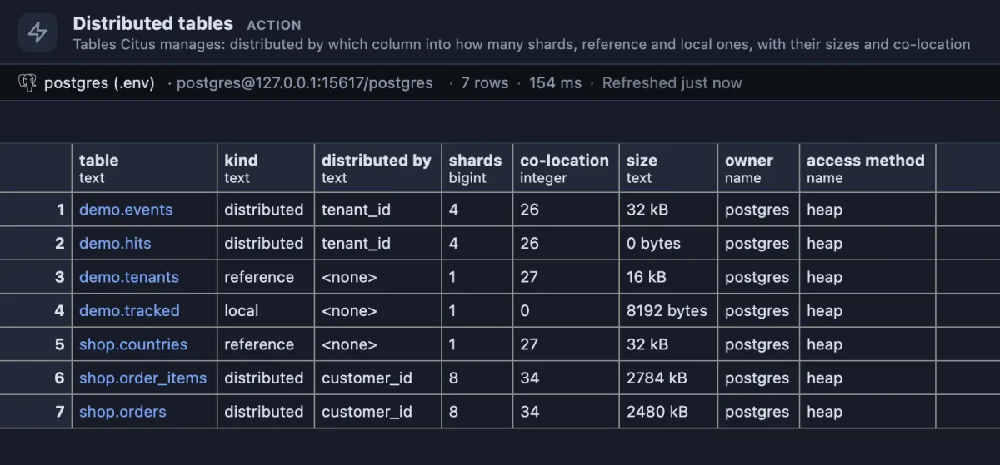
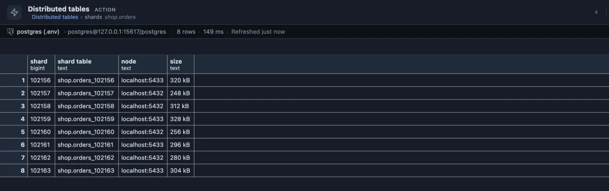

# Distributed tables

Every table Citus manages: which ones are spread over the nodes and by which column, which are copied to every node, how many pieces each has and how big it is in total.



Two families of tables. The `demo` ones are cut by `tenant_id` into 4 shards each and share co-location group 26, so an event and its hits for one tenant always sit on the same node; `demo.tenants` is a reference table, copied whole to every node. The shop's orders and order items are cut by `customer_id` into 8 shards and share group 34, so joining an order to its items never leaves the node.

**Citus** is a PostgreSQL extension that spreads tables across several PostgreSQL servers (nodes). A **distributed table** is cut by one column, its distribution column (the customer, the tenant), into pieces called **shards**, each living on one node. A **reference table** is small and copied to every node, so any node can join to it. A **local** table stays on the coordinator.

## When to use it

- **You inherit a Citus database** and need to know which tables are distributed and by what: every query that filters by that column is fast, every join on it stays on one node.
- **A join is slow or refused**: two distributed tables join cheaply only when they are distributed by the joined column and share a co-location group.
- **Sizes**: the coordinator alone cannot say how big a distributed table is; this sums every shard on every node.

## How to read it

One row per table Citus knows:

| Column | Meaning |
|---|---|
| table | Its name. |
| kind | `distributed` (cut into shards), `reference` (a full copy on every node) or `local` (on the coordinator only, known to Citus). |
| distributed by | The distribution column; `<none>` for reference and local tables. |
| shards | How many shards. |
| co-location | The co-location group: tables in the same group keep matching rows on the same node, so they join without moving data. |
| size | The table's size summed over every shard on every node. |
| owner, access method | As for any table (`heap`, or `columnar` for Citus's column store). |

What to look for: two tables you join often, distributed by the same column but in different co-location groups (the join has to move rows between nodes); a large table that is still `local`.

**Shards** on a table's name opens its shards: each shard's table, the node it lives on and its size.



## Try it

Run it from the Extensions side tab: its row's **Run**, on a connection to the coordinator.

On a test database with Citus (the `citusdata/citus` Docker image runs a one-node cluster), a distributed table of orders:

```sql
create extension if not exists citus;
create table orders (order_id bigserial, customer_id int not null, amount numeric,
                     ordered_at timestamptz default now(), primary key (customer_id, order_id));
select create_distributed_table('orders', 'customer_id', shard_count => 8);
insert into orders (customer_id, amount)
select (random() * 1000)::int, round((random() * 200)::numeric, 2) from generate_series(1, 100000);
```

Distributed tables then lists `orders`: distributed by `customer_id`, 8 shards, about 13 MB.

## Good to know

Reads only. It reads the `citus_tables` view, not schema qualified on purpose (it lives wherever the extension was installed), and `pg_catalog.citus_shards` for the drill-down. Sizes are read from the workers, so the coordinator must be able to reach them. For one table straight from the object tree: Table shards.

## Requirements

PostgreSQL 13 or newer with the `citus` extension; without it the run answers with the server's own error. Run it on the coordinator.
