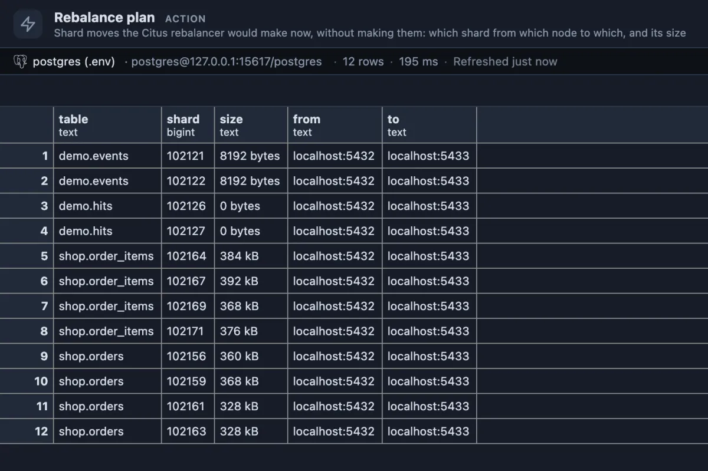

# Rebalance plan

What Citus would move if you rebalanced the cluster now: which pieces of which tables, from which server to which, and how big they are. A plan only; nothing moves.



A worker on port 5433 has just joined and holds nothing yet. The rebalancer would move half of the shards to it: two of each `demo` table and four of each shop table. Orders and their order items move as pairs (shard 102156 of orders with 102164 of order items, and so on), because they share a co-location group and must stay together.

**Citus** is a PostgreSQL extension that spreads tables across several PostgreSQL servers (nodes), each table cut into pieces called **shards**. When you add a node it starts empty; when data grows unevenly, one node carries more than the others. The **rebalancer** moves shards to even things out. This extension asks it what it would do, without doing it.

## When to use it

- **You added a worker** and want to know how much data will travel before you start the move.
- **One node is fuller or busier than the others**: an empty plan means Citus already considers the cluster balanced; a plan lists what would change that.
- **Before a maintenance window**: the moves and their sizes tell how long a rebalance might take.

## How to read it

One row per shard the rebalancer would move:

| Column | Meaning |
|---|---|
| table | The distributed table the shard belongs to. |
| shard | The shard's number. |
| size | How much would travel, the shard on the node it leaves. |
| from, to | The node it leaves and the node it goes to, as `host:port`. |

An empty answer means the cluster is balanced by the rebalancer's current strategy (by default, by disk size).

## Try it

Run it from the Extensions side tab: its row's **Run**, on a connection to the coordinator. On a one-node cluster the answer is always empty: there is nowhere to move to. Add a worker (`select citus_add_node('worker-host', 5432);`) and run it again.

When the plan looks right, start the rebalance yourself in a script, where you choose the moment:

```sql
select citus_rebalance_start();
select * from citus_rebalance_status();
```

## Good to know

Reads only: it calls `get_rebalance_table_shards_plan()`, which plans and moves nothing. The function is the extension's own and not schema qualified on purpose. Version 1.0.1 reads each shard's size from `pg_catalog.citus_shards`, because the plan's own size column reads 0 on current Citus releases.

## Requirements

PostgreSQL 13 or newer with the `citus` extension; without it the run answers with the server's own error. Run it on the coordinator.
