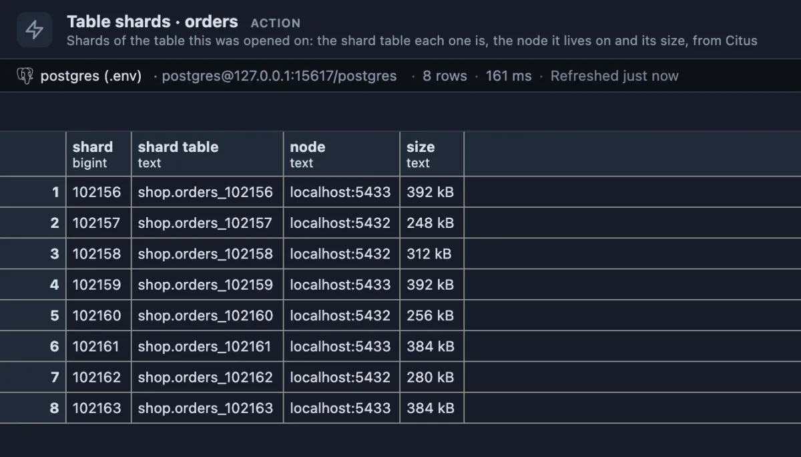

# Table shards

The pieces of one Citus table: each shard, the server it lives on and its size.

The orders table is cut into eight shards. After a rebalance, four live on the coordinator (port 5432) and four on the worker (port 5433), and they are about the same size, so neither node carries much more of the table than the other.

**Citus** is a PostgreSQL extension that spreads tables across several PostgreSQL servers (nodes). A distributed table is cut by one column (the customer, the tenant) into pieces called **shards**; each shard is an ordinary table on one node, named after the table and the shard's number (`orders_102156`). A reference table has one shard, copied to every node.

## When to use it

- **One node is fuller than the others**: see which of this table's shards live there and how big they are.
- **One shard is much bigger than the rest**: a "hot" customer or tenant holds far more rows than the others. Citus can isolate it into a shard of its own (`isolate_tenant_to_new_shard`).
- **Before and after a rebalance**: where each shard was, and where it went.

## How to read it

One row per shard, by number:

| Column | Meaning |
|---|---|
| shard | The shard's number. |
| shard table | The ordinary table that holds it on its node (`schema.table_number`). |
| node | The node it lives on, as `host:port`. A reference table's shard is listed once per node. |
| size | Its size on that node. |

## Try it

Open a distributed or reference table from the object tree (its row's menu offers **Run Table shards**), or open the table and press the **Table shards** pin in the title bar. It only appears on tables Citus manages.

On a test database with the `orders` table from Distributed tables' example, it lists 8 shards of about 1.6 MB each, all on the one node.

## Good to know

Reads only. It reads `pg_catalog.citus_shards`; the sizes come from the nodes themselves, so the coordinator must reach them. `{object}` is the table it was opened on, bound as a parameter. For every Citus table at once: Distributed tables, whose Shards drill-down shows the same list.

## Requirements

PostgreSQL 13 or newer with the `citus` extension; without it the run answers with the server's own error. Run it on the coordinator.
