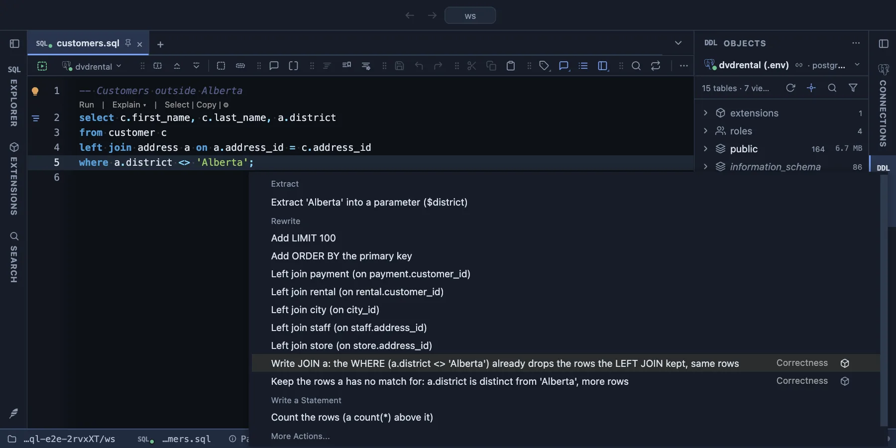

# Correctness refactors

Five fixes for queries that run without an error and still return something other than you meant, offered in the editor's lightbulb (Ctrl+. or ⌘.) where they apply. An offer that returns the same rows says "same rows"; one that changes the result says so, because changing it is the fix.



The lightbulb on a LEFT JOIN whose WHERE filters the joined table. The first offer writes the JOIN the query already is; the second keeps the customers without an address. The cube at the end of a row says it comes from this extension.

## What it is for

- **A LEFT JOIN that quietly became a JOIN**, because the WHERE filters the joined table.
- **`= NULL`**, which is never true, so the query returns nothing.
- **A count that says 1 where it should say 0**, counting a LEFT JOIN with `count(*)`.
- **A date range that loses its last day** on a timestamp column.
- **AND and OR without parentheses**, where PostgreSQL groups the condition differently than it reads.

## Before and after

### A LEFT JOIN its WHERE undoes

```sql
-- before: every employee without a department is gone
select e.employee_name, d.department_name
from employees e
left join departments d on d.department_id = e.department_id
where d.department_name <> 'HR';
```

The rows LEFT JOIN keeps for an employee without a department have NULL in every column of `d`, and `NULL <> 'HR'` is not true, so the WHERE drops them all. Two offers:

```sql
-- Write JOIN d: the same rows, and the query now says so
join departments d on d.department_id = e.department_id

-- Keep the rows d has no match for: more rows
where d.department_name is distinct from 'HR'
```

### A comparison with NULL

```sql
-- before: no row at all
select * from rental where return_date = null;

-- after: the 183 rentals not yet returned
select * from rental where return_date is null;
```

### count(*) over a LEFT JOIN

```sql
-- before: a customer without payments counts 1
select c.customer_id, count(*)
from customer c
left join payment p on p.customer_id = c.customer_id
group by c.customer_id;

-- after: 0
select c.customer_id, count(p.payment_id)
...
```

The key of the joined table is NULL in the row LEFT JOIN keeps for no match, and `count(column)` does not count NULLs.

### BETWEEN that stops at midnight

```sql
-- before: 6,030 rentals; on a timestamp, July 31 after 00:00 is left out
select count(*) from rental where rental_date between '2005-07-01' and '2005-07-31';

-- after: 6,709, all of July 31
select count(*) from rental where rental_date >= '2005-07-01' and rental_date < '2005-08-01';
```

The 679 rentals of July 31 were missing (the sample database dvdrental). `<= '2005-07-31'` gets the same fix. Offered only on a `timestamp` or `timestamptz` column with a day as the bound.

### AND and OR without parentheses

```sql
-- before: AND binds first, so this is (paid and EU) or vip
where status = 'paid' and region = 'EU' or vip

-- Write the parentheses PostgreSQL reads: same rows, now visible
where (status = 'paid' and region = 'EU') or vip

-- Group it the other way: other rows
where status = 'paid' and (region = 'EU' or vip)
```

## How it decides

It reads what PostgreSQL's own parser reads in the query: its joins, its WHERE and its select list, handed over by PlumeSQL. A LEFT JOIN is offered as a JOIN only when a top-level WHERE condition is certain to drop a row without a match (a comparison, BETWEEN, IN, LIKE or IS NOT NULL on the joined table's columns), never for IS NULL, IS DISTINCT FROM, COALESCE or a condition inside an OR, and never when the query has a RIGHT or FULL JOIN. count(*) is offered only in a grouped query not grouped by the joined table.

## Requirements

PlumeSQL 0.26.2 or later. Any PostgreSQL from 13; nothing is asked of the server.
