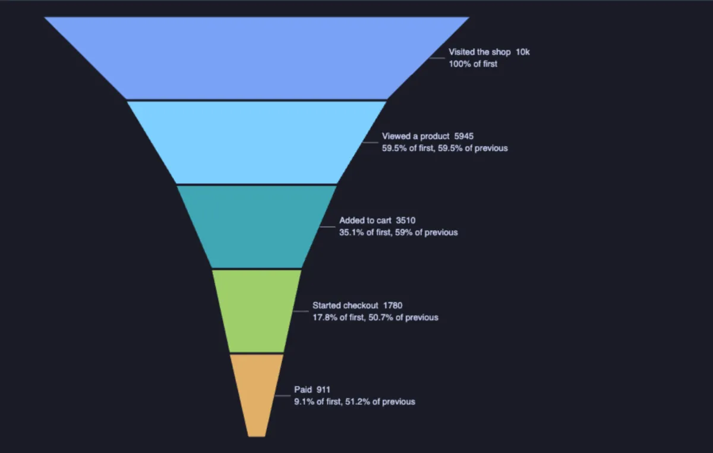
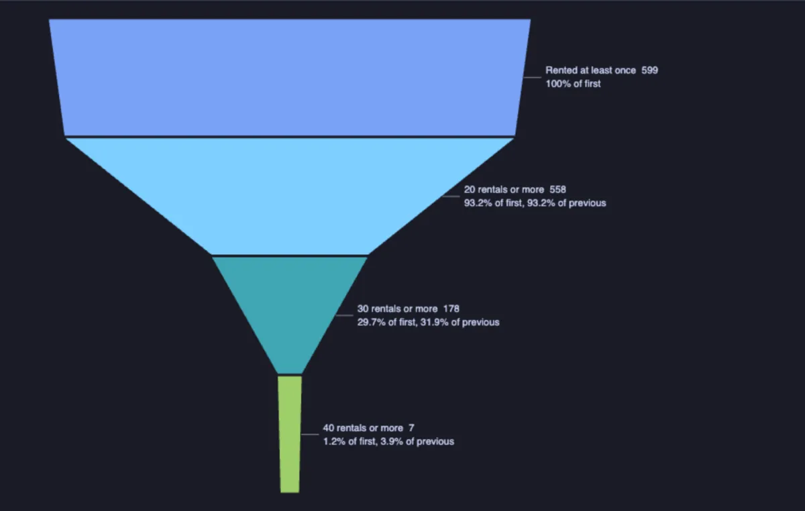

# Funnel

See where people drop out of a process: every step drawn narrower than the one before, with how many made it and what share of them carried on.



Ten thousand visitors of an online shop. Six in ten looked at a product, but only a bit more than half of those put anything in the cart, and half of the carts never reached checkout. Of all visitors, 9% paid. The steps with the sharpest narrowing are the ones to work on first.

## What it is for

- **Where does a shop lose its buyers?** Visits, product views, carts, checkouts, payments: the step with the biggest drop is the one to fix.
- **Where does an app lose its users?** Installed, signed up, finished onboarding, used it a second week.
- **How selective is a team's pipeline?** Applications, screenings, interviews, offers, hires; or leads, calls, proposals, deals.

## How to read it

Each band is one step, as wide as the number of rows (or the value) at that step. The label beside it says how many, what share of the **first** step that is, and what share of the **previous** step: the second number is the one that shows where people leave. A step can be larger than the one before it (more people came back than left); it is then drawn wider, and its share of the previous step is over 100%.

## Try it

**An online shop's visitors** (any connection, made up on the spot), the picture above. The rows are raw events, one per visitor per step they reached, so no value column is needed: the funnel counts the rows of each step.

```sql
-- @extension funnel open
-- @inputs stage=stage
select s.stage
from (select v, case when r < 0.4 then 1 when r < 0.65 then 2 when r < 0.82 then 3 when r < 0.91 then 4 else 5 end as depth
      from (select v, random() as r from generate_series(1, 10000) v) x) visitors
     cross join lateral unnest(array['Visited the shop', 'Viewed a product', 'Added to cart', 'Started checkout', 'Paid'])
                        with ordinality as s(stage, step)
where s.step <= visitors.depth
order by visitors.v, s.step;
```

**How loyal the customers are**, in the [dvdrental](https://neon.com/postgresql/postgresql-getting-started/postgresql-sample-database) sample database: how many customers rented at least once, at least 20 times, 30 times and 40 times. Here every row already carries its number, so it goes in as the value.

```sql
-- @extension funnel open
-- @inputs stage=stage, value=customers
select s.label as stage, count(*) as customers
from (select customer_id, count(*) as rentals from rental group by customer_id) c
     join (values (1, 'Rented at least once'), (20, '20 rentals or more'), (30, '30 rentals or more'), (40, '40 rentals or more')) s(minimum, label)
       on c.rentals >= s.minimum
group by s.minimum, s.label
order by s.minimum;
```



Almost every customer comes back for twenty rentals, but only three in ten make it to thirty: the drop between 20 and 30 is where a loyalty offer would go.

**A hiring pipeline**, typed in (any connection):

```sql
-- @extension funnel open
-- @inputs stage=stage, value=people
select * from (values ('Applied', 420), ('Passed screening', 180), ('Interviewed', 64), ('Got an offer', 12), ('Hired', 9))
  as hiring(stage, people);
```

## Settings

| Setting | `@inputs` key | Default | What it does |
|---|---|---|---|
| Stage | `stage` | asked | The column that names each row's step |
| Value | `value` | none | A number added up per step; none counts the rows of each step |
| Stage order | `sort` | as seen | `as seen`: the steps in the order they first appear in the result (order your query); `descending`: largest first |
| Title | `title` | none | A title over the chart |

## Good to know

The bands are drawn to scale against the largest step. Up to 50 steps; the rest are left out and the Log says how many. A share too small for two decimals reads `<0.01%`. **Copy data** copies the steps with both percentages as CSV. From a script: `-- @extension funnel` above the query (add `open`, `only` or `beside` for how the view opens), and `-- @inputs` to answer the settings in the file so the dialog never shows; a result's own menu attaches it too.

## Requirements

PostgreSQL 13 or newer. Nothing runs on the server: the chart is drawn in the result's sandbox from the rows already fetched. ECharts comes from `cdn.jsdelivr.net`, which has to be an allowed remote script host (the Log offers Allow host when it is not); after the first load it is kept on this machine and works offline. Stats core installs with it.
