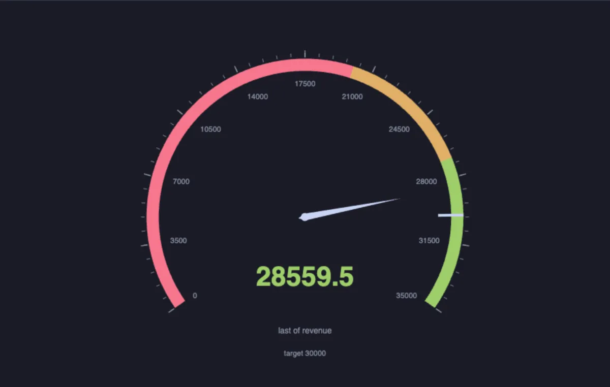
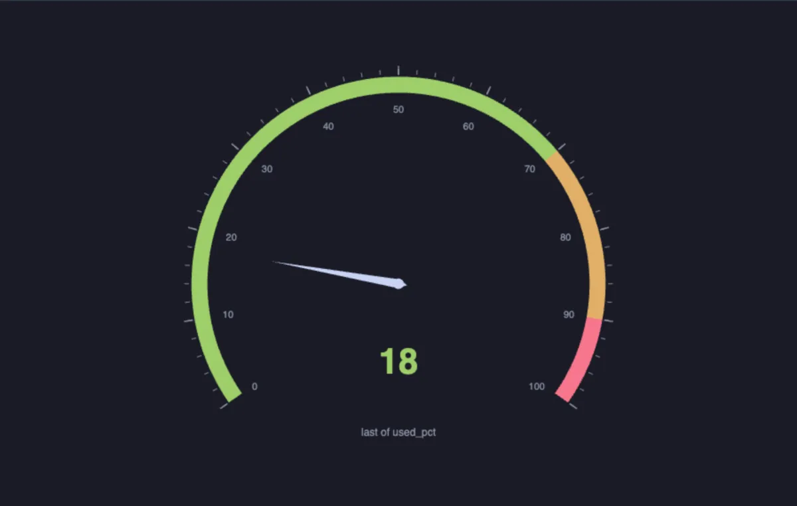

# Gauge

One number on a dial, like a car's speedometer: how full, how fast, how close to the target, coloured green, amber or red by bands you set.



The dvdrental store's revenue in April against a target of 30,000: the needle stands at 28,559, in the green band, a little short of the target mark. One look says "nearly there".

## What it is for

- **How close are we to the goal?** This month's sales against the target, sign-ups against the plan, tickets closed against the week's aim.
- **Is something running out?** Connections in use against the server's limit, disk used, a queue's length, where high is bad.
- **Is a health number where it should be?** The cache hit ratio, the share of orders shipped on time, an uptime percentage.

## How to read it

The big number is the value; the arc runs from **Dial start** to **Dial end**. With **Band limits**, the arc is cut into two or three coloured bands and a needle points at the value, which takes the colour of its band. **Good is** says which end is green: `high` for sales and hit ratios, `low` for load and errors. A **Target** shows as a short mark on the arc, named under the dial. Without bands the arc simply fills up to the value.

## Try it

**Revenue against a target**, in the [dvdrental](https://neon.com/postgresql/postgresql-getting-started/postgresql-sample-database) sample database, the picture above:

```sql
-- @extension gauge open
-- @inputs value=revenue, max=35000, target=30000, thresholds=20000,27000, good=high
select sum(amount) as revenue
from payment
where payment_date >= '2007-04-01' and payment_date < '2007-05-01';
```

**How many of the server's connections are in use** (any connection), where high is bad: green under 70%, amber to 90%, red above.

```sql
-- @extension gauge open
-- @inputs value=used_pct, min=0, max=100, thresholds=70,90, good=low
select round(100.0 * count(*) / current_setting('max_connections')::int, 1) as used_pct
from pg_catalog.pg_stat_activity;
```



**The cache hit ratio** (any connection): the share of data the server found in memory rather than on disk. On a healthy server it stays above 99%, so the dial starts at 80 to make the difference visible.

```sql
-- @extension gauge open
-- @inputs value=hit_pct, min=80, max=100, thresholds=95,99, good=high
select round(100.0 * sum(blks_hit) / nullif(sum(blks_hit) + sum(blks_read), 0), 2) as hit_pct
from pg_catalog.pg_stat_database;
```

## Settings

| Setting | `@inputs` key | Default | What it does |
|---|---|---|---|
| Value | `value` | asked | The number column the dial shows |
| Which number | `agg` | last | `last` or `first` row's value, or `sum`, `mean`, `min`, `max` over every row |
| Dial start | `min` | 0 | Where the arc begins |
| Dial end | `max` | none | Where the arc ends; none picks a round number above the value and the target |
| Target | `target` | none | A mark on the arc for a goal; none for no mark |
| Band limits | `thresholds` | none | One or two numbers cutting the arc into coloured bands, like `70,90`; none for a plain dial |
| Good is | `good` | high | Which end is green: `high` or `low` |
| Title | `title` | none | A title over the dial |

## Good to know

With two limits the bands are red, amber and green (or the other way round with **Good is** at `low`); with one, red and green. The dial starts at 0 unless told otherwise, and ends on a round number (1, 2, 2.5 or 5 times a power of ten) above the value and the target unless **Dial end** is given. For a live number, pair it with a query extension's `@refresh` timer and the needle moves with each run. The copy button in the header copies the number and the dial's range as CSV. From a script: `-- @extension gauge` above the query (add `open`, `only` or `beside`), and `-- @inputs` to answer the settings so the dialog never shows; a result's own menu attaches it too.

## Requirements

PostgreSQL 13 or newer. Nothing runs on the server: the chart is drawn in the result's sandbox from the rows already fetched. ECharts comes from `cdn.jsdelivr.net`, which has to be an allowed remote script host (the Log offers Allow host when it is not); after the first load it is kept on this machine and works offline. Stats core installs with it.
