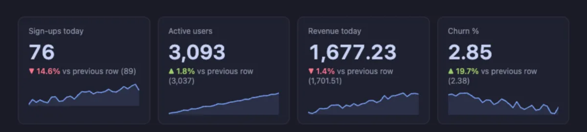
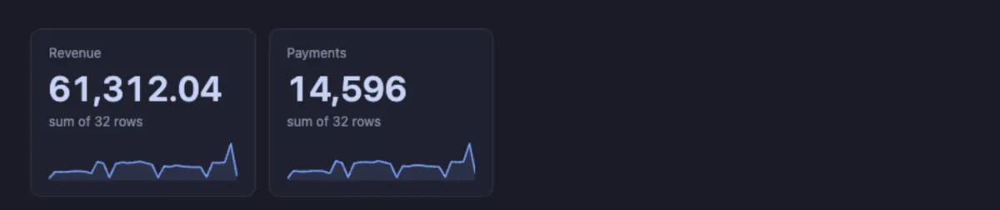

# KPI cards

The few numbers that matter, big and at a glance: one card per number, how it changed since the row before, and a small line of how it got there.



Thirty days of a made-up app. Each card shows the latest day's number in large type; under it, the change against the day before (green up, red down) and a line of the whole month, so a bad day reads differently from a bad trend.

## What it is for

- **The morning check of a business**: today's orders, revenue, new customers and returns, each against yesterday.
- **A server's vital signs**: connections, commits, cache hit ratio and size of a database, read in one row.
- **A team's weekly numbers**: tickets opened and closed, the backlog, the average response time, against last week.

## How to read it

One card per number column. The big number is the **last** row's value by default (or the first, or a sum, mean, minimum, maximum or count over all rows). With **Change against** set, the line under it compares that number with the same column in the previous or the first row: green ▲ for up, red ▼ for down, with the percentage and the earlier value. The small line at the bottom is the whole column, oldest row on the left, so sort the query by time.

Green means "went up", not "good": for a number where up is bad (churn, errors), read the arrow the other way.

## Try it

**An app's last thirty days** (any connection, made up on the spot), the picture above:

```sql
-- @extension kpi-cards open
-- @inputs values=signups, active_users, revenue, churn_pct, compare=previous row, labels=Sign-ups today, Active users, Revenue today, Churn %
select date '2026-09-14' + g as day,
       round(40 + g * 1.2 + random() * 15) as signups,
       2000 + g * 35 + round(random() * 60) as active_users,
       round((900 + g * 25 + random() * 200)::numeric, 2) as revenue,
       round((3.5 - g * 0.04 + random() * 0.6)::numeric, 2) as churn_pct
from generate_series(1, 30) g
order by day;
```

**A store's whole quarter in two cards**, in the [dvdrental](https://neon.com/postgresql/postgresql-getting-started/postgresql-sample-database) sample database: with **Card number** at `sum`, each card is the total of the period, and its line is the day-by-day story behind it.

```sql
-- @extension kpi-cards open
-- @inputs values=revenue, payments, agg=sum, labels=Revenue, Payments
select payment_date::date as day,
       sum(amount) as revenue,
       count(*) as payments
from payment
group by 1
order by 1;
```



**This database at a glance** (any connection): one row of numbers, one card each, with titles of your own.

```sql
-- @extension kpi-cards open
-- @inputs labels=Connections, Commits, Rollbacks, Cache hit %, Size (MB)
select numbackends,
       xact_commit,
       xact_rollback,
       round(100.0 * blks_hit / nullif(blks_hit + blks_read, 0), 2) as cache_hit,
       round(pg_catalog.pg_database_size(datname) / 1048576.0, 1) as size_mb
from pg_catalog.pg_stat_database
where datname = current_database();
```

## Settings

| Setting | `@inputs` key | Default | What it does |
|---|---|---|---|
| Values | `values` | every number column | Which columns get a card, as a comma list (up to 8) |
| Card number | `agg` | last | `last` or `first` row's value, or `sum`, `mean`, `min`, `max` or `count` over every row |
| Change against | `compare` | none | `previous row` or `first row`: the change in % from that row's value of the same column |
| Card titles | `labels` | none | A comma list of titles in card order; none keeps the column names |
| Number format | `format` | number | `number` (1,234.5), `compact` (1.2k, 3.4M), `percent` (0.23 reads as 23%) or `currency` (in dollars) |
| Title | `title` | none | A title over the cards |

## Good to know

The previous row is the one before the last (or after the first, when the card shows the first); empty values are skipped. A count card shows no change. The line needs three rows or more. The cards reflow with the pane's width; hand drawn, no chart library. For a live board, pair it with a query extension's `@refresh` timer. **Copy data** copies the cards as CSV. From a script: `-- @extension kpi-cards` above the query (add `open`, `only` or `beside`), and `-- @inputs` to answer the settings so the dialog never shows; a result's own menu attaches it too.

## Requirements

PostgreSQL 13 or newer. Nothing runs on the server: the cards are drawn in the result's sandbox from the rows already fetched, with no library and no network. Stats core installs with it.
