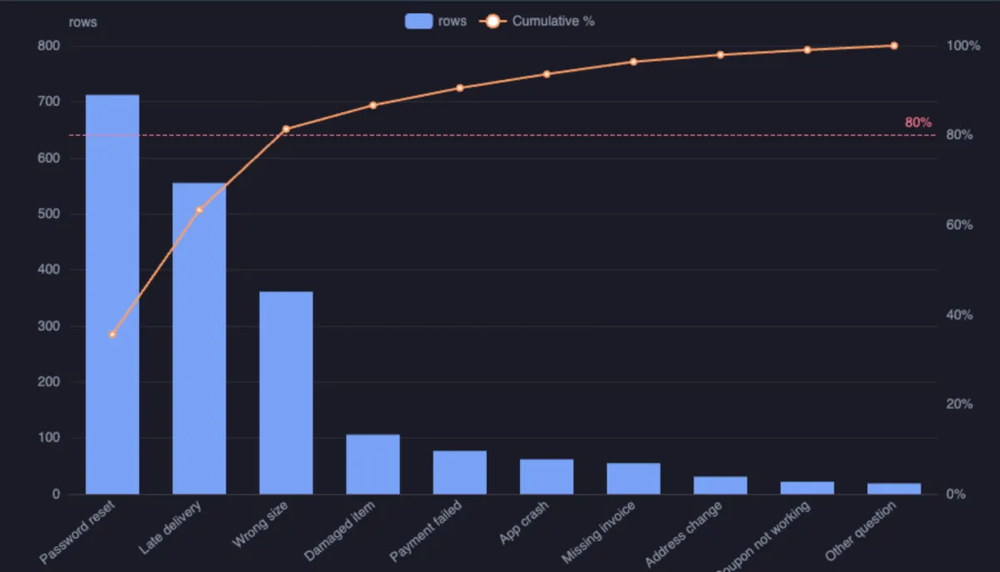
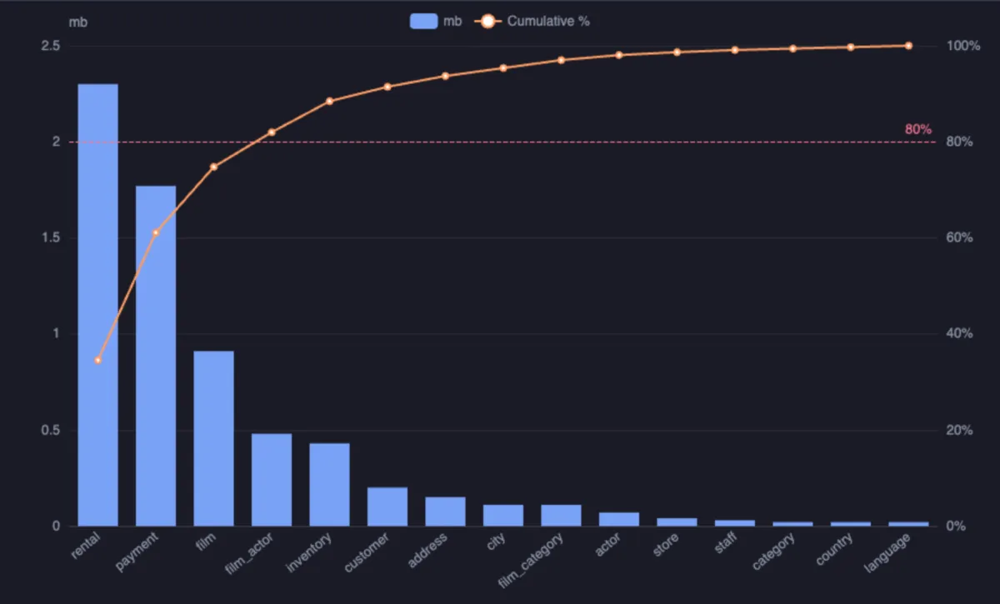

# Pareto

Find the few things that make up most of the total: bars from largest to smallest, a line adding them up, and a mark at 80% where "the vital few" end.



Two thousand support tickets by reason. The line adds up the bars from the left, and it crosses the 80% mark after only three reasons: fix password resets, late deliveries and wrong sizes, and four in five tickets go away.

## What it is for

- **Which problems are worth fixing first?** Support tickets, returns or defects by reason: a handful usually causes most of them.
- **Where does the space or the time go?** Tables by size on disk, queries by total time, folders by bytes.
- **Who carries the business?** Revenue by customer or product: a steep line means a few big ones, a slow line means many small ones.

## How to read it

The bars are the categories, largest first, each as tall as its total. The line climbs from the first bar's share to 100% (right axis). Where it crosses the dashed **80%** mark is where the important few end; everything to the right of that point adds up to the last fifth. A line that climbs steeply means a few categories dominate; a line that climbs slowly and evenly means there is no short list to fix, which is an answer too (the Other bar then stands tallest). Categories past **Top categories** are folded into one **Other** bar at the end.

## Try it

**Support tickets by reason** (any connection, made up on the spot), the picture above. One row per ticket, its reason drawn by chance with fixed odds (`up_to` is the running percentage); the chart counts them.

```sql
-- @extension pareto open
-- @inputs category=reason
select (select w.reason
        from (values ('Password reset', 36), ('Late delivery', 63), ('Wrong size', 81), ('Damaged item', 86),
                     ('Payment failed', 90), ('Missing invoice', 93), ('App crash', 96), ('Address change', 98),
                     ('Coupon not working', 99), ('Other question', 100)) as w(reason, up_to)
        where w.up_to > t.r
        order by w.up_to
        limit 1) as reason
from (select random() * 100 as r from generate_series(1, 2000)) t;
```

**Where the disk space goes** (any database): every table by its size with its indexes, the fifteen largest on their own.

```sql
-- @extension pareto open
-- @inputs category=table, value=mb, n=15
select c.relname as "table",
       round(pg_catalog.pg_total_relation_size(c.oid) / 1048576.0, 2) as mb
from pg_catalog.pg_class c
     join pg_catalog.pg_namespace n on n.oid = c.relnamespace
where c.relkind in ('r', 'm')
  and n.nspname not in ('pg_catalog', 'information_schema')
  and n.nspname !~ '^pg_toast';
```



In the dvdrental sample database, four tables of fifteen hold four fifths of the space: those are the ones whose growth, indexes and vacuum deserve the attention.

## Settings

| Setting | `@inputs` key | Default | What it does |
|---|---|---|---|
| Category | `category` | asked | The column whose values become the bars |
| Value | `value` | none | A number added up per category; none counts the rows |
| Top categories | `n` | 30 | How many of the largest get a bar of their own; the rest are folded into Other |
| Title | `title` | none | A title over the chart |

## Good to know

The raw rows can go in as they are: the view does the grouping, so `select reason from support_tickets` is enough. Categories with a zero or negative total are left out and the Log says how many. The tooltip shows each bar's value, share and cumulative share. The 80/20 rule is a rule of thumb (the Pareto principle), not a law: the chart shows how close your data comes to it. **Copy data** copies the table behind the chart as CSV. From a script: `-- @extension pareto` above the query (add `open`, `only` or `beside`), and `-- @inputs` to answer the settings so the dialog never shows; a result's own menu attaches it too.

## Requirements

PostgreSQL 13 or newer. Nothing runs on the server: the chart is drawn in the result's sandbox from the rows already fetched. ECharts comes from `cdn.jsdelivr.net`, which has to be an allowed remote script host (the Log offers Allow host when it is not); after the first load it is kept on this machine and works offline. Stats core installs with it.
