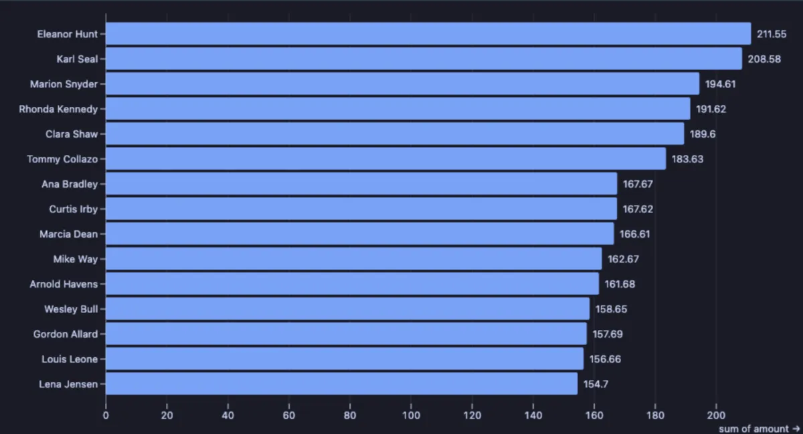
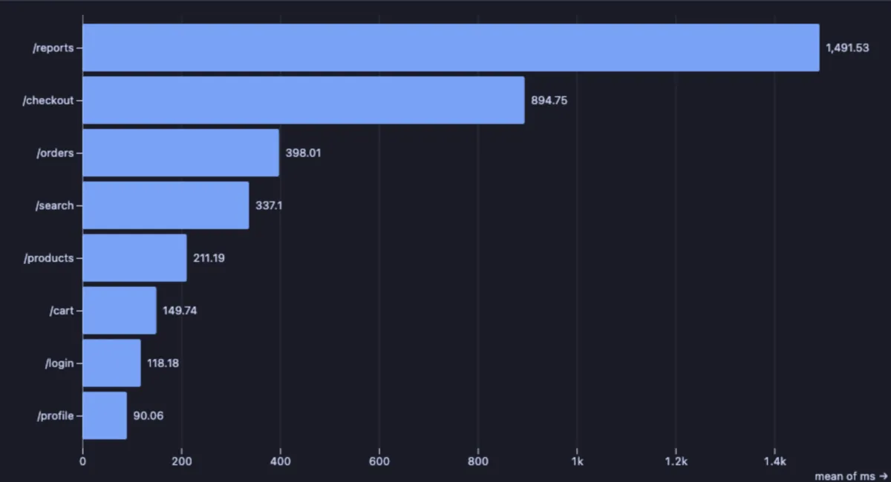

# Ranked

A top list as a picture: the biggest (or smallest) few, one labelled bar each, sorted, with the number at the end of every bar.



The fifteen customers of the dvdrental store who spent the most. The list is close: the top spender paid only about a third more than the fifteenth, so no single customer carries the store.

## What it is for

- **Who are the best?** Top customers by revenue, top products by units sold, top salespeople by deals closed.
- **Where is the worst?** The slowest pages of an app, the tables with the most dead rows, the warehouses with the most late shipments, by sum, average or maximum.
- **What is most common?** Countries of the customers, reasons for returns, error messages: without a value column, it counts the rows.

## How to read it

One bar per category, longest first (or shortest first with **Order**), cut to the **Top N**. The axis starts at zero, so the bars compare honestly: a bar twice as long is twice as much. The number at the end of each bar is its value, folded with **Per category**: a sum by default, or a mean, maximum, minimum or count.

## Try it

**The best customers**, in the [dvdrental](https://neon.com/postgresql/postgresql-getting-started/postgresql-sample-database) sample database, the picture above: every payment in, the money added up per customer.

```sql
-- @extension plot-ranked open
-- @inputs category=customer, value=amount, agg=sum, n=15
select c.first_name || ' ' || c.last_name as customer, p.amount
from payment p join customer c using (customer_id);
```

**Where the customers live**, in the same database: no value column, so each country's rows are counted.

```sql
-- @extension plot-ranked open
-- @inputs category=country, n=15
select co.country
from customer c
     join address a using (address_id)
     join city ci using (city_id)
     join country co using (country_id);
```

**The slowest pages of an app** (any connection, made up on the spot): one row per request, the average time per page. With **Per category** at `max` instead, the same chart shows the worst single request of each page.

```sql
-- @extension plot-ranked open
-- @inputs category=page, value=ms, agg=mean
select page, round((base * (0.6 + random() * 0.8))::numeric) as ms
from (select (array['/login', '/search', '/checkout', '/cart', '/profile', '/products', '/orders', '/reports'])[1 + g % 8] as page,
             (array[120, 340, 890, 150, 90, 210, 400, 1500])[1 + g % 8] as base
      from generate_series(1, 4000) g) requests;
```



## Settings

| Setting | `@inputs` key | Default | What it does |
|---|---|---|---|
| Category (one bar each) | `category` | asked | The column whose values become the bars |
| Value | `value` | none | A number folded per category; none counts the rows |
| Per category | `agg` | sum | How a category's values combine: `sum`, `mean`, `max`, `min` or `count` |
| Top N | `n` | 25 | How many bars are kept after sorting |
| Order | `order` | largest first | `largest first` or `smallest first` |
| Palette | `palette` | Vivid | The colour of the bars (the palette's first colour): Vivid, Cool, Warm or Mono |
| Title | `title` | none | A title over the chart |

## Good to know

The whole result is read, up to a million rows, and folded before drawing, so the raw rows can go in as they are. With more bars than the pane has room for, the chart grows and the view scrolls. Attach it from a script with `-- @extension plot-ranked` above a query (add `open`, `only` or `beside` to open on the view), or from a result's own menu; `-- @inputs` answers the settings in the file so the chart draws with no dialog. For a share of the whole as well as the ranking, Pareto adds the running total.

## Requirements

PostgreSQL 13 or newer. Nothing runs on the server: the chart is drawn in the result's sandbox. Observable Plot comes from `cdn.jsdelivr.net`, which has to be an allowed remote script host (the Log offers Allow host when it is not); after the first load it is kept on this machine and works offline. Plot core installs with it.
