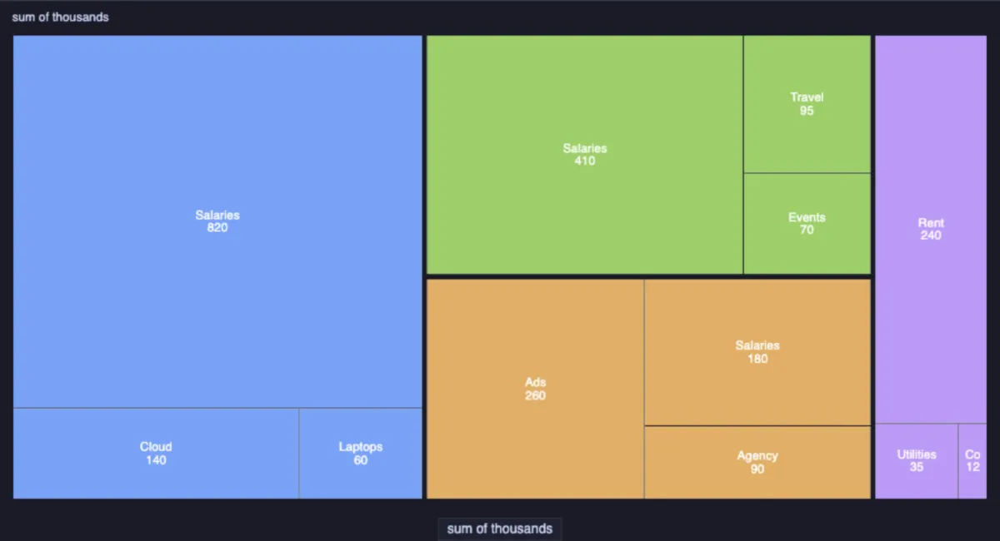
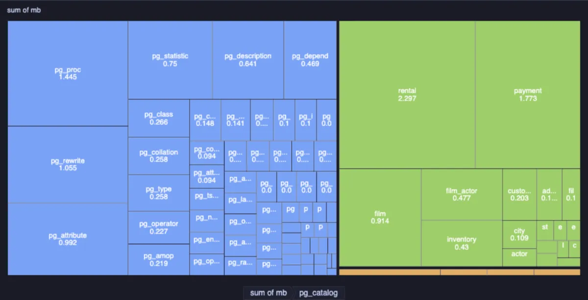

# Treemap

See what the whole is made of: every part a rectangle as big as its share, grouped inside its parent, so the largest pieces jump out. Click one to look inside.



A made-up company budget, by department and then by what the money is spent on. Engineering salaries take the biggest block; sales salaries, marketing ads and office rent come next; the coffee is a sliver. The whole picture is the whole budget, so the size of each rectangle is its share.

## What it is for

- **Where does the money go?** A budget by department and item, revenue by region and product, costs by supplier.
- **Where does the disk go?** A database's size by schema and table, like a disk-usage map for folders.
- **What does a catalog hold?** Products by category and brand, films by genre and title, tickets by team and status.

## How to read it

Each rectangle's area is its value (a sum, a mean or a count of its rows, by **Fold**). Rectangles of the same parent sit together inside the parent's frame, which carries the parent's name in a strip on top. Click a rectangle to zoom into it, so its children fill the view; the breadcrumb under the chart walks back up. With three levels or more, two show at a time and a click goes deeper.

## Try it

**A company budget**, typed in (any connection), the picture above:

```sql
-- @extension treemap open
-- @inputs path=department, item, value=thousands
select * from (values
  ('Engineering', 'Salaries', 820), ('Engineering', 'Cloud', 140), ('Engineering', 'Laptops', 60),
  ('Sales', 'Salaries', 410), ('Sales', 'Travel', 95), ('Sales', 'Events', 70),
  ('Marketing', 'Ads', 260), ('Marketing', 'Salaries', 180), ('Marketing', 'Agency', 90),
  ('Office', 'Rent', 240), ('Office', 'Utilities', 35), ('Office', 'Coffee', 12)
) as budget(department, item, thousands);
```

**Where a database's space goes** (any database): every table and materialized view by schema, sized by its megabytes with indexes and TOAST.

```sql
-- @extension treemap open
-- @inputs path=schema, table, value=mb
select n.nspname as schema,
       c.relname as "table",
       round(pg_catalog.pg_total_relation_size(c.oid) / 1048576.0, 3) as mb
from pg_catalog.pg_class c
     join pg_catalog.pg_namespace n on n.oid = c.relnamespace
where c.relkind in ('r', 'm');
```



**Revenue by film category and title**, in the [dvdrental](https://neon.com/postgresql/postgresql-getting-started/postgresql-sample-database) sample database: the categories share the store's money fairly evenly; click one to see which of its films earned most.

```sql
-- @extension treemap open
-- @inputs path=category, title, value=amount
select c.name as category, f.title, p.amount
from payment p
     join rental r using (rental_id)
     join inventory i using (inventory_id)
     join film f using (film_id)
     join film_category fc using (film_id)
     join category c using (category_id);
```

## Settings

| Setting | `@inputs` key | Default | What it does |
|---|---|---|---|
| Levels (outer first) | `path` | every text column | One column per level, the outermost first: department, then item |
| Value | `value` | none | A number folded into each rectangle; none counts the rows |
| Fold | `agg` | sum | How the rows of one rectangle combine: `sum`, `mean` or `count` |
| Title | `title` | none | A title over the chart |

## Good to know

A parent's area is always the total of its children, whatever the fold, since that is what an area can show; with `mean`, the labels on the leaves are the means. Up to 5,000 rectangles, the largest; the rest, and any with a zero or negative value, are left out and the Log says how many. The copy button in the header copies the leaves with their values as CSV. From a script: `-- @extension treemap` above the query (add `open`, `only` or `beside`), and `-- @inputs` to answer the settings so the dialog never shows; a result's own menu attaches it too. Sunburst draws the same levels as rings, better for seeing the levels; a treemap compares sizes better.

## Requirements

PostgreSQL 13 or newer. Nothing runs on the server: the chart is drawn in the result's sandbox from the rows already fetched. ECharts comes from `cdn.jsdelivr.net`, which has to be an allowed remote script host (the Log offers Allow host when it is not); after the first load it is kept on this machine and works offline. Stats core installs with it.
