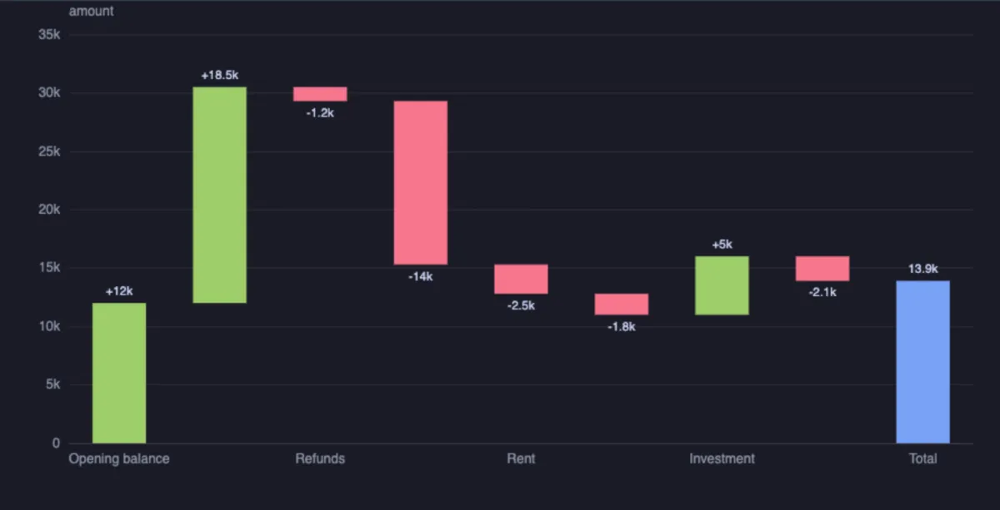
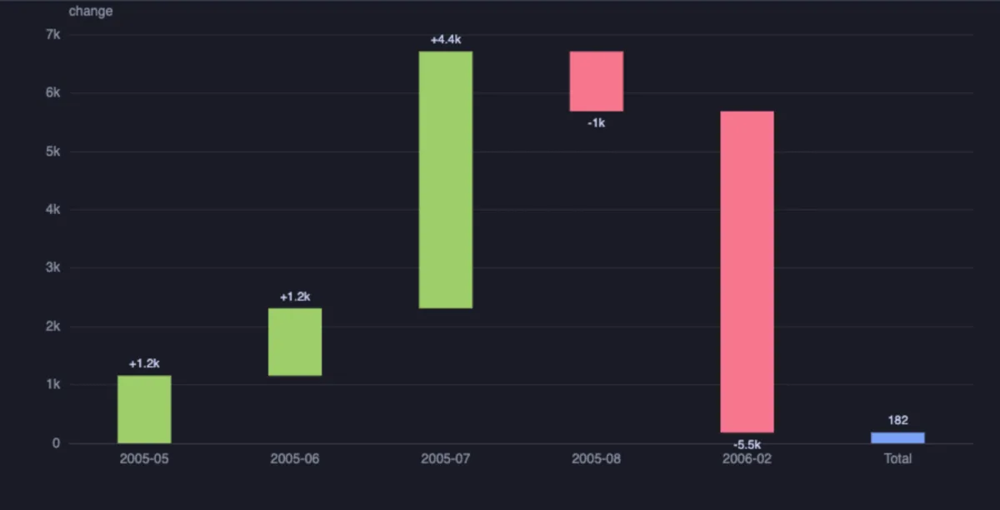

# Waterfall

See how a starting number turns into an ending one, step by step: every rise a green bar, every fall a red one, each starting where the last one ended.



A month of a small company's cash. It opens with 12k; sales bring in 18.5k (green), salaries take most of it back (the tallest red bar), and the smaller costs nibble away until an investment lifts the balance again. The last bar, the total, is where the month ends: 13.9k.

## What it is for

- **Where did the money go?** From the opening balance to the closing one: income and costs, one bar each.
- **What changed a number?** Last year's profit to this year's, through more sales, higher prices, new costs; a headcount from January to December, through hires and departures.
- **How did something grow and shrink?** Users, rentals or orders month by month: each bar is the change from the month before.

## How to read it

The first bar starts at zero; every bar after it floats from where the previous one ended, up (green) for an increase or down (red) for a decrease, labelled with its step (`+120`, `-45`). The **Total** bar at the end, in the accent colour, runs from zero to where the steps finished. The bars follow the order of the rows, so sort the query.

## Try it

**A month of cash** (any connection, typed in), the picture above:

```sql
-- @extension waterfall open
-- @inputs category=item, value=amount, total=yes
select * from (values
  ('Opening balance', 12000), ('Sales', 18500), ('Refunds', -1200), ('Salaries', -14000), ('Rent', -2500),
  ('Marketing', -1800), ('Investment', 5000), ('Taxes', -2100)
) as month(item, amount);
```

**How the rentals rose and fell**, in the [dvdrental](https://neon.com/postgresql/postgresql-getting-started/postgresql-sample-database) sample database: the first month's rentals, then each month's change from the one before. Business climbed through the summer of 2005 and collapsed by February 2006; the total bar is where it ended, February's 182 rentals.

```sql
-- @extension waterfall open
-- @inputs category=month, value=change, total=yes
select to_char(month, 'YYYY-MM') as month,
       rentals - coalesce(lag(rentals) over (order by month), 0) as change
from (select date_trunc('month', rental_date) as month, count(*) as rentals from rental group by 1) m
order by m.month;
```



**What a product's price is made of** (any connection): the base price, then what is added and taken off on the way to the customer.

```sql
-- @extension waterfall open
-- @inputs category=part, value=euros, total=yes
select * from (values ('Base price', 80), ('Shipping', 6.5), ('Gift wrap', 3), ('Member discount', -12), ('VAT', 19.4))
  as price(part, euros);
```

## Settings

| Setting | `@inputs` key | Default | What it does |
|---|---|---|---|
| Category (one bar per row) | `category` | asked | The label under each bar |
| Step | `value` | asked | How much each row adds (positive) or takes away (negative) |
| Total bar | `total` | yes | `yes` adds a last bar from zero to where the steps end; `no` leaves it out |
| Title | `title` | none | A title over the chart |

## Good to know

The first row is usually the starting balance and the rest the changes, in the order the query returns them. A step that crosses zero is drawn whole, part above the axis and part below. Rows without a number are skipped and the Log says how many. Up to 500 bars; past 40 a zoom slider appears, and past 500 the rest are left out and the Log says how many (fold them in SQL). The tooltip shows each step and the running total after it. The copy button in the header copies the steps and running totals as CSV. From a script: `-- @extension waterfall` above the query (add `open`, `only` or `beside`), and `-- @inputs` to answer the settings so the dialog never shows; a result's own menu attaches it too.

## Requirements

PostgreSQL 13 or newer. Nothing runs on the server: the chart is drawn in the result's sandbox from the rows already fetched. ECharts comes from `cdn.jsdelivr.net`, which has to be an allowed remote script host (the Log offers Allow host when it is not); after the first load it is kept on this machine and works offline. Stats core installs with it.
