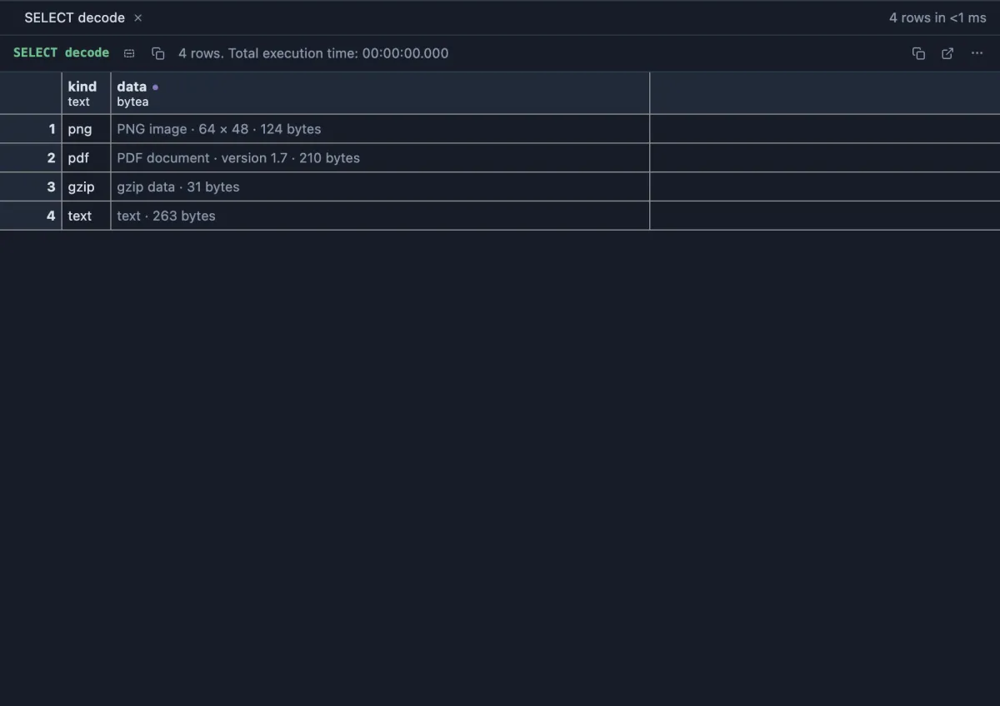

# Bytea



A `bytea` value is shown by the server as hex, `\x89504e470d0a1a0a0000000d49484452...`: correct, and unreadable. This extension reads what the bytes are and says so where you meet them: `PNG image · 640 × 480 · 12.3 kB`, `PDF document · version 1.7 · 88.2 kB`, `Excel workbook (zip) · 9.4 kB`, `text · 312 bytes`.

## What it shows

- **In the grid**: every bytea cell reads as its kind, an image's size in pixels where its header says it, and the byte count. The tooltip has the first 48 bytes in hex, and for text, the text itself.
- **Hover and peek** a cell: the same line.
- **Open Value in Tab**: the facts (kind, size, pixels, the first bytes) and the whole value as **base64** in the editor, ready to paste into a data URL, an API call or a test; **Decode as base64** flips back to the hex as stored, and **Copy** copies whichever is shown.

The kind is read from the first bytes, the signature every file format starts with: PNG, JPEG, GIF, WebP, BMP, TIFF and SVG images; PDF; zip, with Word, Excel, PowerPoint and OpenDocument files told apart by their first entry; gzip, bzip2, xz, zstd and 7-Zip; SQLite databases and pg_dump archives; MP3, Ogg and MP4 media; WebAssembly; and plain text. Anything else is `binary`.

## Where it applies

Every column whose declared type is `bytea`, in every result, from the install on (a global scope you can change on its page). Bytes are read straight out of the hex text, never decoded whole, so a large value costs nothing to show; base64 covers the first 4 MB.

## Examples

**Bytes of known kinds**, made on the spot (any connection): a blue PNG of 64 × 48, the start of a PDF, gzip and plain text.

```sql
-- @extension bytea
select 'png' as kind, decode('89504e470d0a1a0a0000000d49484452000000400000003008020000002e29eb48000000434944415478daedcf410900000804b0cb6d1c4bfab5825f61b0024bf5bc160101010101010101010101010101010101010101010101010101010101010101010181ab050cdee569cf998eff0000000049454e44ae426082', 'hex') as data
union all select 'pdf', convert_to('%PDF-1.7' || chr(10) || '%' || repeat('x', 200), 'UTF8')
union all select 'gzip', decode('1f8b08000000000002ffcb48cdc9c95728cf2fca49010085114a0d0b000000', 'hex')
union all select 'text', convert_to('Hello from PostgreSQL, ' || repeat('lorem ipsum ', 20), 'UTF8');
```

**What a table's large objects hold**: the first bytes of every large object, read by the server with `lo_get`.

```sql
-- @extension bytea
select oid, lo_get(oid, 0, 64) as head
from pg_catalog.pg_largeobject_metadata;
```

## Requirements

PostgreSQL 13 or newer, with `bytea_output` at `hex`, its default since PostgreSQL 9.0 (a value in the old `escape` form is left as it is). Nothing runs on the server: the values are read from what the grid already holds.

## Notes

The kind is a reading of the signature, not a check of the whole file: a truncated or damaged file with the right first bytes still reads as its kind. A script attaches it with `-- @extension bytea` above a query, or once in the header for the whole file.
