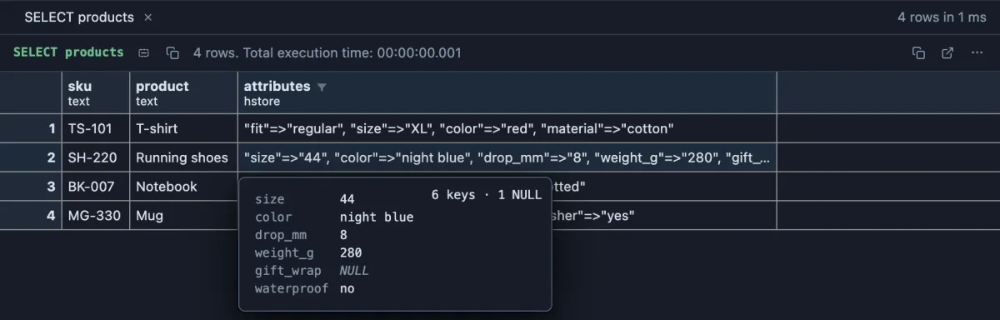

# hstore

Read an `hstore` column as a tidy key and value table instead of one long line of quoted pairs.



Four products of a web shop, each with its own attributes in one `hstore` column. In the grid the running shoes' attributes run off the edge of the cell. Hover the cell and the card lists them one per line: six keys, and one of them (`gift_wrap`) has no value at all, which the card marks as NULL.

## What it is for

- **Attributes that differ from row to row**: a T-shirt has a size and a material, a mug has a volume. Shops often keep such details in one `hstore` column instead of a column per attribute.
- **Tags and settings**: OpenStreetMap data keeps every map feature's tags in `hstore`, and many applications keep per user or per tenant options the same way.
- **Checking what is really stored**: a missing key, a value that is the text `NULL` rather than a real NULL, a key spelled two ways. All of it is hard to see in one long line and easy to see in a table.

## How to read it

An `hstore` value is printed by PostgreSQL as `"color"=>"red", "size"=>"XL", "note"=>NULL`. This extension reads that text for you:

- **Hover** a cell: a card with how many keys there are (`6 keys · 1 NULL`) and the pairs as a table, one per line. A NULL value is marked NULL; an empty value stays empty, so the two never look alike.
- **Peek** a cell (Space): the same count and table above the value as stored.
- **Open Value in Tab** (right-click the cell): the table, the counts and the whole map as JSON in the editor below, ready to paste into a `jsonb` value or a script. **Decode as JSON** in the header switches the editor back to the text as stored; **Copy** copies whichever is shown.
- **Edit a row** (F2): under an `hstore` field you see what you typed being read as you type: `2 keys` while it is a valid hstore, or where it stops being one (`not a valid hstore: expected "=>" after the key "a" (character 3)`). The server still has the last word when you save.

PostgreSQL keeps an `hstore`'s keys in its own order (shorter keys first), not the order you wrote them in; the card shows them as stored.

## Try it

You need the hstore extension in the database (`create extension hstore`, once). Both queries make up their data, so they change nothing.

**A shop's products**, the picture above:

```sql
select sku, product, attributes
from (values
  ('TS-101', 'T-shirt', 'color=>red, size=>XL, material=>cotton, fit=>regular'::hstore),
  ('SH-220', 'Running shoes', 'color=>"night blue", size=>44, weight_g=>280, waterproof=>no, drop_mm=>8, gift_wrap=>NULL'::hstore),
  ('BK-007', 'Notebook', 'pages=>120, paper=>dotted, cover=>hard'::hstore),
  ('MG-330', 'Mug', 'volume_ml=>350, dishwasher=>yes, color=>white'::hstore)
) as products(sku, product, attributes);
```

Hover the `attributes` of the running shoes. A value with a space in it (`"night blue"`) needs its quotes; a bare `NULL` is a real NULL.

**Places on a map with OpenStreetMap style tags**: right-click the café's `tags` and choose **Open Value in Tab**.

```sql
select name, tags
from (values
  ('Kava Bar', 'amenity=>cafe, name=>"Kava Bar", opening_hours=>"Mo-Sa 07:00-22:00", outdoor_seating=>yes, wheelchair=>limited, "addr:street"=>Ilica, "addr:housenumber"=>12'::hstore),
  ('City Library', 'amenity=>library, name=>"City Library", opening_hours=>"Mo-Fr 08:00-20:00", wheelchair=>yes, internet_access=>wlan'::hstore),
  ('Bus stop Trg', 'highway=>bus_stop, name=>Trg, shelter=>yes, bench=>yes, route_ref=>"6;11;13"'::hstore)
) as places(name, tags);
```


Seven tags, each on its own line, and the same map as JSON below them: every value is a string, and a NULL would be a JSON `null`, exactly as PostgreSQL's own `hstore_to_json` builds it.

## Settings

None. Install it and every `hstore` column reads this way.

## Where it applies

Every column whose declared type is `hstore` (schema qualified when the extension lives outside the `search_path`), in every result, from the install on (a global scope you can change on its page). A text column holding `"a"=>"1"` is text and stays that way.

## Good to know

The reading follows the hstore extension's own input rules: keys and values in double quotes (a backslash escapes a quote or a backslash) or bare words, a bare `NULL` in any letter case is SQL NULL, and a quoted `"NULL"` is the four letters. When you type a key twice, the field says so (`1 duplicate key dropped`): PostgreSQL keeps one value per key. Copying cells, exporting and the Log's console still give the value exactly as the server sent it.

## Requirements

PostgreSQL 13 or newer with the hstore extension (`create extension hstore`). Nothing runs on the server: the values are read from what the grid already holds.
