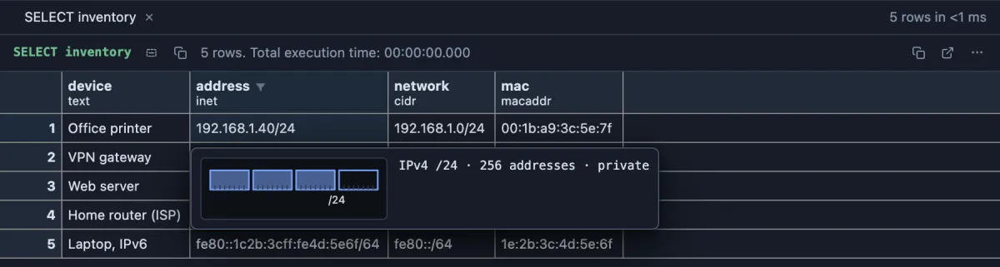

# Network addresses

See what an IP or MAC address in the grid means (which network, how many addresses, private or public) without a subnet calculator.



A small network inventory. Hover the office printer's address, `192.168.1.40/24`, and the card answers the questions the text leaves open: an IPv4 address in a network of 256 addresses, in a private range (one that never appears on the internet). The strip shows the 32 bits of the address; the first 24 are filled because `/24` means the first 24 bits name the network.

## What it is for

- **Reading logs and connections**: who connected from where, and is that a private office address, a VPN, or someone on the internet? `pg_stat_activity.client_addr` is an `inet`, as are the addresses many applications log.
- **Firewall and allow lists**: a table of `cidr` networks is easy to get wrong. The card and the value tab say how big each network is, where it starts and ends, and the row editor warns when a typed network has stray bits after its mask.
- **Device inventories**: a `macaddr` says whether the address was assigned by the maker or made up by the system (phones and virtual machines often do that), which matters when you match devices by it.

## How to read it

For `inet` and `cidr` values:

- **Hover** a cell: one line (`IPv4 /24 · 256 addresses · private`, `IPv6 host · link-local`) and a strip of the address's bits with the network part filled and the prefix written under it (32 bits in four groups for IPv4, the 128 bits of IPv6 in eight groups).
- **Peek** a cell (Space): the same line and strip above the value as stored.
- **Open Value in Tab** (right-click the cell): everything about it, with the address spelled out in the editor below (IPv4 in binary, IPv6 written out in full). **Decode address** switches back to the text as stored; **Copy** copies whichever is shown.
- **Edit a row** (F2): the field reads what you type as you type, says `not an IP address` when it is not one, and for a `cidr` names the network you probably meant when bits are set after the mask (`host bits set right of the /24 mask: the network is 192.168.1.0/24`), which the server would refuse.


The web server's network, `203.0.113.0/28`, opened in a tab: 16 addresses from `.0` to `.15` (the broadcast address), of which 14 can be given to machines. The range is one set aside for documentation and examples, which is why it is used here.

The kind of range is one of: private (the home and office ranges, and IPv6 unique local), loopback (the machine itself), link-local, multicast, documentation, shared (an internet provider's own network, as on the home router row), benchmarking, translation, unspecified, broadcast, reserved, or public.

For `macaddr` and `macaddr8` values the card reads, for example, `EUI-48 · unicast · local`: the address size, whether it names one device or a group, and whether the maker assigned it (universal) or the system made it up (local). A universal address shows its maker's prefix (OUI); there is no table of maker names, so nothing is looked up.

## Try it

Both run on any connection.

**A network inventory**, the pictures above:

```sql
select device, address, network, mac
from (values
  ('Office printer', inet '192.168.1.40/24', cidr '192.168.1.0/24', macaddr '00:1b:a9:3c:5e:7f'),
  ('VPN gateway', inet '10.8.0.1/16', cidr '10.8.0.0/16', macaddr '02:42:ac:11:00:02'),
  ('Web server', inet '203.0.113.25', cidr '203.0.113.0/28', macaddr '3c:22:fb:91:0a:4e'),
  ('Home router (ISP)', inet '100.64.12.9/10', cidr '100.64.0.0/10', macaddr 'f4:f2:6d:11:22:33'),
  ('Laptop, IPv6', inet 'fe80::1c2b:3cff:fe4d:5e6f/64', cidr 'fe80::/64', macaddr '1e:2b:3c:4d:5e:6f')
) as inventory(device, address, network, mac);
```

Hover each `address`: the printer and the VPN gateway are private, the web server is a single host (no `/` means one address), the home router sits in the provider's shared range, and the laptop's IPv6 address is link-local (it works only on its own network segment).

**Who is connected, and from where**:

```sql
select pid, usename as "user", application_name as app, client_addr, state
from pg_stat_activity
where client_addr is not null;
```

Hover a `client_addr`: a private address is a machine on your own network (or a container on the same host); a public one came over the internet.

## Settings

None. Install it and every address column reads this way.

## Where it applies

Every column whose declared type is `inet`, `cidr`, `macaddr` or `macaddr8`, in every result, from the install on (a global scope you can change on its page). A text column holding an address is text and stays that way.

## Good to know

An `inet` is classed by its own address (`192.168.1.5/8` is a private host); a `cidr` by its whole network, and one that spans several kinds says `mixed`. An IPv4 address written inside IPv6 (`::ffff:10.0.0.1`) is classed as the IPv4 address. Host counts leave out the network and broadcast addresses, except for a `/31` and a `/32`. Counts are exact up to 2^32 and written as a power of two above that (`2^64 addresses`). For a `macaddr8` with `ff:fe` in the middle, the tab also gives the 48-bit address it came from, and every MAC address gives the IPv6 interface identifier made from it (modified EUI-64). The ranges follow their RFCs, which the value tab names. Copying, exporting and the console keep the value exactly as the server sent it.

## Requirements

Nothing beyond PostgreSQL: the types are built in. Nothing runs on the server: the values are read from what the grid already holds.
