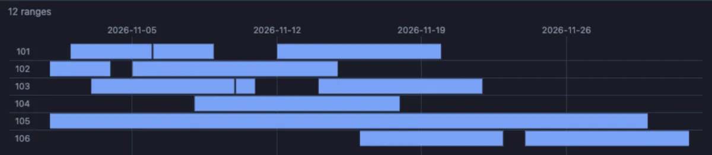
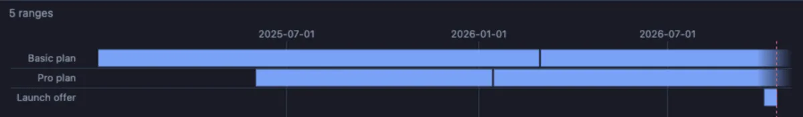
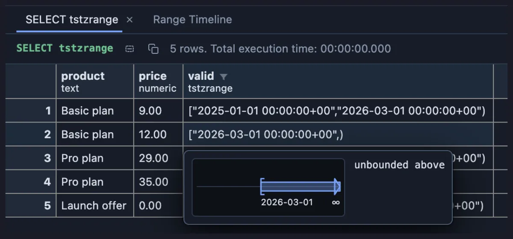
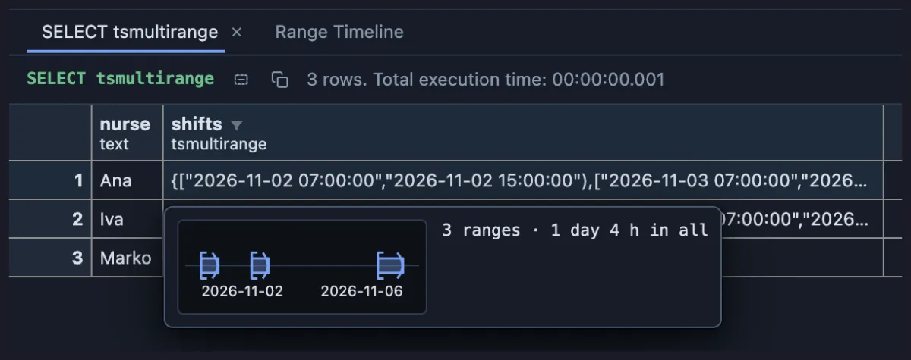

# Ranges

Read PostgreSQL's ranges at a glance: bookings, validity periods, shifts and price bands as bars on a line instead of brackets in text, one value at a time or a whole column on a timeline.



Twelve hotel stays in November, one bar per booking, in room order. Stays in the same room never overlap: some follow each other end to start (a guest leaves on the morning the next one arrives), others leave a few empty nights between them. The one-night stay is the short stub in the middle; the long bar is a guest who has room 105 for the whole month. Hover a bar to see whose stay it is.

## What it is for

- **Bookings and reservations**: rooms, cars, meeting rooms, equipment. Who has what when, where the gaps are, and whether two bookings overlap (which an exclusion constraint on the range column can forbid).
- **Validity periods**: prices, contracts, tax rates, versions of a record. Which one applies today, which ran out, which has no end yet.
- **Schedules and bands**: shifts, opening hours, age or salary bands, the integer ranges of a partition. The brackets say whether an end is included, and that half of the meaning is easy to misread in text.

## How to read it

A range is written `[2026-03-01,2026-03-08)`: a square bracket means that end is included, a round one means it is not, and a missing end means it runs forever. This extension draws that for you.

- **Hover** a cell: one line with the size of the range (`9 integers`, `width 2.5`, `7 days`, `1 day 2 h 30 min`, `unbounded above`) and a bar placing it between its ends, the brackets drawn as written (`[` included, `(` not), an arrow where a side runs to infinity, the ends written under it. On a date or time range a dashed line marks now when it falls on the bar. A multirange draws every member on one bar (`3 ranges · 12 days in all`).
- **Peek** a cell (Space): the same line and bar above the value as stored.
- **Open Value in Tab**: the facts: the type, each end and whether it is included (`lower 2024-03-01, inclusive`, `no upper bound`, `upper infinity`), the width of a number range or how many integers an integer range holds, the length of a date or time range in days, and in hours and weeks where that helps, and what is unbounded. A multirange lists its members, its gaps and its total size.
- **Edit a row** (F2): the field draws the bar of what you type, live; a half typed range draws nothing.
- **Show Ranges on a Timeline**, in the menu of a range or multirange column's header: a **Range Timeline** tab beside the grid draws every range of that column as a bar on one axis, one lane per row, with round ticks on top (months and years on the first of the month, dates as `YYYY-MM-DD`, times with their hour and minute; a `tstzrange` in your local time) and a dashed line at now on a date or time axis. A bar's tooltip names its row and its value, and a click on it selects the row in the grid. A range that runs forever fades into the edge.

## Try it

All three run on any connection, the data made up on the spot.

**Hotel bookings**, the picture above:

```sql
-- @extension ranges open
-- @inputs column=stay
select room, guest, stay
from (values
  ('101', 'Horvat', daterange('2026-11-02', '2026-11-06')), ('101', 'Kovač', daterange('2026-11-06', '2026-11-09')),
  ('101', 'Babić', daterange('2026-11-12', '2026-11-20')), ('102', 'Marić', daterange('2026-11-01', '2026-11-04')),
  ('102', 'Novak', daterange('2026-11-05', '2026-11-15')), ('103', 'Jurić', daterange('2026-11-03', '2026-11-10')),
  ('103', 'Knežević', daterange('2026-11-10', '2026-11-11')), ('103', 'Vuković', daterange('2026-11-14', '2026-11-22')),
  ('104', 'Perić', daterange('2026-11-08', '2026-11-18')), ('105', 'Pavlović', daterange('2026-11-01', '2026-11-30')),
  ('106', 'Božić', daterange('2026-11-16', '2026-11-23')), ('106', 'Lovrić', daterange('2026-11-24', '2026-12-02'))
) as bookings(room, guest, stay)
order by room, lower(stay);
```

`daterange('2026-11-02', '2026-11-06')` is `[2026-11-02,2026-11-06)`: the guest arrives on the 2nd and leaves on the 6th, four nights, and the next guest can arrive on the 6th without an overlap.

**A price list with validity periods**: each price applies from one moment until the next one starts, and the current prices have no end yet.

```sql
-- @extension ranges open
-- @inputs column=valid
select product, price, valid
from (values
  ('Basic plan', 9.00, tstzrange('2025-01-01', '2026-03-01')),
  ('Basic plan', 12.00, tstzrange('2026-03-01', null)),
  ('Pro plan', 29.00, tstzrange('2025-06-01', '2026-01-15')),
  ('Pro plan', 35.00, tstzrange('2026-01-15', null)),
  ('Launch offer', 0.00, tstzrange('2026-10-01', '2026-10-15'))
) as price_list(product, price, valid);
```



Each old price ends exactly where the new one starts, so there is no day without a price and no day with two. The current Basic and Pro prices fade into the right edge: they have no end yet. The dashed line marks now: on the day this picture was taken it fell on the short bar, the two-week launch offer.

Without the timeline, hover a cell in the grid: the open-ended price reads `unbounded above`, its bar running into an arrow.



**A nurse rota** (PostgreSQL 14 or newer): each nurse's shifts in the week as one multirange, a set of ranges in one value.

```sql
select nurse, shifts
from (values
  ('Ana', tsmultirange(tsrange('2026-11-02 07:00', '2026-11-02 15:00'), tsrange('2026-11-03 07:00', '2026-11-03 15:00'), tsrange('2026-11-05 19:00', '2026-11-06 07:00'))),
  ('Iva', tsmultirange(tsrange('2026-11-02 15:00', '2026-11-02 23:00'), tsrange('2026-11-04 07:00', '2026-11-04 19:00'))),
  ('Marko', tsmultirange(tsrange('2026-11-03 19:00', '2026-11-04 07:00')))
) as rota(nurse, shifts);
```



Ana's cell holds three shifts. The card adds them up (`3 ranges · 1 day 4 h in all`, two eight-hour day shifts and a twelve-hour night) and draws them on one line, so the long gap before her night shift shows at once.

## Settings

The timeline has one setting; everything else works with nothing to set.

| Setting | `@inputs` key | Default | What it does |
|---|---|---|---|
| Range column | `column` | the first one | The range or multirange column the Range Timeline draws (the column menu's entry sets it) |

## Where it applies

Every column whose declared type is `int4range`, `int8range`, `numrange`, `daterange`, `tsrange` or `tstzrange`, or one of their multiranges (`int4multirange` ... `tstzmultirange`, PostgreSQL 14 and newer), in every result, from the install on (a global scope you can change on its page). A text column holding `[1,5)` is text and stays that way. A range type of your own (`create type ... as range`) is not read. The Range Timeline tab shows only on a result that has a range or multirange column.

## Good to know

When the rows do not fit the pane, the timeline lets ranges that do not overlap share a lane, as a booking calendar draws them, and the line above says `packed into N lanes`. That line also counts the ranges, the empty ones, the NULLs and anything that could not be placed. The view reads the column page by page up to 20,000 ranges, saying how far it read (`first 20,000 of 25,000 rows`). It resizes with the pane and paints in the theme's colours.

Integer ranges count exactly, whatever their size. Dates and times are placed when the server prints them in ISO style (the default `DateStyle`); a value in another style is still listed in the facts but not drawn, and the timeline says how many it could not place. A BC date is not placed.

## Requirements

Nothing beyond PostgreSQL: the types are built in (multiranges since PostgreSQL 14). Nothing runs on the server: the values are read from what the grid already holds.
