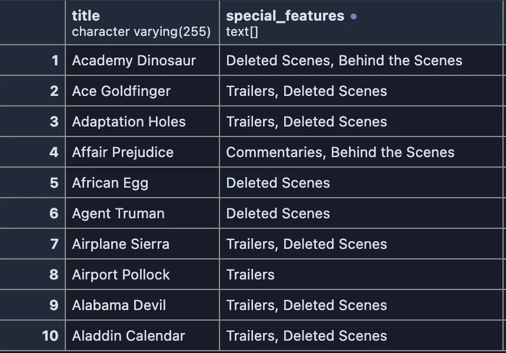
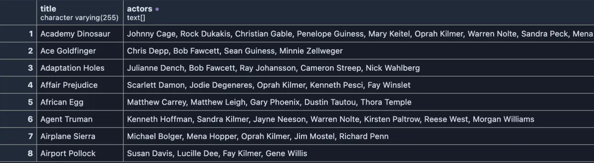

# Arrays

Array columns read as a plain list: `Trailers, Deleted Scenes` instead of `{Trailers,"Deleted Scenes"}`.



The `special_features` column of the dvdrental films is a `text[]`. PostgreSQL sends it as `{Trailers,"Deleted Scenes"}`, with braces, and quotes around every item that holds a space. With Arrays the braces and quotes are gone: each cell is the items, separated by commas. Hover a cell to see how many items it holds.

## What it is for

- **Tags, labels and features** stored in one column (`tags text[]`, `roles text[]`): read them at a glance instead of decoding the brackets.
- **Lists you build in a query** with `array_agg`: the actors of a film, the products of an order, the members of a team.
- **Reading a list column someone else designed**, before you decide whether to split it into its own table.

## Try it

**The cast of each film**, in the [dvdrental](https://neon.com/postgresql/postgresql-getting-started/postgresql-sample-database) sample database: `array_agg` gathers the actors of a film into one array, Arrays reads it as names.

```sql
-- @extension arrays
select f.title,
       array_agg(a.first_name || ' ' || a.last_name order by a.last_name) as actors
from film f
     join film_actor fa using (film_id)
     join actor a using (actor_id)
group by f.film_id
order by f.title
limit 8;
```



The picture at the top is this query:

```sql
-- @extension arrays
select title, special_features
from film
order by title
limit 10;
```

## Settings

None. Every column whose type ends in `[]` is read this way: `text[]`, `integer[]`, `uuid[]` and the rest.

## Good to know

- Copying cells from the grid copies them as they read; **Save As** writes the server's own text to the file, braces and quotes included.
- An empty array reads `[]`, greyed out; a NULL item inside an array reads `∅`; a NULL array stays NULL.
- A list of numbers can also be drawn as a small line: **Sparklines** does that for number arrays. A column wears one formatter at a time, so attach one of the two to a query whose arrays hold numbers.
- PlumeSQL sizes a column by the server's text, so a formatted list can leave a column wider than it needs. Double-click the right edge of the column's header to fit it to what the cells show.
- To use it, put `-- @extension arrays` above a query (in the file header it covers every query in the file), or pick it from a result's own menu.

## Requirements

PostgreSQL 13 or newer. Runs in the grid alone; nothing is sent to the server.
